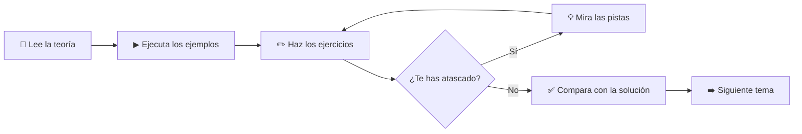

# teoria-java

Aprende a programar desde cero con Java. Este repositorio empieza por la **lógica de la programación** (qué es un algoritmo, cómo se piensa un problema) y avanza tema a tema hasta los conceptos que se usan en el día a día: programación orientada a objetos, colecciones, excepciones, lambdas, streams y ficheros.

Cada tema tiene tres partes:

1. **Teoría** explicada en Markdown, con analogías y fragmentos de código.
2. **Ejemplos** en archivos `.java` que puedes ejecutar, comentados línea a línea.
3. **Cinco ejercicios** de dificultad creciente, con plantilla para completar y su solución explicada.

👉 Empieza por el [**ÍNDICE**](INDICE.md) para ver todos los temas y navegar entre ellos.

---

## ¿Para quién es?

- Personas que **nunca han programado** y quieren empezar con buen pie.
- Estudiantes de ciclos formativos, bachillerato o primeros cursos de universidad.
- Quien ya programa en otro lenguaje y quiere un repaso ordenado de Java.

No hace falta saber nada previo. Cada tema solo usa lo que se ha visto en los anteriores.

---

## Requisitos

### 1. Instalar Java (JDK)

Necesitas el **JDK** (Java Development Kit), versión **21 o superior**. Se recomienda la última versión LTS (soporte a largo plazo), la **25**.

- Descarga: [Eclipse Temurin (Adoptium)](https://adoptium.net/) u [Oracle JDK](https://www.oracle.com/java/technologies/downloads/).
- Comprueba la instalación abriendo una terminal y escribiendo:

```bash
java -version
```

Si aparece la versión, todo está listo.

### 2. Un editor de código

Cualquiera de estos sirve:

- [Visual Studio Code](https://code.visualstudio.com/) con la extensión *Extension Pack for Java*.
- [IntelliJ IDEA Community](https://www.jetbrains.com/idea/download/) (gratuito).

---

## Cómo ejecutar los archivos

Todos los archivos `.java` del repositorio son **independientes**: cada uno tiene su propio método `main`. Desde Java 11 se pueden ejecutar directamente, sin compilar antes:

```bash
# Desde la carpeta donde está el archivo
java T01_01_Secuencia.java
```

También puedes pulsar el botón **Run** ▶ que aparece encima del `main` en VS Code o IntelliJ.

> 💡 **Windows y las tildes:** si en la consola ves símbolos raros en lugar de tildes o eñes, ejecuta `chcp 65001` antes de lanzar el programa para que la terminal use UTF-8.

---

## Cómo usar el repositorio



1. Lee el `README.md` del tema en `teoria/`.
2. Ejecuta los ejemplos de la carpeta `ejemplos/` y **cambia cosas** para ver qué pasa. Romper el código es la mejor forma de aprender.
3. Haz los ejercicios en orden. Cada uno tiene un `ENUNCIADO.md` y un archivo `.java` con huecos marcados con `// TODO`.
4. Si te atascas, abre las pistas (están escondidas para que no las veas sin querer).
5. Cuando termines, compara con la solución en la carpeta `soluciones/`. No pasa nada si tu código es distinto: casi siempre hay varias formas correctas.

---

## Estructura

```
teoria-java/
├── README.md                 ← Estás aquí
├── INDICE.md                 ← Índice con enlaces a todo
├── teoria/
│   └── NN-nombre-tema/
│       ├── README.md         ← Teoría del tema
│       └── ejemplos/         ← Código de ejemplo comentado
└── ejercicios/
    └── NN-nombre-tema/
        ├── README.md         ← Lista de ejercicios del tema
        ├── ejercicio-01-.../
        │   ├── ENUNCIADO.md  ← Qué hay que hacer + pistas
        │   └── EjNN_01_....java  ← Plantilla para completar
        └── soluciones/
            └── ejercicio-01-.../
                ├── SOLUCION.md       ← Explicación detallada
                └── SolNN_01_....java ← Código resuelto
```

---

## Convenciones

| Elemento | Formato | Ejemplo |
|---|---|---|
| Ejemplo de teoría | `TNN_XX_Nombre.java` | `T03_02_TiposPrimitivos.java` |
| Plantilla de ejercicio | `EjNN_XX_Nombre.java` | `Ej07_04_NumerosPrimos.java` |
| Solución | `SolNN_XX_Nombre.java` | `Sol07_04_NumerosPrimos.java` |

- `NN` es el número del tema y `XX` el número del ejemplo o ejercicio.
- Los nombres son únicos en todo el repositorio para que el editor no se confunda con clases repetidas.
- Variables y comentarios en **español**. Los **nombres** de variables, métodos y clases van sin tildes ni eñes (`anio` en lugar de `año`); los comentarios y los textos que se muestran, con su ortografía normal.
- Dificultad de los ejercicios: ⭐ (un solo concepto) hasta ⭐⭐⭐⭐⭐ (todo el tema junto con los anteriores).

### Reglas de estilo del repositorio

- **No se usa `continue`** y **`break` solo se usa dentro de un `switch`**. Para salir de un bucle se usa su propia condición, normalmente con una variable de control (por ejemplo, `boolean encontrado`). Así el flujo del programa se lee siempre de arriba abajo y es más fácil de seguir.
- Por el mismo motivo, **no se usa `return` dentro de un bucle** para salir de él antes de tiempo (tema 10): bandera en la condición y un único `return` al final.
- Siempre se usan **llaves** en `if`, `else`, `for` y `while`, aunque el bloque tenga una sola línea.
- A partir del tema 11, las clases auxiliares de cada ejemplo o ejercicio se escriben **dentro** de la clase principal como `static class`. Así cada programa sigue siendo un único archivo que se ejecuta con `java Archivo.java` (en un proyecto real, cada clase iría en su propio archivo). Lo explica la [sección 11 del tema 11](teoria/11-clases-y-objetos/README.md#11-las-clases-en-este-repositorio).

---

## Licencia

Este proyecto se distribuye bajo la licencia incluida en el archivo [LICENSE](LICENSE).
