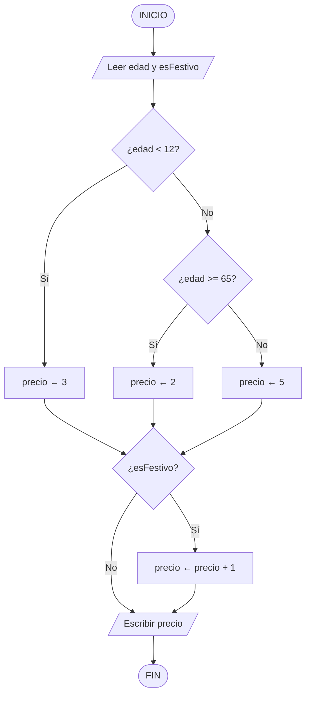

# Ejercicio 03 · Del diagrama al código

[⬅️ Ejercicios del tema](../README.md)

**Dificultad:** ⭐⭐⭐
**Conceptos:** diagramas de flujo, decisión (`if` / `else if` / `else`), secuencia

## Enunciado

La piscina municipal calcula el precio de la entrada con este diagrama de flujo:



1. Escribe el **pseudocódigo** equivalente al diagrama.
2. Completa [`Ej01_03_DelDiagramaAlCodigo.java`](Ej01_03_DelDiagramaAlCodigo.java) para que calcule y muestre el precio.
3. Prueba **todos los casos** de la tabla cambiando los valores de `edad` y `esFestivo` en el código.

## Casos de prueba

| `edad` | `esFestivo` | Precio esperado |
|---|---|---|
| 8 | `false` | 3 |
| 8 | `true` | 4 |
| 30 | `false` | 5 |
| 30 | `true` | 6 |
| 70 | `false` | 2 |
| 12 | `false` | 5 |
| 65 | `true` | 3 |

## Salida esperada (con edad = 30 y esFestivo = true)

```
Edad: 30 | Festivo: true
Precio de la entrada: 6 euros
```

## Pistas

<details>
<summary>Pista 1</summary>

El diagrama tiene **dos decisiones independientes**, una detrás de otra:

1. Primero se elige el precio base según la edad (tres caminos).
2. Después, *sea cual sea el precio*, se comprueba si es festivo.

Por eso, en el código son **dos `if` separados**, no uno dentro del otro.

</details>

<details>
<summary>Pista 2</summary>

Los tres caminos de la edad se escriben con `if` / `else if` / `else`:

```java
if (edad < 12) {
    precio = 3;
} else if (...) {
    ...
} else {
    ...
}
```

</details>

<details>
<summary>Pista 3</summary>

`esFestivo` es de tipo `boolean`: ya vale `true` o `false`, así que se puede poner directamente como condición: `if (esFestivo) { ... }`.

</details>

## Cómo ejecutarlo

```bash
java Ej01_03_DelDiagramaAlCodigo.java
```

---

✅ ¿Terminado? Compara con la [solución](../soluciones/ejercicio-03-del-diagrama-al-codigo/SOLUCION.md).
