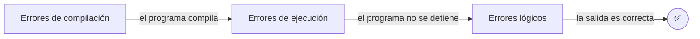

# Solución · Ejercicio 03 · Caza de errores

[⬅️ Enunciado](../../ejercicio-03-caza-de-errores/ENUNCIADO.md) · [Ejercicios del tema](../../README.md)

## Cómo pensarlo

Los errores se arreglan **por fases**, porque cada tipo aparece en un momento distinto:

No puedes ver un error de ejecución mientras haya errores de compilación, porque el programa ni siquiera arranca.

## Los 7 errores

| # | Línea original | Tipo | Mensaje (aprox.) | Corrección |
|---|---|---|---|---|
| 1 | `println("=== Ficha del videojuego ===")` | Compilación | `';' expected` | Añadir `;` |
| 2 | `system.out.println(...)` | Compilación | `package system does not exist` | `System` con mayúscula |
| 3 | `System.out.printn(...)` | Compilación | `cannot find symbol` | `println` |
| 4 | `println("=== Fin de la ficha ===);` | Compilación | `unclosed string literal` | Cerrar comillas: `"...===");` |
| 5 | Falta la `}` final de la clase | Compilación | `reached end of file while parsing` | Añadir `}` |
| 6 | `puntosTotales / jugadores` con `jugadores = 0` | Ejecución | `ArithmeticException: / by zero` | `jugadores = 4` |
| 7 | `"...: " + 3 + 1` muestra `31` | Lógico | Ninguno | `"...: " + (3 + 1)` |

## Explicación de los más difíciles

**Error 2.** El mensaje no dice "mayúscula": dice algo como `package system does not exist`. Java ve `system.out` y cree que `system` es un paquete (lo verás más adelante). Siempre que aparezca algo raro sobre un nombre, revisa mayúsculas y minúsculas.

**Error 5.** El compilador llega al final del archivo esperando todavía una `}`. Contar llaves es más fácil si el código está bien **indentado**: cada `}` debe estar alineada con la línea que abrió su `{`.

**Error 6.** El programa compila, empieza a mostrar la ficha y se detiene en seco en la división. Lo que había antes sí se muestra; lo que había después, no. El comentario decía `NO TOCAR`, pero los datos estaban mal: en la vida real también pasa. Hay que corregir el **dato** (4 jugadores), no la operación.

**Error 7.** Java evalúa de izquierda a derecha: `"...: " + 3` da el texto `"...: 3"`, y después `+ 1` le pega un `1`. Resultado: `31`. Con paréntesis, `(3 + 1)` se calcula primero como número. Este error no lo avisa nadie: solo lo detectas **comparando con lo esperado**.

## Código completo

📄 [Sol02_03_CazaDeErrores.java](Sol02_03_CazaDeErrores.java)
