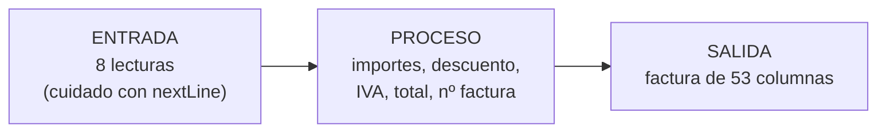

# Solución · Ejercicio 05 · Factura interactiva

[⬅️ Enunciado](../../ejercicio-05-factura-interactiva/ENUNCIADO.md) · [Ejercicios del tema](../../README.md)

## Cómo pensarlo

Divide el programa en tres partes y resuelve cada una por separado:



## Entrada: ¿dónde hay que limpiar?

| Lectura | Método | Viene después de | ¿Limpiar antes? |
|---|---|---|---|
| Cliente | `nextLine` | Nada | No |
| Producto 1 | `nextLine` | `nextLine` | No |
| Unidades 1 | `nextInt` | — | No |
| Precio 1 | `nextDouble` | — | No |
| **Producto 2** | `nextLine` | **`nextDouble`** | **Sí** |
| Unidades 2 | `nextInt` | — | No |
| Precio 2 | `nextDouble` | — | No |
| Descuento | `nextInt` | — | No |

Solo hay un punto problemático:

```java
double precio1 = teclado.nextDouble();
teclado.nextLine();                         // Limpia el ⏎ antes de leer un texto

System.out.print("Producto 2: ");
String producto2 = teclado.nextLine();
```

## Proceso

```java
int numeroFactura = random.nextInt(1, 10000);              // 1 a 9999
String codigoFactura = String.format("F-%04d", numeroFactura);

double importe1 = unidades1 * precio1;                     // 79.80
double importe2 = unidades2 * precio2;                     // 37.50
double subtotal = importe1 + importe2;                     // 117.30
double descuento = subtotal * porcentajeDescuento / 100;   // 11.73
double base = subtotal - descuento;                        // 105.57
double iva = base * PORCENTAJE_IVA / 100;                  // 22.1697
double total = base + iva;                                 // 127.7397

int unidadesTotales = 0;
unidadesTotales += unidades1;
unidadesTotales += unidades2;
```

En `subtotal * porcentajeDescuento / 100` no hay división entera: `subtotal` es `double`, así que `subtotal * porcentajeDescuento` ya es `double`. Si escribieras `porcentajeDescuento / 100 * subtotal`, se calcularía primero `10 / 100` = **0** (entero) y el descuento sería 0.

## Salida

**La cabecera con dos textos en los extremos:**

```java
String textoCliente = String.format("Cliente: %s", cliente);
System.out.printf("%-20s%33s%n", "FACTURA " + codigoFactura, textoCliente);
```

20 + 33 = 53. El código queda a la izquierda y el cliente pegado a la derecha.

**Filas y resumen**, con los anchos de las pistas:

```java
System.out.printf("%-26s %5d %9.2f %10.2f%n", producto1, unidades1, precio1, importe1);
System.out.printf("%-26s %26.2f%n", "Subtotal", subtotal);
System.out.printf("%-26s %26.2f%n", String.format("Descuento (%d%%)", porcentajeDescuento), -descuento);
```

El número del resumen ocupa las columnas que hay a la derecha del nombre del producto: 5 + 1 + 9 + 1 + 10 = 26.

## Errores comunes

- No limpiar tras el precio 1 → el producto 2 se queda vacío y el programa intenta leer `Funda de móvil` como unidades: `InputMismatchException`.
- `porcentajeDescuento / 100 * subtotal` → descuento 0 por división entera.
- `random.nextInt(9999)` → puede dar 0 y nunca 9999.
- Usar `%d` para el precio → `IllegalFormatConversionException`.

## Código completo

📄 [Sol05_05_FacturaInteractiva.java](Sol05_05_FacturaInteractiva.java)
