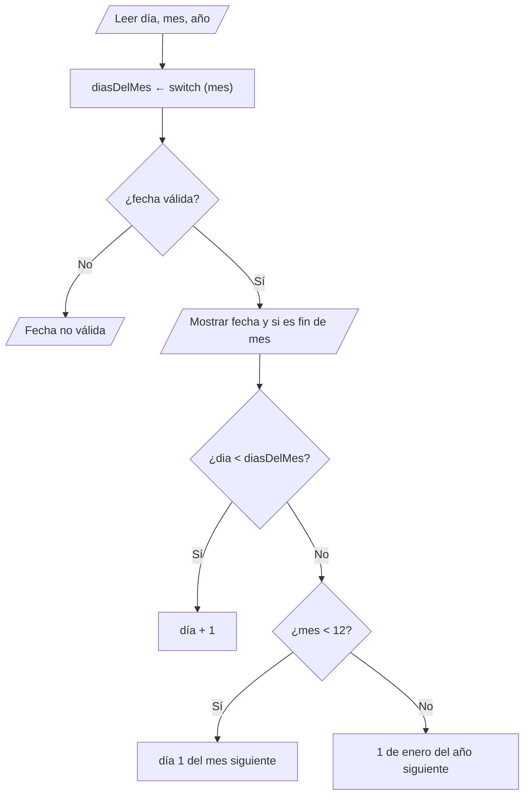

# Solución · Ejercicio 04 · Validador de fechas

[⬅️ Enunciado](../../ejercicio-04-validador-de-fechas/ENUNCIADO.md) · [Ejercicios del tema](../../README.md)

## Cómo pensarlo



## Código explicado

**Días del mes con `switch` y `yield`:**

```java
int diasDelMes = switch (mes) {
    case 4, 6, 9, 11 -> 30;
    case 2 -> {
        boolean bisiesto = (anio % 4 == 0 && anio % 100 != 0) || anio % 400 == 0;
        yield bisiesto ? 29 : 28;
    }
    case 1, 3, 5, 7, 8, 10, 12 -> 31;
    default -> 0;
};
```

El caso de febrero necesita **dos pasos** (calcular si es bisiesto y elegir 28 o 29), por eso va en un bloque `{ }` con `yield`.

**Validez:**

```java
boolean esValida = anio > 0 && mes >= 1 && mes <= 12 && dia >= 1 && dia <= diasDelMes;
```

Con un mes inexistente `diasDelMes` es 0, así que `dia <= 0` ya sería falso; aun así, comprobar el mes de forma explícita hace la condición más clara para quien la lee.

**Día siguiente:** se parte de la misma fecha y se cambia solo lo necesario.

```java
int diaSiguiente = dia + 1;
int mesSiguiente = mes;
int anioSiguiente = anio;

if (esFinDeMes) {
    diaSiguiente = 1;
    if (mes < 12) {
        mesSiguiente = mes + 1;
    } else {
        mesSiguiente = 1;
        anioSiguiente = anio + 1;
    }
}
```

Aquí el anidamiento tiene sentido: la pregunta "¿es diciembre?" solo importa **si** es fin de mes.

## Casos límite que conviene probar

| Caso | Por qué |
|---|---|
| 29/02 en año bisiesto y no bisiesto | Comprueba el `yield` |
| 29/02/1900 y 29/02/2000 | La regla de los siglos |
| 30/04 y 31/04 | Meses de 30 días |
| 31/12 | Cambio de año |
| Día 0, mes 0, mes 13 | Valores fuera de rango |

## Errores comunes

- `dia < diasDelMes` en la validación → el último día de cada mes saldría como no válido.
- Calcular el día siguiente **antes** de validar → con una fecha inválida se mostrarían resultados absurdos.
- Olvidar el `default` en el `switch` como expresión → error de compilación: `the switch expression does not cover all possible input values`.

## Código completo

📄 [Sol06_04_ValidadorDeFechas.java](Sol06_04_ValidadorDeFechas.java)
