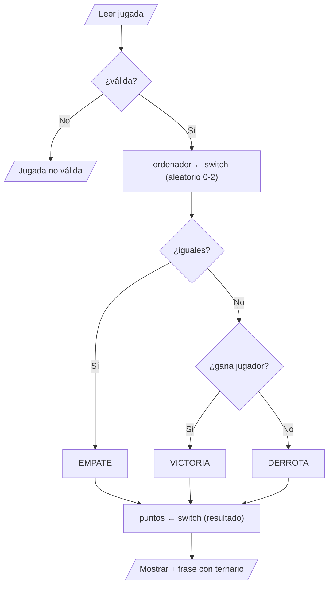

# Solución · Ejercicio 05 · Piedra, papel o tijera

[⬅️ Enunciado](../../ejercicio-05-piedra-papel-tijera/ENUNCIADO.md) · [Ejercicios del tema](../../README.md)

## Cómo pensarlo



## Código explicado

**Normalizar la entrada** al leerla evita tener que pensar en mayúsculas el resto del programa:

```java
String jugador = teclado.nextLine().trim().toLowerCase();
boolean jugadaValida = jugador.equals("piedra") || jugador.equals("papel") || jugador.equals("tijera");
```

**Jugada del ordenador** con `switch` como expresión:

```java
String ordenador = switch (random.nextInt(3)) {
    case 0 -> "piedra";
    case 1 -> "papel";
    default -> "tijera";
};
```

Usamos `default` para el 2 porque el `switch` como expresión debe cubrir **todos** los `int`. Sabemos que `nextInt(3)` solo da 0, 1 o 2, pero el compilador no.

**El resultado:**

```java
boolean ganaJugador = (jugador.equals("piedra") && ordenador.equals("tijera"))
        || (jugador.equals("tijera") && ordenador.equals("papel"))
        || (jugador.equals("papel") && ordenador.equals("piedra"));

String resultado;
if (jugador.equals(ordenador)) {
    resultado = "EMPATE";
} else if (ganaJugador) {
    resultado = "VICTORIA";
} else {
    resultado = "DERROTA";
}
```

En lugar de escribir las 9 combinaciones posibles, solo describimos las 3 en las que gana el jugador. Las otras se deducen: si no es empate y no gana el jugador, pierde.

**Puntos** con `switch` sobre un `String`, y la frase con ternario:

```java
int puntos = switch (resultado) {
    case "VICTORIA" -> 3;
    case "EMPATE" -> 1;
    default -> 0;
};
System.out.printf("Resultado: %s (+%d puntos)%n", resultado, puntos);
System.out.println(puntos > 0 ? "¡Bien jugado!" : "Otra vez será...");
```

## ¿Y si queremos jugar varias rondas?

Haría falta repetir todo el programa mientras el usuario quiera seguir... es justo lo que aprenderás en el [tema 07 · Bucles](../../../../teoria/07-bucles/README.md).

## Errores comunes

- Comparar con `==`: `jugador == "piedra"` puede dar `false` aunque el usuario haya escrito `piedra`.
- No normalizar la entrada: `Piedra` se consideraría no válida.
- Usar `if` sueltos en lugar de `else if` para el resultado: un empate podría acabar también como derrota.

## Código completo

📄 [Sol06_05_PiedraPapelTijera.java](Sol06_05_PiedraPapelTijera.java)
