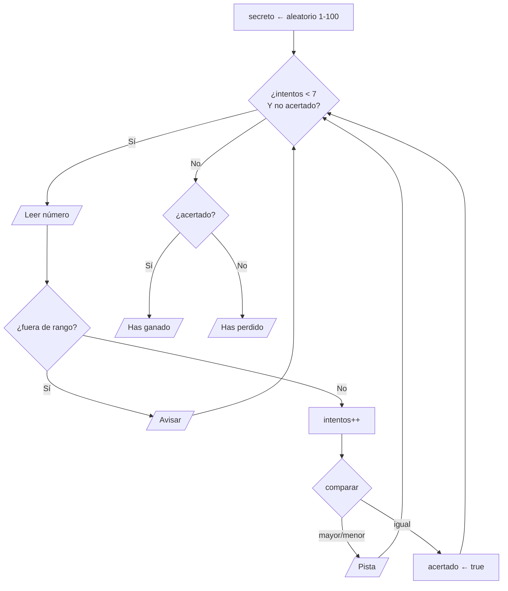

# Solución · Ejercicio 03 · Adivina el número

[⬅️ Enunciado](../../ejercicio-03-adivina-el-numero/ENUNCIADO.md) · [Ejercicios del tema](../../README.md)

## Cómo pensarlo



¿Por qué `while` y no `for`? Porque **no sabemos** cuántas vueltas habrá: puede acertar a la primera, gastar los 7 intentos o escribir varios números fuera de rango (que no cuentan).

## Código explicado

```java
int secreto = random.nextInt(MINIMO, MAXIMO + 1);

while (intentos < MAX_INTENTOS && !acertado) {
    System.out.print("Intento " + (intentos + 1) + " de " + MAX_INTENTOS + ": ");
    int numero = teclado.nextInt();

    if (numero < MINIMO || numero > MAXIMO) {
        System.out.println("  Fuera de rango (1-100). Este intento no cuenta.");
    } else {
        intentos++;
        if (numero < secreto) {
            System.out.println("  El número es MAYOR");
        } else if (numero > secreto) {
            System.out.println("  El número es MENOR");
        } else {
            System.out.println("  ¡Correcto!");
            acertado = true;
        }
    }
}
```

Al poner `acertado = true`, la vuelta **termina con normalidad** y, al volver a comprobar la condición, `!acertado` es `false` y el bucle acaba. Es lo que haría un `break`, pero sin saltos: la condición del `while` cuenta toda la historia.

**Mensaje final:** como el bucle tiene dos salidas, miramos la bandera para saber cuál ha sido:

```java
if (acertado) {
    System.out.println("¡Has ganado en " + intentos + " intentos!");
} else {
    System.out.println("Has perdido. El número era " + secreto);
}
```

## ¿Sabías que...?

Con 7 intentos siempre se puede ganar si usas la estrategia de **búsqueda binaria**: probar siempre el número del medio del rango que queda (50, luego 25 o 75...). Cada intento reduce el rango a la mitad, y 2⁷ = 128 > 100.

## Errores comunes

- Usar `||` en la condición → el juego no termina al acertar.
- Contar los intentos fuera de rango.
- Preguntar `if (intentos == MAX_INTENTOS)` al final para saber si ha perdido: falla si acierta justo en el último intento.
- `random.nextInt(100)` → da de 0 a 99.

## Código completo

📄 [Sol07_03_AdivinaElNumero.java](Sol07_03_AdivinaElNumero.java)
