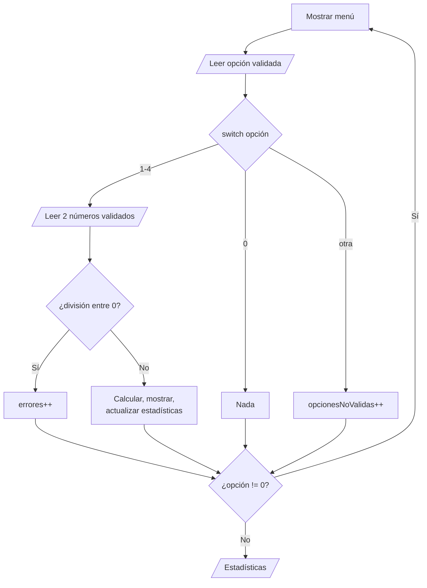

# Solución · Ejercicio 05 · Calculadora con menú

[⬅️ Enunciado](../../ejercicio-05-calculadora-con-menu/ENUNCIADO.md) · [Ejercicios del tema](../../README.md)

## Cómo pensarlo



Hay **cuatro** bucles en el programa:

| Bucle | Tipo | Termina cuando... |
|---|---|---|
| Menú | `do-while` | La opción es 0 |
| Validar opción | `while` | Lo siguiente es un `int` |
| Validar primer número | `while` | Lo siguiente es un `double` |
| Validar segundo número | `while` | Lo siguiente es un `double` |

Ninguno usa `break`: todos terminan por su condición.

## Código explicado

**Leer la opción validada:**

```java
System.out.print("Opción: ");
while (!teclado.hasNextInt()) {
    System.out.print("  '" + teclado.next() + "' no es una opción. Otra vez: ");
}
opcion = teclado.nextInt();
```

`teclado.next()` dentro del `while` **consume** lo que se ha escrito mal. Si no lo hiciéramos, `hasNextInt()` seguiría viendo lo mismo una y otra vez: bucle infinito.

**El cálculo** con un `switch` como expresión, dentro del caso 1–4:

```java
boolean divisionPorCero = opcion == 4 && b == 0;
if (divisionPorCero) {
    System.out.println("Error: no se puede dividir entre 0");
    errores++;
} else {
    double resultado = switch (opcion) {
        case 1 -> a + b;
        case 2 -> a - b;
        case 3 -> a * b;
        default -> a / b;         // Solo puede ser 4
    };
    ...
}
```

**El máximo sin conocer el primer valor:**

```java
if (operaciones == 0 || resultado > maximo) {
    maximo = resultado;
}
operaciones++;
```

Gracias al cortocircuito de `||`, con la primera operación se guarda el resultado sin comparar. Así funciona aunque todos los resultados sean negativos.

**La media**, solo si hay operaciones (si no, dividiríamos entre 0 y saldría `NaN`):

```java
if (operaciones > 0) {
    System.out.printf("Resultado más alto: %.2f%n", maximo);
    System.out.printf("Media de resultados: %.2f%n", sumaResultados / operaciones);
} else {
    System.out.println("No se ha realizado ninguna operación");
}
```

## Errores comunes

- Declarar `opcion` dentro del `do { }` → no existe en el `while (opcion != 0)`.
- No consumir la entrada incorrecta → bucle infinito con `abc`.
- Poner `break` en el `case 0` creyendo que sale del bucle: en un `switch` moderno no hace falta, y en uno clásico solo saldría del `switch`.
- Inicializar `maximo = 0` y comparar siempre → con resultados negativos, el máximo sería 0.

## Código completo

📄 [Sol07_05_CalculadoraConMenu.java](Sol07_05_CalculadoraConMenu.java)
