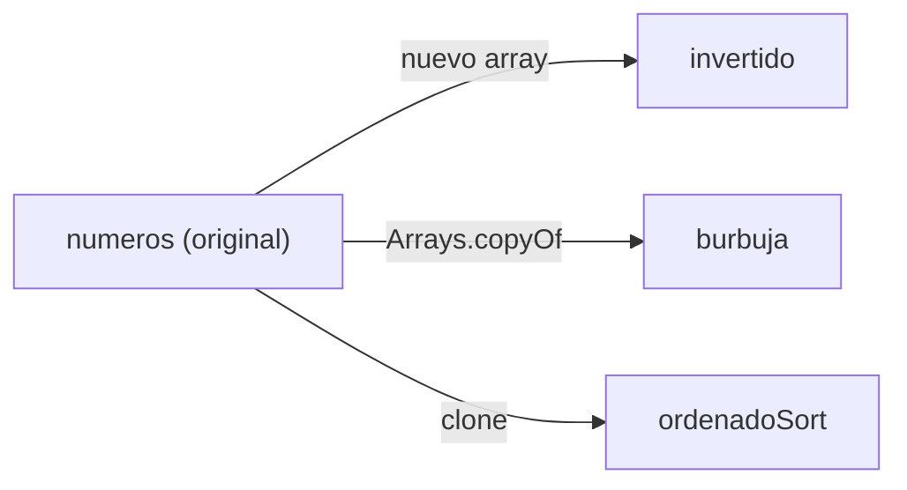

# Solución · Ejercicio 03 · Buscar y ordenar

[⬅️ Enunciado](../../ejercicio-03-buscar-y-ordenar/ENUNCIADO.md) · [Ejercicios del tema](../../README.md)

## Cómo pensarlo

Todas las operaciones salvo la búsqueda **modifican** un array. Para no perder el original, cada una trabaja sobre su **propia copia**:



## Código explicado

**Buscar todas las apariciones** (aquí no queremos parar en la primera, así que basta un `for` completo):

```java
int veces = 0;
for (int i = 0; i < numeros.length; i++) {
    if (numeros[i] == buscado) {
        if (veces == 0) {
            System.out.print("Aparece en las posiciones:");
        }
        System.out.print(" " + i);
        veces++;
    }
}
```

**Copia invertida:**

```java
int[] invertido = new int[numeros.length];
for (int i = 0; i < numeros.length; i++) {
    invertido[i] = numeros[numeros.length - 1 - i];
}
```

A diferencia de la inversión "en el sitio" de la teoría, aquí escribimos en un array **nuevo**, así que se recorre entero.

**Burbuja contando intercambios:**

```java
int[] burbuja = Arrays.copyOf(numeros, numeros.length);
int intercambios = 0;
boolean hayCambios = true;
int pasada = 0;
while (hayCambios) {
    hayCambios = false;
    for (int i = 0; i < burbuja.length - 1 - pasada; i++) {
        if (burbuja[i] > burbuja[i + 1]) {
            int auxiliar = burbuja[i];
            burbuja[i] = burbuja[i + 1];
            burbuja[i + 1] = auxiliar;
            intercambios++;
            hayCambios = true;
        }
    }
    pasada++;
}
```

¿Por qué 24 intercambios? Cada intercambio de la burbuja corrige exactamente una pareja de números que estaba "al revés" (un número mayor delante de otro menor). En este array hay 24 de esas parejas.

**Comparar con `Arrays.sort`:**

```java
int[] ordenadoSort = numeros.clone();
Arrays.sort(ordenadoSort);
boolean coinciden = Arrays.equals(burbuja, ordenadoSort);
```

Con `burbuja == ordenadoSort` saldría `false`: son dos arrays distintos aunque tengan el mismo contenido.

## Errores comunes

- `int[] burbuja = numeros;` → se ordena el original.
- Parar la búsqueda en la primera aparición → solo se muestra la posición 1.
- Comparar los arrays con `==`.

## Código completo

📄 [Sol08_03_BuscarYOrdenar.java](Sol08_03_BuscarYOrdenar.java)
