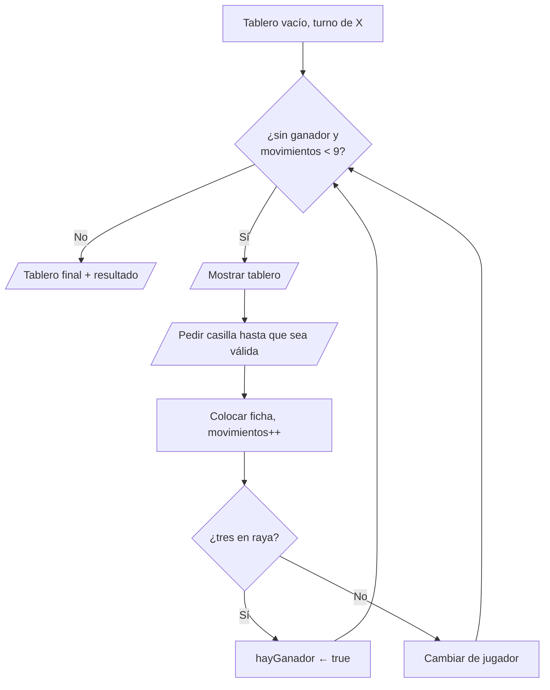

# Solución · Ejercicio 05 · Tres en raya

[⬅️ Enunciado](../../ejercicio-05-tres-en-raya/ENUNCIADO.md) · [Ejercicios del tema](../../README.md)

## Cómo pensarlo



El programa tiene **tres niveles** de bucle:

| Bucle | Termina cuando... |
|---|---|
| Partida (`while`) | Hay ganador o se han hecho 9 movimientos |
| Pedir casilla (`while` con bandera) | La casilla está dentro y libre |
| Recorrer el tablero (`for` anidados) | Se han visto todas las casillas |

## Código explicado

**Pedir una casilla válida** (bandera `casillaValida`):

```java
boolean casillaValida = false;
int fila = 0;
int columna = 0;
while (!casillaValida) {
    System.out.print("Fila: ");
    fila = teclado.nextInt() - 1;          // El usuario ve 1-3, la matriz usa 0-2
    System.out.print("Columna: ");
    columna = teclado.nextInt() - 1;

    if (fila < 0 || fila >= TAMANIO || columna < 0 || columna >= TAMANIO) {
        System.out.println("  Esa casilla no existe. Usa números del 1 al 3.");
    } else if (tablero[fila][columna] != VACIA) {
        System.out.println("  Esa casilla ya está ocupada.");
    } else {
        casillaValida = true;
    }
}
```

El orden de las comprobaciones importa: si la casilla está fuera, **no** se puede mirar `tablero[fila][columna]` (daría `ArrayIndexOutOfBoundsException`). Por eso el rango va primero, y el `else if` solo se evalúa cuando el rango es correcto.

**Comprobar si ha ganado** (filas y columnas en el mismo bucle):

```java
for (int i = 0; i < TAMANIO; i++) {
    boolean filaCompleta = tablero[i][0] == jugador && tablero[i][1] == jugador && tablero[i][2] == jugador;
    boolean columnaCompleta = tablero[0][i] == jugador && tablero[1][i] == jugador && tablero[2][i] == jugador;
    if (filaCompleta || columnaCompleta) {
        hayGanador = true;
    }
}
boolean diagonal = tablero[0][0] == jugador && tablero[1][1] == jugador && tablero[2][2] == jugador;
boolean diagonalInversa = tablero[0][2] == jugador && tablero[1][1] == jugador && tablero[2][0] == jugador;
if (diagonal || diagonalInversa) {
    hayGanador = true;
}
```

Solo hace falta comprobar al jugador que **acaba de mover**: el otro no ha cambiado nada en este turno.

**El resultado final:** como solo cambiamos de turno si no hay ganador, al salir del bucle `jugador` es quien ha ganado:

```java
if (hayGanador) {
    System.out.println("¡Gana " + jugador + "!");
} else {
    System.out.println("Empate");
}
```

## Para mejorar

- Mostrar el tablero está escrito **dos veces** (dentro del bucle y al final). En el [tema 10](../../../../teoria/10-metodos/README.md) aprenderás a escribirlo una vez en un **método** y llamarlo cuando quieras.
- Si el usuario escribe letras, `nextInt()` falla. Puedes añadir la validación con `hasNextInt()` del tema 07.

## Errores comunes

- No restar 1 a la fila y la columna → la casilla `3,3` se sale del tablero.
- Comprobar `tablero[fila][columna] != VACIA` antes que el rango → `ArrayIndexOutOfBoundsException`.
- Cambiar de jugador antes de comprobar si ha ganado → se anuncia al ganador equivocado.

## Código completo

📄 [Sol08_05_TresEnRaya.java](Sol08_05_TresEnRaya.java)
