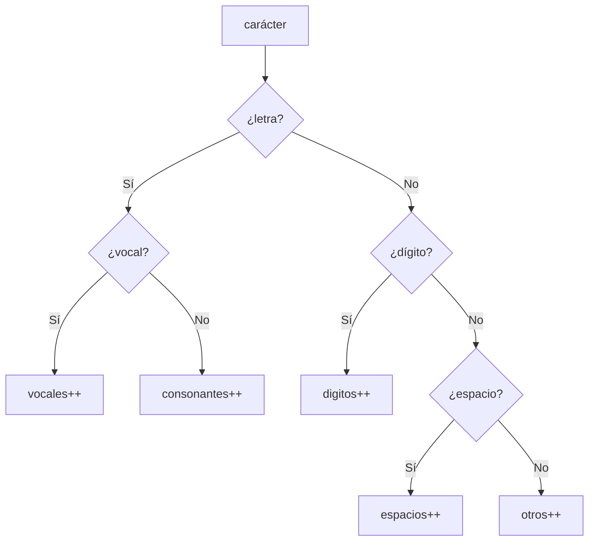

# Solución · Ejercicio 02 · Contador de caracteres

[⬅️ Enunciado](../../ejercicio-02-contador-de-caracteres/ENUNCIADO.md) · [Ejercicios del tema](../../README.md)

## Cómo pensarlo

Cada carácter cae en **exactamente una** categoría, así que encaja una cadena `if` / `else if`:



## Código explicado

```java
for (char c : frase.toCharArray()) {
    boolean esVocal = VOCALES.indexOf(Character.toLowerCase(c)) != -1;

    if (Character.isLetter(c)) {
        if (esVocal) {
            vocales++;
        } else {
            consonantes++;
        }
    } else if (Character.isDigit(c)) {
        digitos++;
    } else if (Character.isWhitespace(c)) {
        espacios++;
    } else {
        otros++;
    }

    if (!esVocal) {
        sinVocales.append(c);
    }
}
```

- `Character.isLetter` reconoce también `ñ`, `á`, `ü`... (con un rango `c >= 'a' && c <= 'z'` se quedarían fuera).
- La lista `VOCALES` incluye las vocales con tilde y la `ü` (como en "pingüino").
- `sinVocales` es un `StringBuilder` porque se construye **carácter a carácter** en un bucle.

## Errores comunes

- Contar las vocales con tilde como consonantes (si la lista no las incluye).
- Olvidar pasar a minúscula antes de buscar → `A` y `E` mayúsculas serían consonantes.
- Usar `if` sueltos en lugar de `else if` → un dígito podría contar también como "otro".

## Código completo

📄 [Sol09_02_ContadorDeCaracteres.java](Sol09_02_ContadorDeCaracteres.java)
