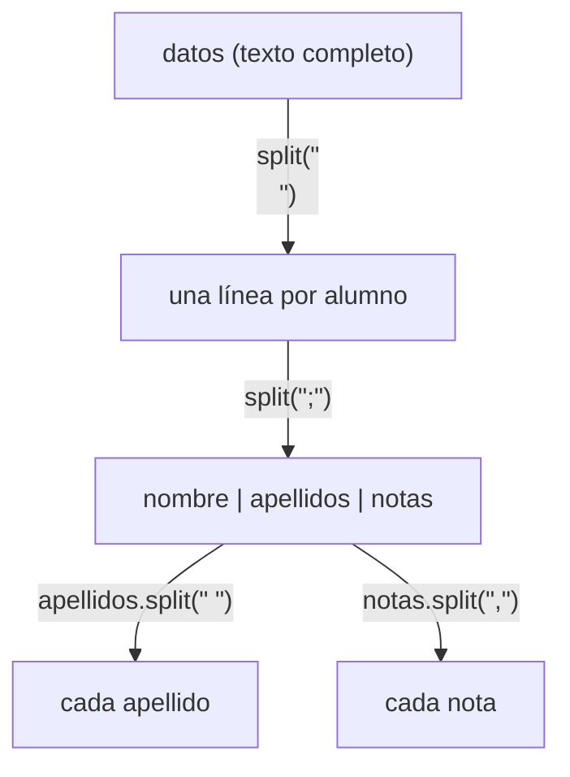

# Solución · Ejercicio 05 · Informe de alumnos

[⬅️ Enunciado](../../ejercicio-05-informe-de-alumnos/ENUNCIADO.md) · [Ejercicios del tema](../../README.md)

## Cómo pensarlo

Se trabaja de lo grande a lo pequeño, dividiendo con `split` en cada nivel:



Traza con la segunda línea:

| Paso | Resultado |
|---|---|
| Línea | `LUIS;martín;5,4.5,6` |
| Campos | `"LUIS"`, `"martín"`, `"5,4.5,6"` |
| Nombre capitalizado | `Luis` |
| Apellidos capitalizados | `Martín` |
| Usuario | `l` + `martin` = `lmartin` |
| Notas | 5 + 4.5 + 6 = 15.5 → media 5.17 |
| Estado | `APROBADO` |

## Código explicado

**Capitalizar el nombre:**

```java
String nombre = campos[0].substring(0, 1).toUpperCase() + campos[0].substring(1).toLowerCase();
```

**Capitalizar cada apellido** (con un `StringBuilder` y separador entre palabras):

```java
StringBuilder apellidos = new StringBuilder();
for (String palabra : campos[1].strip().split(" +")) {
    if (apellidos.length() > 0) {
        apellidos.append(" ");
    }
    apellidos.append(palabra.substring(0, 1).toUpperCase()).append(palabra.substring(1).toLowerCase());
}
```

**Usuario sin tildes:**

```java
String primerApellido = campos[1].strip().split(" +")[0];
String usuario = (nombre.charAt(0) + primerApellido).toLowerCase()
        .replace('á', 'a').replace('é', 'e').replace('í', 'i')
        .replace('ó', 'o').replace('ú', 'u').replace('ü', 'u');
```

`nombre.charAt(0) + primerApellido` funciona porque uno de los dos es un `String`: el `char` se concatena como texto. (Si fueran dos `char`, se **sumarían** como números, como viste en la teoría.)

**La media:**

```java
String[] notas = campos[2].split(",");
double suma = 0;
for (String nota : notas) {
    suma += Double.parseDouble(nota);
}
double media = suma / notas.length;
```

**La fila del informe**, con `String.format` y `append`:

```java
informe.append(String.format("%3d  %-20s %-10s %6.2f  %s%n",
        i + 1, nombreCompleto, usuario, media, estado));
```

Construir todo el informe en un `StringBuilder` y mostrarlo **al final** tiene una ventaja: el mismo texto se podría guardar en un fichero (tema 20) o enviar por correo sin cambiar nada.

## Para mejorar

La capitalización y la eliminación de tildes se repiten varias veces. En el [tema 10](../../../../teoria/10-metodos/README.md) aprenderás a escribirlas **una sola vez** como métodos (`capitalizar(texto)`, `quitarTildes(texto)`) y llamarlas donde haga falta.

## Errores comunes

- `split(";")` sobre el texto completo → mezcla los campos de todas las líneas.
- No hacer `strip()` en el bloque de texto → la última línea vacía produce un alumno "fantasma" y `campos[1]` da `ArrayIndexOutOfBoundsException`.
- Capitalizar uniendo dos `char` (`Character.toUpperCase(a) + b`) → se suman como números. Al menos uno de los dos lados tiene que ser un `String`.

## Código completo

📄 [Sol09_05_InformeDeAlumnos.java](Sol09_05_InformeDeAlumnos.java)
