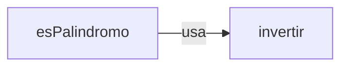

# Solución · Ejercicio 02 · Utilidades de texto

[⬅️ Enunciado](../../ejercicio-02-utilidades-de-texto/ENUNCIADO.md) · [Ejercicios del tema](../../README.md)

## Cómo pensarlo

Cada método hace **una sola cosa** y la hace bien. Y cuando una tarea ya está resuelta en un método (`invertir`), los demás la **reutilizan** en lugar de repetir el código.



## Código explicado

**capitalizar**, con protección para el texto vacío:

```java
static String capitalizar(String texto) {
    if (texto.isEmpty()) {
        return texto;
    } else {
        return texto.substring(0, 1).toUpperCase() + texto.substring(1).toLowerCase();
    }
}
```

**invertir** y **esPalindromo** (que reutiliza `invertir`):

```java
static String invertir(String texto) {
    return new StringBuilder(texto).reverse().toString();
}

static boolean esPalindromo(String texto) {
    String preparado = texto.toLowerCase().replace(" ", "");
    return preparado.equals(invertir(preparado));
}
```

**repetir** con Javadoc:

```java
/**
 * Repite un texto varias veces, poniendo un separador entre cada repetición.
 *
 * @param texto     el texto que se repite
 * @param veces     cuántas veces se repite
 * @param separador lo que se pone entre una repetición y la siguiente
 * @return el texto repetido, por ejemplo ("ja", 3, "-") → "ja-ja-ja"
 */
static String repetir(String texto, int veces, String separador) {
    StringBuilder resultado = new StringBuilder();
    for (int i = 0; i < veces; i++) {
        if (i > 0) {
            resultado.append(separador);
        }
        resultado.append(texto);
    }
    return resultado.toString();
}
```

## Otras formas de resolverlo

`repetir` también se puede escribir sin bucle, combinando lo que ya conoces: crear un array con `veces` copias del texto y unirlas con `String.join(separador, ...)`. Y `contarVocales` se puede resolver con un `for` y `charAt` o con `toCharArray()`; las dos son igual de válidas.

## Errores comunes

- Copiar el código de `invertir` dentro de `esPalindromo` en lugar de llamarlo.
- `capitalizar("")` sin comprobar → `StringIndexOutOfBoundsException`.
- Devolver un `StringBuilder` donde se espera un `String` → error de compilación: falta `toString()`.

## Código completo

📄 [Sol10_02_UtilidadesDeTexto.java](Sol10_02_UtilidadesDeTexto.java)
