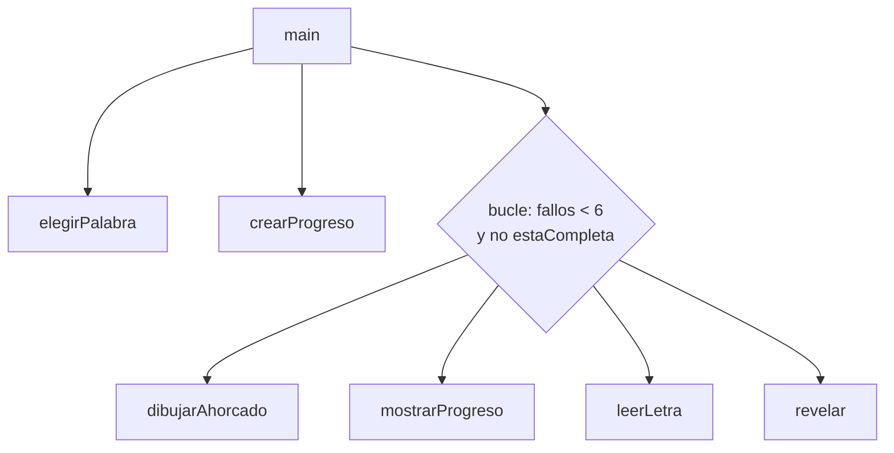

# Solución · Ejercicio 05 · El ahorcado

[⬅️ Enunciado](../../ejercicio-05-el-ahorcado/ENUNCIADO.md) · [Ejercicios del tema](../../README.md)

## Cómo pensarlo

El juego se divide en tareas pequeñas, cada una en un método con **una sola responsabilidad**:



| Método | Tipo de retorno | ¿Modifica algo? |
|---|---|---|
| `elegirPalabra` | `String` | No |
| `crearProgreso` | `char[]` (nuevo) | No |
| `mostrarProgreso`, `dibujarAhorcado` | `void` | No: solo muestran |
| `leerLetra` | `char` | No |
| `revelar` | `int` | **Sí**: el array `progreso` |
| `estaCompleta` | `boolean` | No |

Gracias a esta división, el `main` cabe en una pantalla y se entiende sin conocer los detalles.

## Código explicado

**`revelar`**: modifica el array recibido y devuelve un dato extra.

```java
static int revelar(String palabra, char[] progreso, char letra) {
    int aciertos = 0;
    for (int i = 0; i < palabra.length(); i++) {
        if (palabra.charAt(i) == letra) {
            progreso[i] = letra;          // Se ve en el main: es el mismo array
            aciertos++;
        }
    }
    return aciertos;
}
```

**`estaCompleta`**: bandera en la condición y un único `return`.

```java
static boolean estaCompleta(char[] progreso) {
    boolean quedaHueco = false;
    int i = 0;
    while (i < progreso.length && !quedaHueco) {
        quedaHueco = progreso[i] == '_';
        i++;
    }
    return !quedaHueco;
}
```

**`leerLetra`**: validación con dos condiciones y bandera.

```java
static char leerLetra(Scanner teclado, String usadas) {
    char letra = ' ';
    boolean valida = false;
    while (!valida) {
        System.out.print("Letra: ");
        String entrada = teclado.nextLine().strip().toLowerCase();
        if (entrada.length() != 1 || !Character.isLetter(entrada.charAt(0))) {
            System.out.println("  Escribe una sola letra.");
        } else if (usadas.indexOf(entrada.charAt(0)) != -1) {
            System.out.println("  Ya has usado la '" + entrada + "'.");
        } else {
            letra = entrada.charAt(0);
            valida = true;
        }
    }
    return letra;
}
```

El orden de las condiciones protege a `charAt(0)`: si la entrada está vacía, `entrada.length() != 1` es `true` y, gracias al cortocircuito de `||`, no se llega a ejecutar `entrada.charAt(0)`.

**`dibujarAhorcado`** construye cada línea con ternarios, de forma que cada parte del muñeco aparece a partir de cierto número de fallos:

```java
String cabeza = fallos >= 1 ? "O" : " ";
String brazoIzquierdo = fallos >= 3 ? "/" : " ";
...
```

La solución completa usa un `switch` para dar un mensaje distinto según la gravedad.

## Para mejorar

- Elegir la dificultad (palabras cortas o largas).
- Permitir arriesgar la palabra completa.
- Repetir partidas con un menú (`do-while`) y llevar la cuenta de victorias.

## Errores comunes

- Leer la letra con `next()` en lugar de `nextLine()` → la validación de "una sola letra" no detecta `ab c`.
- Devolver desde dentro del bucle en `estaCompleta` (en este repositorio usamos bandera).
- Olvidar que `revelar` debe destapar **todas** las apariciones, no solo la primera.

## Código completo

📄 [Sol10_05_ElAhorcado.java](Sol10_05_ElAhorcado.java)
