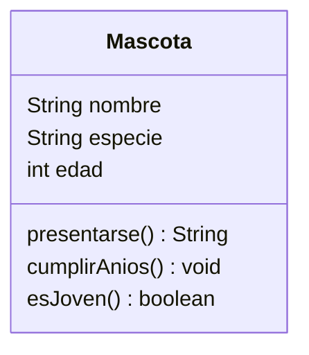

# Ejercicio 01 · Mascotas

[⬅️ Ejercicios del tema](../README.md)

**Dificultad:** ⭐
**Conceptos:** definir una clase con atributos y métodos, crear objetos con `new`, operador punto

## Enunciado

Completa la clase `Mascota` de [`Ej11_01_Mascotas.java`](Ej11_01_Mascotas.java):



| Método | Qué hace |
|---|---|
| `presentarse()` | Devuelve `"Soy Toby, un perro de 3 años"` |
| `cumplirAnios()` | Suma 1 a la edad |
| `esJoven()` | `true` si tiene menos de 2 años |

Después, en el `main`, crea **dos** mascotas, dales valores, muéstralas, haz que la segunda cumpla años y vuelve a mostrarla.

## Salida esperada

```
Soy Toby, un perro de 3 años
¿Toby es joven? false
Soy Misi, un gato de 1 años
¿Misi es joven? true
Misi cumple años...
Soy Misi, un gato de 2 años
¿Misi es joven? false
```

## Pistas

<details>
<summary>Pista 1</summary>

Los métodos de una clase **no** llevan `static` y pueden usar los atributos directamente: `return "Soy " + nombre + ...;`.

</details>

<details>
<summary>Pista 2</summary>

```java
Mascota toby = new Mascota();
toby.nombre = "Toby";
```

</details>

## Cómo ejecutarlo

```bash
java Ej11_01_Mascotas.java
```

---

✅ ¿Terminado? Compara con la [solución](../soluciones/ejercicio-01-mascotas/SOLUCION.md).
