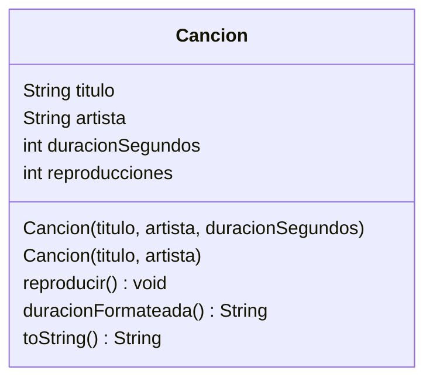

# Ejercicio 02 · Canciones

[⬅️ Ejercicios del tema](../README.md)

**Dificultad:** ⭐⭐
**Conceptos:** constructores, sobrecarga de constructores, `this` y `this(...)`, `toString`

## Enunciado

Completa la clase `Cancion` de [`Ej11_02_Canciones.java`](Ej11_02_Canciones.java):



1. **Constructor completo** con título, artista y duración. Las reproducciones empiezan en 0.
2. **Constructor corto** con título y artista: la duración es desconocida (0). Debe llamar al completo con `this(...)`.
3. `reproducir()` suma 1 a las reproducciones y muestra `▶ Reproduciendo: <título>`.
4. `duracionFormateada()` devuelve la duración como `m:ss` (`225` segundos → `"3:45"`; `65` → `"1:05"`), o `"?:??"` si es 0.
5. `toString()` devuelve `"Bohemian Rhapsody - Queen [5:55] (2 reproducciones)"`.

El `main` ya está escrito.

## Salida esperada

```
▶ Reproduciendo: Bohemian Rhapsody
▶ Reproduciendo: Bohemian Rhapsody
▶ Reproduciendo: Despacito
Bohemian Rhapsody - Queen [5:55] (2 reproducciones)
Despacito - Luis Fonsi [3:48] (1 reproducciones)
Canción nueva - Artista desconocido [?:??] (0 reproducciones)
```

## Pistas

<details>
<summary>Pista 1</summary>

Minutos y segundos con `/` y `%` (tema 04). Para los segundos con dos cifras: `String.format("%d:%02d", minutos, segundos)`.

</details>

<details>
<summary>Pista 2</summary>

`this(titulo, artista, 0);` debe ser la primera línea del constructor corto.

</details>

## Cómo ejecutarlo

```bash
java Ej11_02_Canciones.java
```

---

✅ ¿Terminado? Compara con la [solución](../soluciones/ejercicio-02-canciones/SOLUCION.md).
