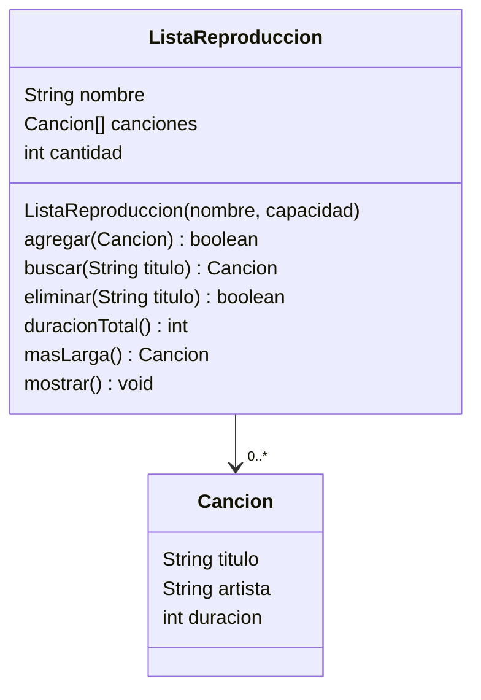

# Ejercicio 04 · Lista de reproducción

[⬅️ Ejercicios del tema](../README.md)

**Dificultad:** ⭐⭐⭐⭐
**Conceptos:** un objeto que contiene un **array de objetos**, contador de elementos ocupados, buscar, eliminar desplazando, `null`

## Enunciado

La clase `Cancion` ya está hecha. Completa la clase `ListaReproduccion` de [`Ej11_04_ListaDeReproduccion.java`](Ej11_04_ListaDeReproduccion.java):



- El array tiene una **capacidad** fija, pero la lista puede no estar llena: `cantidad` dice cuántas posiciones están **ocupadas** (siempre las primeras).
- `agregar`: si hay hueco, pone la canción en la posición `cantidad` y devuelve `true`; si está llena, devuelve `false`.
- `buscar`: devuelve la canción con ese título (sin importar mayúsculas) o `null` si no está. Usa una bandera, sin `return` dentro del bucle.
- `eliminar`: quita la canción y **desplaza** las siguientes una posición a la izquierda para no dejar huecos.
- `duracionTotal`: suma de duraciones, en segundos.
- `masLarga`: la de mayor duración (`null` si la lista está vacía).
- `mostrar`: título de la lista, cada canción numerada y la duración total en `m:ss`.

## Salida esperada

```
¿Añadida "Thunderstruck"? false
=== Para correr (4/4) ===
1. Eye of the Tiger - Survivor [4:05]
2. Lose Yourself - Eminem [5:26]
3. Titanium - David Guetta [4:05]
4. Stronger - Kanye West [5:12]
Duración total: 18:48
Más larga: Lose Yourself - Eminem [5:26]
Buscar "titanium": Titanium - David Guetta [4:05]
Buscar "Hello": null
¿Eliminada "Lose Yourself"? true
¿Añadida "Thunderstruck"? true
=== Para correr (4/4) ===
1. Eye of the Tiger - Survivor [4:05]
2. Titanium - David Guetta [4:05]
3. Stronger - Kanye West [5:12]
4. Thunderstruck - AC/DC [4:52]
Duración total: 18:14
```

## Pistas

<details>
<summary>Pista 1</summary>

Recorre siempre hasta `cantidad`, **no** hasta `canciones.length`: las posiciones a partir de `cantidad` están vacías (`null`) y llamar a un método sobre ellas daría `NullPointerException`.

</details>

<details>
<summary>Pista 2</summary>

Para eliminar la posición `p`:

```java
for (int i = p; i < cantidad - 1; i++) {
    canciones[i] = canciones[i + 1];
}
canciones[cantidad - 1] = null;
cantidad--;
```

</details>

<details>
<summary>Pista 3</summary>

`eliminar` puede buscar primero la **posición** de la canción (con bandera) y, si la encuentra, desplazar.

</details>

## Cómo ejecutarlo

```bash
java Ej11_04_ListaDeReproduccion.java
```

---

✅ ¿Terminado? Compara con la [solución](../soluciones/ejercicio-04-lista-de-reproduccion/SOLUCION.md).
