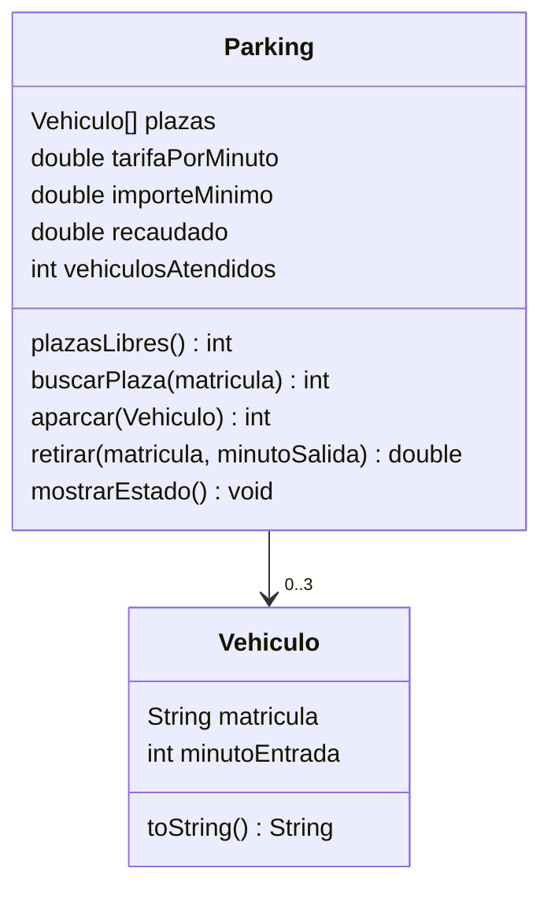

# Ejercicio 05 · Parking

[⬅️ Ejercicios del tema](../README.md)

**Dificultad:** ⭐⭐⭐⭐⭐
**Conceptos:** todo el tema (varias clases que colaboran, constructores, arrays de objetos con `null`, métodos `static` de utilidad, `toString`) + menú con `do-while`/`switch`, validación de texto y `String.format`

## Enunciado

Programa la gestión de un pequeño **parking de 3 plazas**. Completa [`Ej11_05_Parking.java`](Ej11_05_Parking.java):



- Una plaza vacía es `null` en el array `plazas`.
- Las horas se escriben como `HH:MM` y se guardan como **minutos desde las 00:00** (`09:15` → 555). Los métodos `static` `aHoraEnMinutos` y `aTextoHora` hacen la conversión.
- **Aparcar**: si la matrícula ya está dentro, devuelve `-2`; si no hay sitio, `-1`; si no, la coloca en la **primera plaza libre** y devuelve su número (empezando en 1).
- **Retirar**: si la matrícula no está, devuelve `-1`. Si está, libera la plaza, calcula el importe (**0,05 € por minuto**, con un **mínimo de 1 €**), lo suma a lo recaudado y lo devuelve.
- Las matrículas se guardan **sin espacios y en mayúsculas** (`5678 def` → `5678DEF`).

El menú (ya hecho en parte) tiene: `1. Aparcar`, `2. Retirar`, `3. Ver estado`, `0. Salir`. Al salir se muestra un resumen.

Validaciones:

- La opción del menú tiene que ser un número.
- La hora tiene que tener el formato `HH:MM` con horas de 00 a 23 y minutos de 00 a 59. Si no, se vuelve a pedir.
- La hora de salida no puede ser anterior a la de entrada.

## Salida de ejemplo (resumida)

```
Opción: 1
Matrícula: 1234abc
Hora de entrada (HH:MM): 9:15
  Formato incorrecto. Usa HH:MM (por ejemplo 09:05).
Hora de entrada (HH:MM): 09:15
  1234ABC aparcado en la plaza 1
...
Opción: 3
=== Estado del parking (1 libres de 3) ===
Plaza 1: 1234ABC (entrada 09:15)
Plaza 2: 5678DEF (entrada 10:00)
Plaza 3: libre
...
Opción: 2
Matrícula: 1234ABC
Hora de salida (HH:MM): 11:45
  1234ABC sale tras 150 minutos. Importe: 7,50 €
...
Opción: 0
=== Resumen del día ===
Vehículos atendidos: 1
Recaudado: 7,50 €
Siguen dentro: 1
```

## Pistas

<details>
<summary>Pista 1</summary>

`aHoraEnMinutos("09:15")`: `Integer.parseInt(hora.substring(0, 2)) * 60 + Integer.parseInt(hora.substring(3))`.

`aTextoHora(555)`: `String.format("%02d:%02d", 555 / 60, 555 % 60)`.

</details>

<details>
<summary>Pista 2</summary>

Para validar `HH:MM` sin errores: longitud 5, `charAt(2) == ':'`, y los otros 4 caracteres son dígitos (`Character.isDigit`). Solo después de comprobar eso es seguro hacer `parseInt` y mirar los rangos.

</details>

<details>
<summary>Pista 3</summary>

`aparcar` necesita la primera plaza libre: recorre `plazas` con una bandera hasta encontrar un `null`.

</details>

## Cómo ejecutarlo

```bash
java Ej11_05_Parking.java
```

---

✅ ¿Terminado? Compara con la [solución](../soluciones/ejercicio-05-parking/SOLUCION.md).
