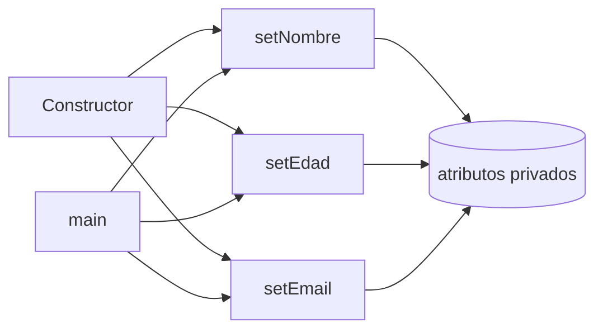

# Solución · Ejercicio 01 · Persona encapsulada

[⬅️ Enunciado](../../ejercicio-01-persona-encapsulada/ENUNCIADO.md) · [Ejercicios del tema](../../README.md)

## Cómo pensarlo

Las reglas de validación se escriben **una sola vez**, en los setters. El constructor no las repite: llama a los setters. Así, si mañana cambia una regla (por ejemplo, edad máxima 120), se cambia en un único sitio.



## Código explicado

```java
private String nombre;
private int edad;
private String email;

public Persona(String nombre, int edad, String email) {
    this.nombre = "Sin nombre";              // Valores seguros por si algún dato no es válido
    this.edad = 0;
    this.email = "sin-email@ejemplo.com";
    setNombre(nombre);
    setEdad(edad);
    setEmail(email);
}

public void setNombre(String nombre) {
    if (nombre != null && !nombre.isBlank()) {
        this.nombre = nombre.strip();
    } else {
        System.out.println("  ⚠ Nombre no válido: \"" + nombre + "\"");
    }
}
```

- `nombre != null && !nombre.isBlank()`: el orden importa. Si `nombre` fuera `null`, el cortocircuito evita llamar a `isBlank()` y el `NullPointerException`.
- `isBlank()` detecta tanto `""` como `"   "`.
- `setEmail` usa `email != null && email.contains("@")`.

## Errores comunes

- Validar en el constructor **y** en los setters con código duplicado.
- Olvidar los valores por defecto: si el nombre no es válido en el constructor, el atributo se quedaría en `null`.
- Escribir `if (edad > 0 ...)`: un bebé de 0 años no sería válido.

## Código completo

📄 [Sol12_01_PersonaEncapsulada.java](Sol12_01_PersonaEncapsulada.java)
