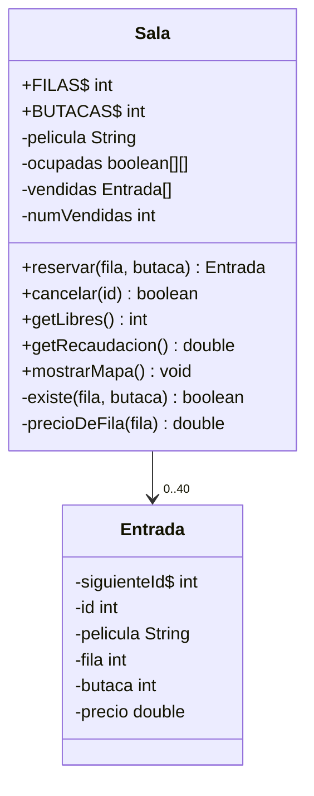

# Solución · Ejercicio 05 · Reservas de cine

[⬅️ Enunciado](../../ejercicio-05-reservas-de-cine/ENUNCIADO.md) · [Ejercicios del tema](../../README.md)

## Cómo pensarlo



En los diagramas de clases, `+` significa `public`, `-` significa `private` y el `$` marca los miembros `static`.

Las responsabilidades están bien separadas:

- `Sala` decide **si** se puede reservar, **cuánto** cuesta y **guarda** el estado. Nadie más toca la matriz.
- `Entrada` es un **comprobante inmutable**: una vez emitida, nadie puede cambiar su fila ni su precio.
- `main` solo habla con el usuario.

## Código explicado

**Identificador automático en una clase inmutable:**

```java
private static int siguienteId = 1;
private final int id;
...
public Entrada(String pelicula, int fila, int butaca, double precio) {
    this.id = siguienteId;
    siguienteId++;
    ...
}
```

**Reservar** (la conversión 1 → 0 se hace dentro de la sala):

```java
public Entrada reservar(int fila, int butaca) {
    Entrada entrada = null;
    if (existe(fila, butaca) && !ocupadas[fila - 1][butaca - 1]) {
        ocupadas[fila - 1][butaca - 1] = true;
        entrada = new Entrada(pelicula, fila, butaca, precioDeFila(fila));
        vendidas[numVendidas] = entrada;
        numVendidas++;
    }
    return entrada;
}
```

`existe` va primero: si la butaca está fuera, el cortocircuito de `&&` evita mirar la matriz (que lanzaría `ArrayIndexOutOfBoundsException`).

**Precio con un método privado:**

```java
private double precioDeFila(int fila) {
    if (fila <= 2) {
        return PRECIO_DELANTERA;
    } else if (fila <= 4) {
        return PRECIO_CENTRAL;
    } else {
        return PRECIO_VIP;
    }
}
```

Si cambian las tarifas, solo se toca este método y las constantes.

**Cancelar**: buscar la posición, liberar la butaca y desplazar.

```java
public boolean cancelar(int id) {
    int posicion = -1;
    int i = 0;
    while (i < numVendidas && posicion == -1) {
        if (vendidas[i].getId() == id) {
            posicion = i;
        }
        i++;
    }
    if (posicion != -1) {
        Entrada e = vendidas[posicion];
        ocupadas[e.getFila() - 1][e.getButaca() - 1] = false;
        for (int j = posicion; j < numVendidas - 1; j++) {
            vendidas[j] = vendidas[j + 1];
        }
        vendidas[numVendidas - 1] = null;
        numVendidas--;
    }
    return posicion != -1;
}
```

La recaudación se calcula sumando las entradas vendidas **en cada momento**, así que una cancelación la descuenta automáticamente, sin tener que acordarse de restarla.

## Para mejorar

- Reservar varias butacas seguidas de una vez.
- Distintas películas y sesiones (una `Sala` por sesión).
- Descuentos por edad o carnet joven, con herencia (tema 13).

## Código completo

📄 [Sol12_05_ReservasDeCine.java](Sol12_05_ReservasDeCine.java)
