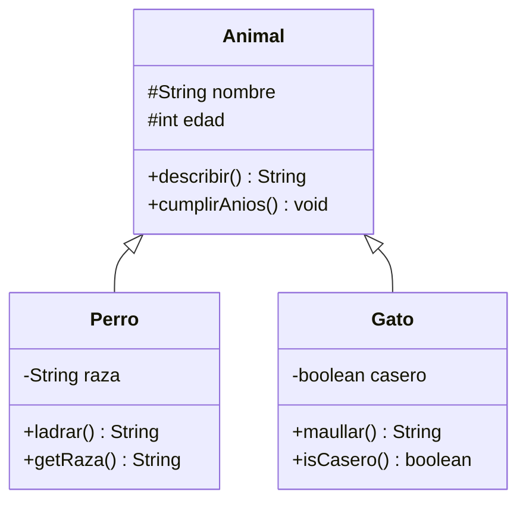

# Ejercicio 01 · Animales

[⬅️ Ejercicios del tema](../README.md)

**Dificultad:** ⭐
**Conceptos:** `extends`, constructores con `super(...)`, métodos heredados y métodos propios

## Enunciado

En [`Ej13_01_Animales.java`](Ej13_01_Animales.java) la clase `Animal` ya está hecha. Crea dos subclases:



- `Perro(nombre, edad, raza)` y `Gato(nombre, edad, casero)` llaman a `super(nombre, edad)`.
- `ladrar()` devuelve `"Toby dice ¡Guau!"`.
- `maullar()` devuelve `"Misi dice ¡Miau!"` si es casero, o `"Misi dice ¡MIAU! (y se escapa por la ventana)"` si no.

(En los diagramas, `#` significa `protected`.)

> ⚠️ La plantilla **no compila** hasta que crees las dos clases, porque el `main` ya las usa. Es normal.

## Salida esperada

```
Toby (3 años)
Raza: Beagle
Toby dice ¡Guau!
Misi (5 años)
Misi dice ¡Miau!
Tigre dice ¡MIAU! (y se escapa por la ventana)
Tras su cumpleaños: Toby (4 años)
```

## Pistas

<details>
<summary>Pista 1</summary>

```java
static class Perro extends Animal {
    private final String raza;

    public Perro(String nombre, int edad, String raza) {
        super(nombre, edad);
        this.raza = raza;
    }
    ...
}
```

</details>

<details>
<summary>Pista 2</summary>

`nombre` es `protected` en `Animal`, así que puedes usarlo directamente en `ladrar()`.

</details>

## Cómo ejecutarlo

```bash
java Ej13_01_Animales.java
```

---

✅ ¿Terminado? Compara con la [solución](../soluciones/ejercicio-01-animales/SOLUCION.md).
