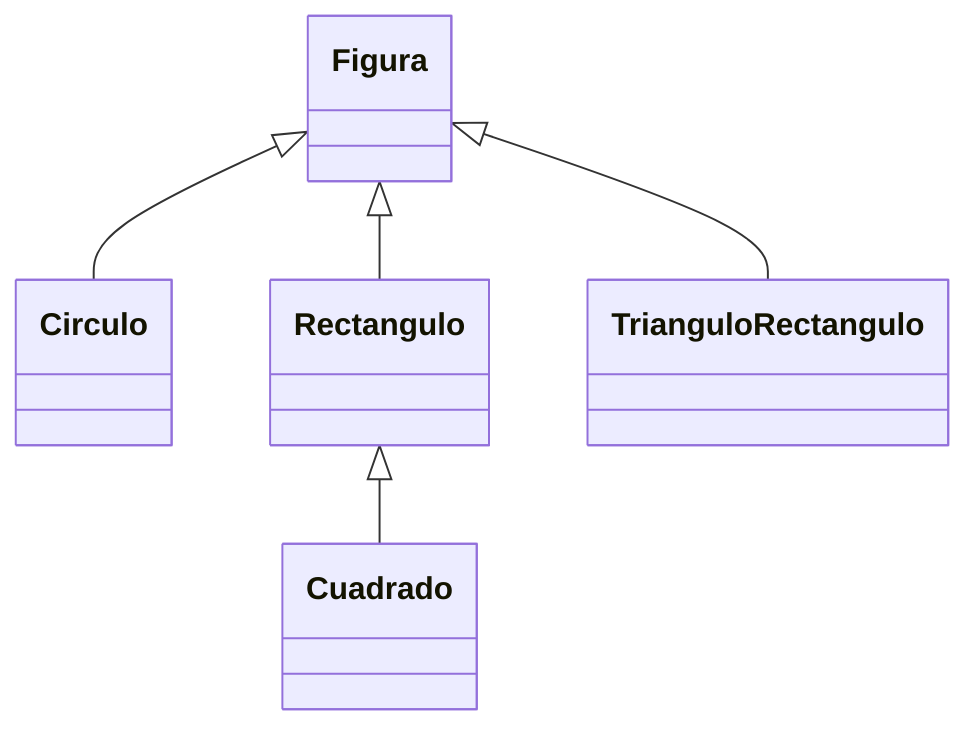

# Ejercicio 03 · Figuras polimórficas

[⬅️ Ejercicios del tema](../README.md)

**Dificultad:** ⭐⭐⭐
**Conceptos:** polimorfismo, métodos que reciben un array de la superclase, cadena de herencia, `instanceof`, ordenar objetos

## Enunciado

En [`Ej13_03_FigurasPolimorficas.java`](Ej13_03_FigurasPolimorficas.java) la clase `Figura` ya está hecha (con `area()` y `perimetro()` que devuelven 0). Completa:

**Las subclases** (sobrescribiendo `getNombre()`, `area()` y `perimetro()`):



| Clase | Nombre | Área | Perímetro |
|---|---|---|---|
| `Circulo(radio)` | `Círculo (r=1,5)` | π·r² | 2·π·r |
| `Rectangulo(ancho, alto)` | `Rectángulo (4,0 x 2,5)` | ancho·alto | 2·(ancho + alto) |
| `Cuadrado(lado)` | `Cuadrado (3,0)` | Heredada | Heredado |
| `TrianguloRectangulo(cateto1, cateto2)` | `Triángulo (3,0 y 4,0)` | c1·c2 / 2 | c1 + c2 + hipotenusa |

**Los métodos `static` del programa** (que reciben `Figura[]` y funcionan con cualquier figura):

- `areaTotal(figuras)`
- `laMayor(figuras)`
- `contarDeTipo...`: cuenta cuántas son `Circulo` y cuántas son `Rectangulo` (con `instanceof`).
- `ordenarPorArea(figuras)`: ordena el array de menor a mayor área (burbuja).

## Salida esperada

```
Círculo (r=1,5)          área   7,07 | perímetro   9,42
Rectángulo (4,0 x 2,5)   área  10,00 | perímetro  13,00
Cuadrado (3,0)           área   9,00 | perímetro  12,00
Triángulo (3,0 y 4,0)    área   6,00 | perímetro  12,00
Círculo (r=0,5)          área   0,79 | perímetro   3,14
Área total: 32,85
La mayor: Rectángulo (4,0 x 2,5)
Círculos: 2 | Rectángulos (incluidos cuadrados): 2
--- Ordenadas por área ---
Círculo (r=0,5)          área   0,79 | perímetro   3,14
Triángulo (3,0 y 4,0)    área   6,00 | perímetro  12,00
Círculo (r=1,5)          área   7,07 | perímetro   9,42
Cuadrado (3,0)           área   9,00 | perímetro  12,00
Rectángulo (4,0 x 2,5)   área  10,00 | perímetro  13,00
```

## Pistas

<details>
<summary>Pista 1</summary>

`Cuadrado` solo necesita un constructor que llame a `super(lado, lado)` y sobrescribir `getNombre()`. El área y el perímetro de `Rectangulo` ya le sirven.

</details>

<details>
<summary>Pista 2</summary>

Fíjate en el resultado de `instanceof Rectangulo` para el cuadrado: un `Cuadrado` **es un** `Rectangulo`, así que cuenta.

</details>

<details>
<summary>Pista 3</summary>

En la burbuja se intercambian **referencias** de tipo `Figura`. Compara con `figuras[i].area() > figuras[i + 1].area()`: cada objeto calcula su área a su manera.

</details>

## Cómo ejecutarlo

```bash
java Ej13_03_FigurasPolimorficas.java
```

---

✅ ¿Terminado? Compara con la [solución](../soluciones/ejercicio-03-figuras-polimorficas/SOLUCION.md).
