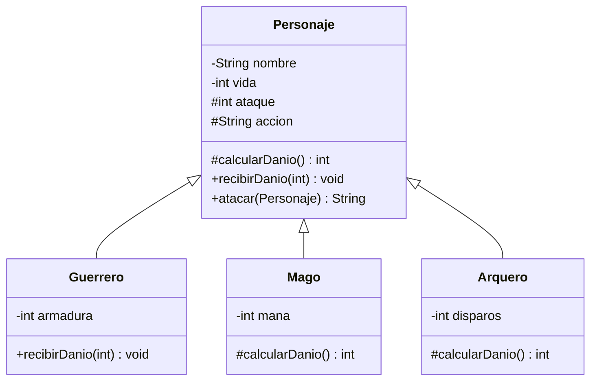

# Ejercicio 05 · Batalla de personajes

[⬅️ Ejercicios del tema](../README.md)

**Dificultad:** ⭐⭐⭐⭐⭐
**Conceptos:** todo el tema (herencia, `super`, sobrescritura, polimorfismo, métodos `final`, `protected`, `instanceof` con patrón) + encapsulamiento, arrays y bucles con banderas

## Enunciado

Programa una batalla por turnos entre dos equipos. En [`Ej13_05_BatallaDePersonajes.java`](Ej13_05_BatallaDePersonajes.java) la superclase `Personaje` ya está hecha:



Fíjate en cómo está diseñado `atacar`: es **`final`** (nadie lo puede sobrescribir) y define los pasos de cualquier ataque. Dentro llama a dos métodos que las subclases **sí** pueden sobrescribir:

1. `calcularDanio()` → cuánto daño hace el atacante (y qué `accion` describe el ataque).
2. `recibirDanio(danio)` → cómo se defiende el objetivo.

**Tareas:**

| Clase | Qué sobrescribe | Regla |
|---|---|---|
| `Guerrero` | `recibirDanio` | Su armadura resta daño, pero siempre recibe al menos 1. Usa `super.recibirDanio(...)` |
| `Mago` | `calcularDanio` | Con 10 o más de maná: `"lanza una bola de fuego a"`, ataque × 2 y gasta 10. Si no: `"da un bastonazo a"`, ataque / 2 |
| `Arquero` | `calcularDanio` | Cuenta sus disparos. Cada tercero: `"dispara una flecha CRÍTICA a"`, ataque × 3. Los demás: `"dispara a"`, ataque normal |

**La batalla** (métodos `static` que trabajan con `Personaje[]`):

- `hayVivos(equipo)` y `primerVivo(equipo)`, con banderas.
- `atacarEquipo(atacantes, defensores)`: cada atacante vivo ataca al primer defensor vivo, y se deja de atacar si ya no quedan defensores.
- En el `main`, rondas (máximo 20) mientras los dos equipos tengan vivos: atacan los héroes y luego los villanos. Al final, el resultado y el estado de todos (del mago, también el maná restante, con `instanceof` con patrón).

## Salida esperada (principio y final)

```
--- Ronda 1 ---
  Brienne golpea a Sombra (14) → Sombra [66/80]
  Merlín lanza una bola de fuego a Sombra (24) → Sombra [42/80]
  Sombra dispara a Brienne (6) → Brienne [114/120]
  Conan golpea a Brienne (11) → Brienne [103/120]
--- Ronda 2 ---
  Brienne golpea a Sombra (14) → Sombra [28/80]
  Merlín lanza una bola de fuego a Sombra (24) → Sombra [4/80]
  Sombra dispara a Brienne (6) → Brienne [97/120]
  Conan golpea a Brienne (11) → Brienne [86/120]
--- Ronda 3 ---
  Brienne golpea a Sombra (4) → Sombra [0/80]
  Merlín lanza una bola de fuego a Conan (21) → Conan [89/110]
  Conan golpea a Brienne (11) → Brienne [75/120]
--- Ronda 4 ---
  Brienne golpea a Conan (11) → Conan [78/110]
  Merlín da un bastonazo a Conan (3) → Conan [75/110]
  Conan golpea a Brienne (11) → Brienne [64/120]
...
--- Ronda 10 ---
  Brienne golpea a Conan (5) → Conan [0/110]
=== Resultado ===
¡Ganan los héroes en 10 rondas!
Brienne [9/120]
Merlín [70/70] (maná restante: 0)
Sombra [0/80]
Conan [0/110]
```

Fíjate en la ronda 3: Sombra cae antes de su turno, así que no llega a lanzar su tercer disparo (el crítico). Y desde la ronda 4 Merlín ya no tiene maná para bolas de fuego.

## Pistas

<details>
<summary>Pista 1</summary>

```java
@Override
public void recibirDanio(int danio) {
    super.recibirDanio(Math.max(1, danio - armadura));
}
```

</details>

<details>
<summary>Pista 2</summary>

`calcularDanio()` tiene que **devolver** el daño y, además, **cambiar** el atributo `accion` para que `atacar` describa bien lo ocurrido.

</details>

<details>
<summary>Pista 3</summary>

En `atacarEquipo`, la condición del `for` incluye `hayVivos(defensores)`: así se deja de atacar en cuanto cae el último defensor, sin `break`.

</details>

## Cómo ejecutarlo

```bash
java Ej13_05_BatallaDePersonajes.java
```

---

✅ ¿Terminado? Compara con la [solución](../soluciones/ejercicio-05-batalla-de-personajes/SOLUCION.md).
