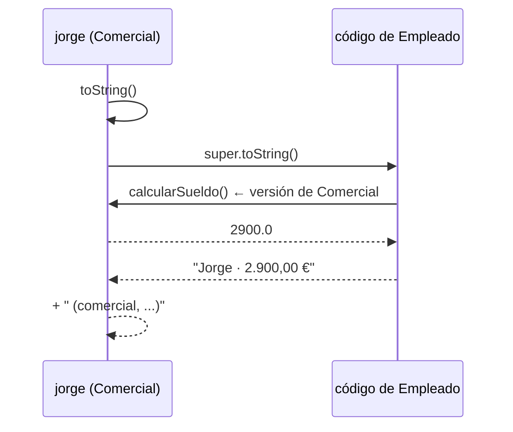

# Solución · Ejercicio 02 · Nóminas

[⬅️ Enunciado](../../ejercicio-02-nominas/ENUNCIADO.md) · [Ejercicios del tema](../../README.md)

## Código explicado

**Comercial:**

```java
@Override
public double calcularSueldo() {
    return super.calcularSueldo() + ventas * porcentajeComision / 100;   // 1300 + 40000 * 4 / 100
}

@Override
public String toString() {
    return super.toString() + String.format(" (comercial, ventas: %,.2f €)", ventas);
}
```

**Gerente:**

```java
@Override
public double calcularSueldo() {
    return super.calcularSueldo() + bonus + 50 * personasACargo;         // 2800 + 500 + 300
}

@Override
public String toString() {
    return super.toString() + " (gerente de " + personasACargo + " personas)";
}
```

## Lo interesante: super.toString() y el polimorfismo

`Empleado.toString()` está escrito así:

```java
return String.format("%s · %,.2f €", nombre, calcularSueldo());
```

Cuando `Comercial.toString()` llama a `super.toString()`, se ejecuta ese código de `Empleado`... pero dentro, `calcularSueldo()` se resuelve con el **objeto real**, que es un `Comercial`. Por eso muestra 2 900 € y no 1 300 €.



## Errores comunes

- Repetir el cálculo del sueldo base en cada subclase en lugar de `super.calcularSueldo()`: si cambia la forma de calcular el base, habría que cambiarlo en tres sitios.
- Escribir `calcularSueldo()` (sin `super.`) dentro de la versión sobrescrita → el método se llama a sí mismo infinitamente: `StackOverflowError`.
- Olvidar `@Override` y escribir `calcularsueldo()` → se crea un método nuevo que nunca se usa.

## Código completo

📄 [Sol13_02_Nominas.java](Sol13_02_Nominas.java)
