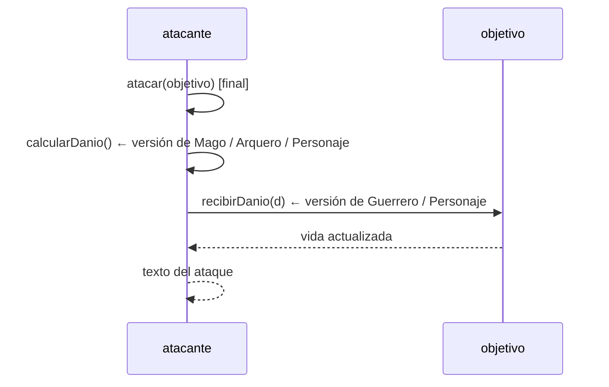

# Solución · Ejercicio 05 · Batalla de personajes

[⬅️ Enunciado](../../ejercicio-05-batalla-de-personajes/ENUNCIADO.md) · [Ejercicios del tema](../../README.md)

## Cómo pensarlo

El diseño de `Personaje` sigue un patrón muy usado, el **método plantilla**: la superclase fija los **pasos** de una operación en un método `final` y deja que las subclases rellenen los **detalles** sobrescribiendo métodos concretos.



Así, `atacar` funciona igual para todos, y cada subclase solo cambia **lo que la hace especial**. Si mañana se crea un `Curandero`, solo hay que escribir su `calcularDanio()`.

## Código explicado

**Guerrero: amplía la defensa con `super`:**

```java
@Override
public void recibirDanio(int danio) {
    super.recibirDanio(Math.max(1, danio - armadura));
}
```

No repite la lógica de restar vida (ni la de no bajar de 0): la reutiliza.

**Mago: cambia el ataque según su estado:**

```java
@Override
protected int calcularDanio() {
    int danio;
    if (mana >= COSTE_HECHIZO) {
        mana -= COSTE_HECHIZO;
        accion = "lanza una bola de fuego a";
        danio = ataque * 2;
    } else {
        accion = "da un bastonazo a";
        danio = ataque / 2;
    }
    return danio;
}
```

**Arquero: lleva su propia cuenta:**

```java
@Override
protected int calcularDanio() {
    disparos++;
    boolean critico = disparos % 3 == 0;
    accion = critico ? "dispara una flecha CRÍTICA a" : "dispara a";
    return critico ? ataque * 3 : ataque;
}
```

**La batalla no conoce los tipos concretos:**

```java
static void atacarEquipo(Personaje[] atacantes, Personaje[] defensores) {
    for (int i = 0; i < atacantes.length && hayVivos(defensores); i++) {
        if (atacantes[i].estaVivo()) {
            System.out.println("  " + atacantes[i].atacar(primerVivo(defensores)));
        }
    }
}
```

`atacantes[i].atacar(...)` funciona con guerreros, magos, arqueros y cualquier personaje futuro. El **único** sitio en el que se pregunta por un tipo concreto es al mostrar el maná, porque es un dato que solo tiene el mago:

```java
String extra = p instanceof Mago mago ? " (maná restante: " + mago.mana + ")" : "";
```

## Traza de la ronda 1

| Ataque | Daño calculado | Defensa | Daño recibido |
|---|---|---|---|
| Brienne → Sombra | 14 (golpe) | Personaje normal | 14 |
| Merlín → Sombra | 12 × 2 = 24 (bola de fuego, maná 30 → 20) | Personaje normal | 24 |
| Sombra → Brienne | 11 (1.er disparo) | Armadura 5 | 6 |
| Conan → Brienne | 16 (golpe) | Armadura 5 | 11 |

## Para mejorar

- Elegir el objetivo con menos vida en lugar del primero vivo.
- Un `Curandero` cuyo "ataque" cure a un compañero (¿qué tendría que cambiar en el diseño?).
- En el tema 14 verás que `Personaje` debería ser **abstracto**: no tiene sentido crear un personaje "genérico".

## Código completo

📄 [Sol13_05_BatallaDePersonajes.java](Sol13_05_BatallaDePersonajes.java)
