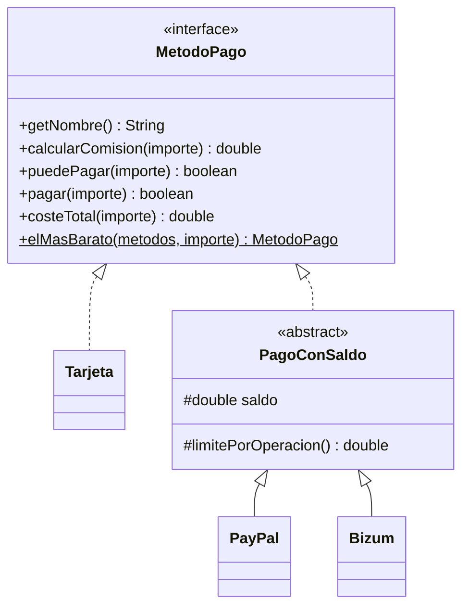

# Ejercicio 04 · Métodos de pago

[⬅️ Ejercicios del tema](../README.md)

**Dificultad:** ⭐⭐⭐⭐
**Conceptos:** interfaz como contrato, métodos `default` y `static` en una interfaz, clase abstracta que implementa la parte común, subclases que solo escriben lo específico

## Enunciado

Una tienda online quiere elegir **automáticamente** el método de pago más barato para cada compra. Completa [`Ej14_04_MetodosDePago.java`](Ej14_04_MetodosDePago.java):



| Elemento | Qué hace |
|---|---|
| `costeTotal` (`default`) | Importe + comisión |
| `elMasBarato` (`static`) | De los métodos que **pueden pagar** ese importe, el de menor comisión. `null` si ninguno puede |
| `Tarjeta` | Crédito con un límite. Comisión: 1,5 %. Puede pagar si `gastado + costeTotal ≤ límite` |
| `PagoConSaldo` | Parte común de los métodos con saldo: puede pagar si el importe no supera `limitePorOperacion()` y el coste total cabe en el saldo; al pagar, descuenta el coste total |
| `PayPal` | Comisión: 3,4 % + 0,35 € |
| `Bizum` | Sin comisión, pero como mucho 1 000 € por operación |

## Salida esperada

```
Compra de 49,99 € → Bizum (comisión 0,00 €)
Compra de 250,00 € → Bizum (comisión 0,00 €)
Compra de 800,00 € → Visa (comisión 12,00 €)
Compra de 1200,00 € → no hay ningún método de pago disponible
=== Estado final ===
Visa: gastado 812,00 € de 1500,00 €
PayPal: saldo 300,00 €
Bizum: saldo 200,01 €
```

## Pistas

<details>
<summary>Pista 1</summary>

`elMasBarato` es una búsqueda de mínimo con `null` como "todavía ninguno" (como en el tema 11):

```java
if (m.puedePagar(importe) && (elegido == null || m.calcularComision(importe) < elegido.calcularComision(importe)))
```

</details>

<details>
<summary>Pista 2</summary>

`Bizum` solo necesita sobrescribir `calcularComision` y `limitePorOperacion`. Todo lo demás lo hereda de `PagoConSaldo`.

</details>

## Cómo ejecutarlo

```bash
java Ej14_04_MetodosDePago.java
```

---

✅ ¿Terminado? Compara con la [solución](../soluciones/ejercicio-04-metodos-de-pago/SOLUCION.md).
