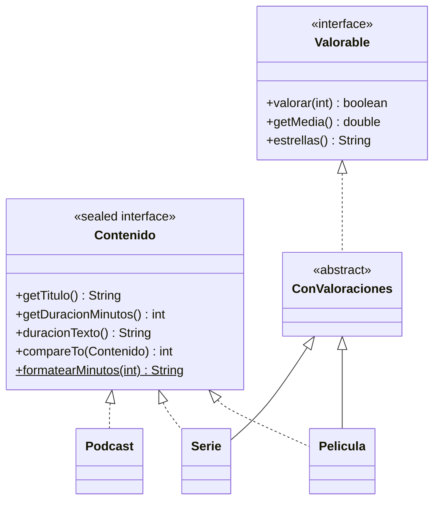

# Ejercicio 05 · Catálogo de streaming

[⬅️ Ejercicios del tema](../README.md)

**Dificultad:** ⭐⭐⭐⭐⭐
**Conceptos:** todo el tema (interfaz `sealed`, interfaces de capacidad, métodos `default` y `static`, clase abstracta, `Comparable`, `switch` exhaustivo con patrones) + `instanceof` con patrón y `Arrays.sort`

## Enunciado

Una plataforma de streaming tiene tres tipos de contenido, y **solo esos tres**: películas, series y podcasts. Completa [`Ej14_05_CatalogoDeStreaming.java`](Ej14_05_CatalogoDeStreaming.java):



1. **`Contenido`**: hazla `sealed` con `permits Pelicula, Serie, Podcast`, y que extienda `Comparable<Contenido>` con un `compareTo` **`default`** que ordene por duración.
2. **`formatearMinutos`** (`static`): `35` → `"35 min"`, `96` → `"1 h 36 min"`, `720` → `"12 h"`.
3. **`Valorable.estrellas()`** (`default`): tantas `★` como la media redondeada y el resto `☆`, hasta 5.
4. **`ConValoraciones`**: suma y cuenta de valoraciones; solo acepta de 1 a 5 estrellas.
5. **`Serie.getDuracionMinutos()`**: temporadas × episodios por temporada × minutos por episodio.
6. **`describir(contenido)`**: un `switch` con patrones **sin `default`**.
7. En el `main`: ordenar el catálogo, mostrarlo, calcular el tiempo total y el contenido mejor valorado.

## Salida esperada

```
¿Valoración de 6 estrellas aceptada? false
=== Catálogo (de más corto a más largo) ===
Entiende tu mente  35 min       🎙 Podcast con Molo Cebrián · sin valoraciones
Up                 1 h 36 min   🎬 Película de Pete Docter · ★★★★☆ 3,50 (2)
Dune: Parte dos    2 h 46 min   🎬 Película de Denis Villeneuve · ★★★★★ 4,67 (3)
Arcane             12 h         📺 Serie de 2 temporadas (18 episodios) · ★★★★★ 5,00 (1)
Dark               22 h         📺 Serie de 3 temporadas (24 episodios) · ★★★★★ 4,67 (3)
Tiempo total para verlo todo: 38 h 57 min
Mejor valorado: Arcane (5,00)
```

## Pistas

<details>
<summary>Pista 1</summary>

Una interfaz puede extender otra y dar una implementación `default` de su método:

```java
sealed interface Contenido extends Comparable<Contenido> permits Pelicula, Serie, Podcast {
    ...
    @Override
    default int compareTo(Contenido otro) {
        return Integer.compare(getDuracionMinutos(), otro.getDuracionMinutos());
    }
}
```

</details>

<details>
<summary>Pista 2</summary>

Al mostrar el catálogo, la valoración solo existe para películas y series:

```java
String valoracion = c instanceof Valorable v ? ... : "sin valoraciones";
```

</details>

<details>
<summary>Pista 3</summary>

Formato de cada línea: `printf("%-18s %-12s %s · %s%n", titulo, duracion, descripcion, valoracion)`.

</details>

## Cómo ejecutarlo

```bash
java Ej14_05_CatalogoDeStreaming.java
```

---

✅ ¿Terminado? Compara con la [solución](../soluciones/ejercicio-05-catalogo-de-streaming/SOLUCION.md).
