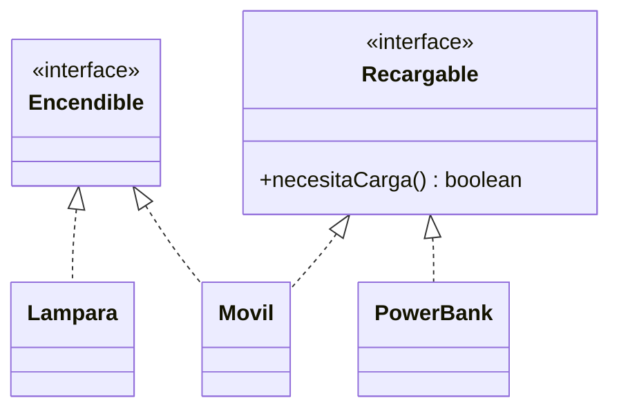

# Solución · Ejercicio 02 · Dispositivos

[⬅️ Enunciado](../../ejercicio-02-dispositivos/ENUNCIADO.md) · [Ejercicios del tema](../../README.md)

## Cómo pensarlo



Las tres clases no tienen nada en común en una jerarquía, pero comparten **capacidades**. El móvil tiene las dos.

## Código explicado

**El método default:**

```java
default boolean necesitaCarga() {
    return getBateria() < 20;
}
```

Se escribe **una vez** en la interfaz y lo heredan `Movil` y `PowerBank` sin escribir nada.

**El móvil implementa las dos interfaces y combina sus reglas:**

```java
static class Movil implements Encendible, Recargable {
    private boolean encendido = false;
    private int bateria = 0;

    @Override
    public void encender() {
        if (bateria > 0) {
            encendido = true;
        }
    }

    @Override
    public void cargar(int porcentaje) {
        bateria = Math.min(100, bateria + porcentaje);
    }

    @Override
    public String toString() {
        return "Móvil: " + (encendido ? "encendido" : "apagado") + ", batería " + bateria + "%"
                + (necesitaCarga() ? " (necesita carga)" : "");
    }
    ...
}
```

**Tratar objetos por su capacidad:**

```java
for (Object d : dispositivos) {
    if (d instanceof Recargable r) {
        r.cargar(50);       // Da igual si es un móvil o un power bank
    }
}
```

## Errores comunes

- Implementar los métodos sin `public` → `attempting to assign weaker access privileges; was public`.
- Escribir `extends Encendible` → las interfaces se **implementan**.
- Repetir `necesitaCarga()` en cada clase: para eso está el `default`.

## Código completo

📄 [Sol14_02_Dispositivos.java](Sol14_02_Dispositivos.java)
