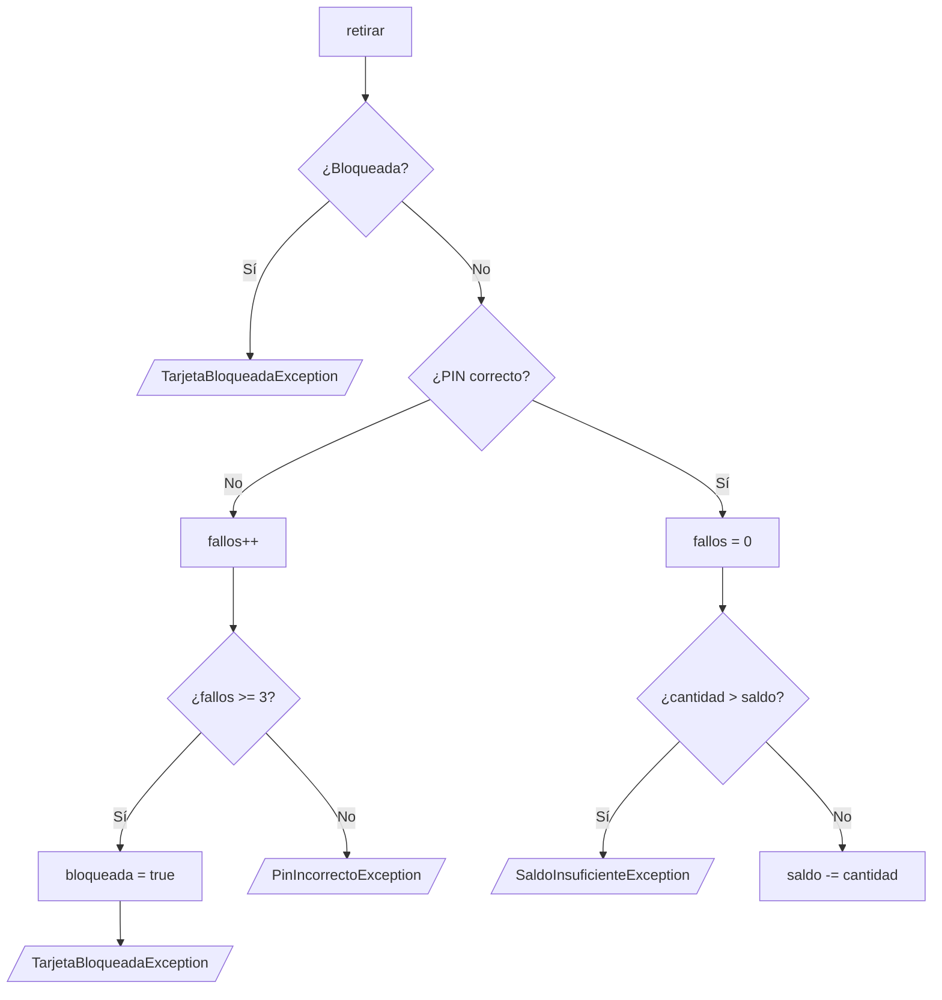

# Solución · Ejercicio 04 · Cajero con excepciones

[⬅️ Enunciado](../../ejercicio-04-cajero-con-excepciones/ENUNCIADO.md) · [Ejercicios del tema](../../README.md)

## Cómo pensarlo

La pregunta clave es **¿checked o unchecked?**

| Excepción | Elección | Por qué |
|---|---|---|
| `SaldoInsuficienteException` | checked | Es un caso normal del negocio: quien use `retirar` **debe** pensar qué hacer. |
| `PinIncorrectoException` | checked | Igual: equivocarse de PIN es previsible. |
| `TarjetaBloqueadaException` | unchecked | Indica un estado en el que no se debería ni intentar operar. No obligamos a capturarla en cada llamada. |

Con las checked, el compilador se convierte en tu aliado: si alguien llama a `retirar` y se olvida de tratar el saldo insuficiente, **el programa no compila**.



## Código explicado

**Una excepción propia con información extra:**

```java
static class SaldoInsuficienteException extends Exception {
    private final double faltan;

    public SaldoInsuficienteException(double faltan) {
        super(String.format("Saldo insuficiente: faltan %.2f €", faltan));
        this.faltan = faltan;
    }

    public double getFaltan() {
        return faltan;
    }
}
```

`super(mensaje)` deja el texto disponible en `getMessage()`. El campo `faltan` permite a quien captura la excepción **actuar** con el dato, no solo mostrarlo.

**`throw` dentro, `throws` en la cabecera:**

```java
public void retirar(String pinIntroducido, double cantidad)
        throws PinIncorrectoException, SaldoInsuficienteException {
    if (bloqueada) {
        throw new TarjetaBloqueadaException("Tarjeta bloqueada");
    }
    ...
    saldo -= cantidad;   // Solo llega aquí si no se ha lanzado nada
}
```

Cada `throw` corta la ejecución del método, como lo haría un `return`. Por eso la última línea solo se ejecuta cuando todas las comprobaciones han pasado: no hace falta ningún `else`.

**Un `catch` por tipo de error y un `finally`:**

```java
try {
    double cantidad = Double.parseDouble(textoCantidad);
    tarjeta.retirar(pin, cantidad);
    System.out.printf("✔ Retirados %.2f €. Saldo: %.2f €%n", cantidad, tarjeta.getSaldo());
    correctas++;
} catch (NumberFormatException e) {
    System.out.println("✘ Cantidad no válida: " + textoCantidad);
} catch (PinIncorrectoException e) {
    System.out.println("✘ " + e.getMessage());
    if (e.getIntentosRestantes() == 1) {
        System.out.println("   ⚠ Último intento antes del bloqueo");
    }
} catch (SaldoInsuficienteException e) {
    ...
} catch (TarjetaBloqueadaException e) {
    System.out.println("⛔ " + e.getMessage());
} finally {
    procesadas++;
}
```

Aquí el orden de los `catch` no importa porque ninguna de estas clases hereda de otra. El `finally` se ejecuta tanto si la operación sale bien como si falla, así que `procesadas` siempre acaba en 8.

## Errores comunes

- Hacer que `SaldoInsuficienteException` extienda `RuntimeException` → compila, pero pierdes el aviso del compilador.
- Olvidar `super(mensaje)` → `getMessage()` devuelve `null`.
- Descontar el saldo **antes** de comprobar si alcanza.
- Declarar `textoCantidad` dentro del `try` → no se puede usar en el `catch` (fuera de ámbito).

## Código completo

📄 [Sol15_04_CajeroConExcepciones.java](Sol15_04_CajeroConExcepciones.java)
