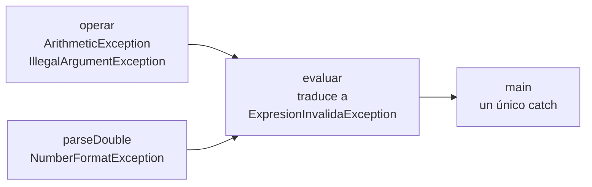

# Solución · Ejercicio 05 · Evaluador de expresiones

[⬅️ Enunciado](../../ejercicio-05-evaluador-de-expresiones/ENUNCIADO.md) · [Ejercicios del tema](../../README.md)

## Cómo pensarlo

El programa tiene tres capas y cada una habla "su idioma" de errores:



- **`operar`** solo sabe calcular. Usa las excepciones estándar de Java.
- **`evaluar`** sabe de líneas y expresiones. Captura los errores técnicos y los **envuelve** en una excepción propia que añade contexto (la línea) y conserva el original como **causa**.
- **`main`** solo necesita **un** `catch`: todo lo que puede ir mal llega como `ExpresionInvalidaException`.

## Código explicado

**Excepción con causa:**

```java
public ExpresionInvalidaException(String mensaje, int linea, Throwable causa) {
    super(mensaje, causa);
    this.linea = linea;
}
```

`Throwable` es la superclase de todas las excepciones, así que la causa puede ser de cualquier tipo. Si el programa terminara por esta excepción, la traza mostraría también un bloque `Caused by: ...` con la original.

**Lanzar desde un switch:**

```java
case "/" -> {
    if (b == 0) {
        throw new ArithmeticException("División por cero");
    }
    yield a / b;
}
case "^" -> Math.pow(a, b);
default -> throw new IllegalArgumentException("Operador desconocido: " + operador);
```

Con enteros, `8 / 0` lanza `ArithmeticException` sola. Con `double` da `Infinity`, y por eso la lanzamos nosotros.

**Traducir excepciones:**

```java
double a;
double b;
try {
    a = Double.parseDouble(partes[0]);
    b = Double.parseDouble(partes[2]);
} catch (NumberFormatException e) {
    throw new ExpresionInvalidaException("Número no válido", linea, e);
}
```

Después de este `try`, el compilador sabe que `a` y `b` tienen valor: o se asignaron, o el `catch` lanzó una excepción y nunca se llega a usarlas.

En el segundo `try`, el **multi-catch** `ArithmeticException | IllegalArgumentException` trata igual dos tipos que no tienen relación de herencia. Se permite porque ninguno es subclase del otro.

**Dos recursos y su cierre:**

```java
try (Scanner lector = new Scanner(expresiones);
     Informe informe = new Informe()) {
    ...
}   // Aquí se llama a informe.close() y después a lector.close()
```

El resumen no se escribe en el `main`: sale solo cuando el `try` termina, porque Java llama a `close()`. Se cierran en orden inverso a como se abrieron.

**Mostrar la causa:**

```java
String detalle = e.getMessage();
if (e.getCause() != null) {
    detalle = detalle + " (causa: " + e.getCause().getMessage() + ")";
}
```

Las expresiones con un número de elementos incorrecto no tienen causa (`getCause()` devuelve `null`), así que la comprobación evita un `NullPointerException`.

## Errores comunes

- `split(" ")` en lugar de `split(" +")` → con dos espacios seguidos aparecerían partes vacías.
- Capturar `IllegalArgumentException` **antes** que `NumberFormatException` en el mismo `try` → no compila. Aquí se evita usando dos `try` separados.
- Traducir la excepción sin pasar la causa → se pierde el mensaje original ("For input string...").
- Olvidar `implements AutoCloseable` → `Informe` no puede ir dentro del `try (...)`.

## Código completo

📄 [Sol15_05_EvaluadorDeExpresiones.java](Sol15_05_EvaluadorDeExpresiones.java)
