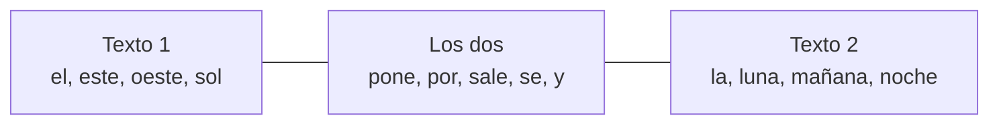

# Solución · Ejercicio 03 · Palabras únicas

[⬅️ Enunciado](../../ejercicio-03-palabras-unicas/ENUNCIADO.md) · [Ejercicios del tema](../../README.md)

## Cómo pensarlo

Todo el ejercicio gira en torno a una idea: **un `Set` no admite duplicados**. Elegir la implementación decide el orden en que salen:

| Necesito... | Uso |
|---|---|
| Las distintas, en el orden en que aparecen | `LinkedHashSet` |
| Las distintas, ordenadas | `TreeSet` |

Las comparaciones entre textos son operaciones de conjuntos de toda la vida:



## Código explicado

**Distintas en dos órdenes:**

```java
Set<String> enOrden = new LinkedHashSet<>(lista1);
Set<String> alfabetico = new TreeSet<>(lista1);
```

Crear un conjunto a partir de una lista añade todos sus elementos; los repetidos se descartan.

**Detectar repetidas con el resultado de `add`:**

```java
Set<String> vistas = new LinkedHashSet<>();
Set<String> repetidas = new TreeSet<>();
for (String palabra : palabras) {
    if (!vistas.add(palabra)) {      // false → ya estaba
        repetidas.add(palabra);
    }
}
```

`el` aparece cuatro veces, pero en `repetidas` solo está una: también es un conjunto.

**Intersección y diferencias:**

```java
Set<String> comunes = new TreeSet<>(set1);
comunes.retainAll(set2);             // Se queda solo con lo que también está en set2

Set<String> solo1 = new TreeSet<>(set1);
solo1.removeAll(set2);               // Quita todo lo que esté en set2
```

En el `TreeSet`, `mañana` aparece después de `luna` y antes de `noche` porque se compara letra a letra: `m` va entre `l` y `n`.

## Errores comunes

- Usar `HashSet` y esperar un orden concreto → el resultado puede salir en cualquier orden.
- Hacer `set1.retainAll(set2)` sin copiar → después `set1` ya no es el texto 1 y las diferencias salen mal.
- Contar las distintas con `lista1.size()` → eso son **todas** las palabras.

## Código completo

📄 [Sol16_03_PalabrasUnicas.java](Sol16_03_PalabrasUnicas.java)
