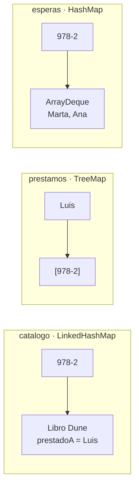

# Solución · Ejercicio 05 · Gestor de biblioteca

[⬅️ Enunciado](../../ejercicio-05-gestor-de-biblioteca/ENUNCIADO.md) · [Ejercicios del tema](../../README.md)

## Cómo pensarlo

Cada colección responde a una pregunta distinta, y por eso se elige una implementación distinta para cada una:



| Pregunta | Colección | Por qué esa implementación |
|---|---|---|
| ¿Qué libro tiene este ISBN? | `catalogo` | `LinkedHashMap`: el informe sale en el orden de alta |
| ¿Qué libros tiene este socio? | `prestamos` | `TreeMap`: el informe sale en orden alfabético de socios |
| ¿Quién es el siguiente en recibir este libro? | `esperas` | `HashMap`: solo se busca por clave, el orden no importa. Cada valor es una **cola** |

Hay **información duplicada a propósito**: el libro sabe a quién está prestado (`prestadoA`) y el socio sabe qué libros tiene (`prestamos`). Así las dos preguntas se responden sin recorrer nada, pero hay que mantenerlas **sincronizadas**: por eso prestar y devolver se hacen siempre a través de `entregar` y de `devolver`.

## Código explicado

**Prestar: una cadena de `if`/`else if` en el orden del enunciado:**

```java
Libro libro = catalogo.get(isbn);
if (libro == null) {
    mensaje = "✘ No existe el libro " + isbn;
} else if (socio.equals(libro.getPrestadoA())) {
    mensaje = "✘ " + socio + " ya tiene «" + libro.getTitulo() + "»";
} else if (librosDe(socio).size() >= MAX_PRESTAMOS) {
    ...
} else if (libro.getPrestadoA() == null) {
    entregar(socio, libro);
    ...
} else {
    Deque<String> cola = esperas.get(isbn);
    ...
    cola.offer(socio);
}
```

El orden importa: en la operación 13, Ana tiene 2 libros y uno de ellos es *Dune*. Como "ya lo tiene" se comprueba antes que "tiene el máximo", el mensaje es el más preciso.

**Devolver y atender la cola:**

```java
Deque<String> cola = esperas.get(isbn);
boolean entregado = false;
while (!cola.isEmpty() && !entregado) {
    String siguiente = cola.poll();               // Sale de la cola pase lo que pase
    if (librosDe(siguiente).size() < MAX_PRESTAMOS) {
        entregar(siguiente, libro);
        entregado = true;
    } else {
        // pierde su turno
    }
}
```

Traza de la operación 12 (Luis devuelve *Dune*, cola `[Marta, Ana]`):

| Vuelta | `poll()` | Libros que tiene | Resultado | Cola después |
|---|---|---|---|---|
| 1 | Marta | 2 | Pierde su turno | [Ana] |
| 2 | Ana | 1 | Se lo lleva → `entregado = true` | [] |

**El informe convierte ISBN en títulos:**

```java
for (Map.Entry<String, List<String>> par : prestamos.entrySet()) {
    List<String> titulos = new ArrayList<>();
    for (String isbn : par.getValue()) {
        titulos.add(catalogo.get(isbn).getTitulo());
    }
    ...
}
```

Luis aparece con `(ninguno)` porque su lista existe (se creó la primera vez que pidió un libro) aunque ahora esté vacía.

## Errores comunes

- `libro.getPrestadoA().equals(socio)` → `NullPointerException` cuando el libro está disponible.
- Actualizar `prestadoA` pero no la lista del socio (o al revés) → el informe y las reglas dejan de coincidir.
- Usar `remove(0)` o un `List` para la cola → funciona, pero `ArrayDeque` con `offer`/`poll` expresa mejor la idea y es más eficiente.
- `librosDe(socio).remove(isbn)`: aquí `remove` recibe un `String`, así que borra por **valor**. Con una `List<Integer>` habría que tener cuidado (sección 4 de la teoría).

## Código completo

📄 [Sol16_05_GestorDeBiblioteca.java](Sol16_05_GestorDeBiblioteca.java)
