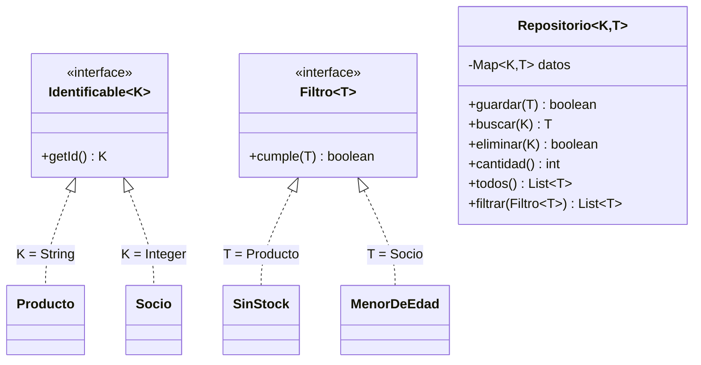

# Ejercicio 05 · Repositorio genérico

[⬅️ Ejercicios del tema](../README.md)

**Dificultad:** ⭐⭐⭐⭐⭐
**Conceptos:** todo el tema: interfaces genéricas, clase con dos parámetros de tipo y uno **acotado por otro** (`T extends Identificable<K>`), métodos genéricos acotados, comodines + `Map`, `Comparable` e interfaces

## Enunciado

Las aplicaciones reales guardan muchos tipos de datos (productos, socios, pedidos...) y casi siempre necesitan lo mismo: guardar, buscar por identificador, borrar, listar y filtrar. En lugar de escribir un "gestor" para cada tipo, vas a escribir **uno genérico** en [`Ej17_05_RepositorioGenerico.java`](Ej17_05_RepositorioGenerico.java).



1. **`Repositorio<K, T extends Identificable<K>>`**: `K` es el tipo de la clave y `T` el de los elementos, que **tienen que** saber dar su clave. Así el repositorio puede llamar a `elemento.getId()` sin saber qué es `T`. `guardar` no sustituye: si la clave ya existe, devuelve `false`.
2. **`Producto`** (clave `String`, se ordena por precio) y **`Socio`** (clave `Integer`, se ordena por nombre).
3. **Filtros**: `SinStock` y `MenorDeEdad`.
4. **`ordenados(coleccion)`**: método genérico acotado que devuelve una copia ordenada.
5. **`mostrar(titulo, lista)`**: con un comodín `List<?>`, para que sirva con cualquier lista.

## Salida esperada

```
Productos guardados: 4 (¿Ratón repetido? false)
Buscar P3: P3 · Monitor · 189,00 € · stock 4
Buscar P9: null
=== Productos por precio ===
  P4 · Alfombrilla · 8,75 € · stock 0
  P2 · Ratón · 19,50 € · stock 30
  P1 · Teclado · 59,90 € · stock 12
  P3 · Monitor · 189,00 € · stock 4
=== Productos sin stock ===
  P4 · Alfombrilla · 8,75 € · stock 0
¿Eliminado P4? true · quedan 3
=== Socios por nombre ===
  1002 · Andrés (17 años)
  1003 · Carmen (15 años)
  1001 · Lucía (34 años)
=== Socios menores de edad ===
  1002 · Andrés (17 años)
  1003 · Carmen (15 años)
Socio 1001: Lucía
```

Comprueba también que `socios.buscar("1001")` **no compila**: la clave de ese repositorio es `Integer`.

## Pistas

<details>
<summary>Pista 1</summary>

```java
static class Repositorio<K, T extends Identificable<K>> {
    private final Map<K, T> datos = new LinkedHashMap<>();
    ...
}
```

`LinkedHashMap` conserva el orden en que se guardaron, así que `todos()` y `filtrar()` devuelven los elementos en ese orden.

</details>

<details>
<summary>Pista 2</summary>

`Socio` guarda el número en un `int`, pero `getId()` tiene que devolver `Integer` (porque implementa `Identificable<Integer>`). Basta con `return numero;`: el autoboxing hace el resto.

</details>

<details>
<summary>Pista 3</summary>

`eliminar` puede aprovechar que `Map.remove` devuelve el valor borrado, o `null` si la clave no existía: `return datos.remove(id) != null;`.

</details>

<details>
<summary>Pista 4</summary>

Una clase puede implementar varias interfaces genéricas a la vez:

```java
static class Producto implements Identificable<String>, Comparable<Producto> { ... }
```

</details>

## Cómo ejecutarlo

```bash
java Ej17_05_RepositorioGenerico.java
```

---

✅ ¿Terminado? Compara con la [solución](../soluciones/ejercicio-05-repositorio-generico/SOLUCION.md).
