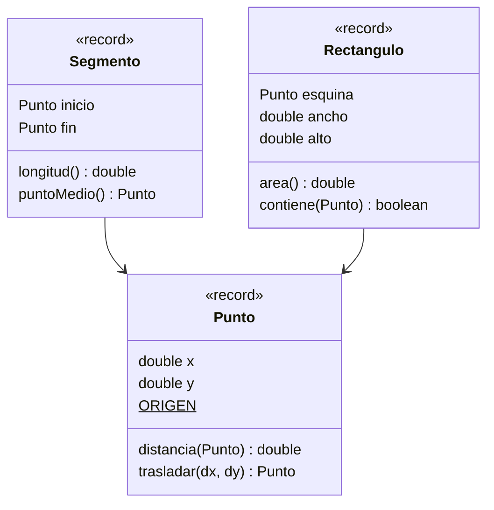

# Ejercicio 03 · Geometría con records

[⬅️ Ejercicios del tema](../README.md)

**Dificultad:** ⭐⭐⭐
**Conceptos:** `record`, accesores, constructor compacto para validar, métodos en un record, constantes `static`, records que contienen records, `equals`/`hashCode` automáticos

## Enunciado

En [`Ej18_03_GeometriaConRecords.java`](Ej18_03_GeometriaConRecords.java), crea tres records:



- `Punto.trasladar` no cambia el punto: devuelve uno **nuevo**.
- `Segmento` rechaza en su constructor compacto que los dos extremos sean el mismo punto.
- `Rectangulo` rechaza medidas que no sean positivas. `esquina` es la esquina inferior izquierda y los bordes cuentan como dentro.

Por último, comprueba con un `HashSet` cuántos puntos **distintos** hay en un recorrido.

## Salida esperada

```
p = Punto[x=3.0, y=4.0]
Distancia al origen: 5.0
p trasladado (+1, -2): Punto[x=4.0, y=2.0]
¿p sigue igual? Punto[x=3.0, y=4.0]
Segmento[inicio=Punto[x=0.0, y=0.0], fin=Punto[x=6.0, y=8.0]]
  Longitud: 10.0 · punto medio: Punto[x=3.0, y=4.0]
  ¿El punto medio es p? true
✘ Un segmento necesita dos puntos distintos
Rectángulo de 4.0 × 3.0 en Punto[x=1.0, y=1.0] · área 12.0
  ¿Contiene p? true
  ¿Contiene el origen? false
✘ Las medidas tienen que ser positivas: 0.0 × 2.0
Puntos del recorrido: 5 · distintos: 3
```

El recorrido es `[p, ORIGEN, (3, 4), (6, 8), (0, 0)]`.

## Pistas

<details>
<summary>Pista 1</summary>

Dentro de un record puedes usar los atributos directamente (`x`, `otro.x`) o con sus accesores (`x()`, `otro.x()`). Desde fuera, solo con los accesores.

</details>

<details>
<summary>Pista 2</summary>

El constructor compacto no lleva paréntesis:

```java
record Segmento(Punto inicio, Punto fin) {
    Segmento {
        if (inicio.equals(fin)) {
            throw new IllegalArgumentException("...");
        }
    }
}
```

</details>

<details>
<summary>Pista 3</summary>

No hace falta escribir `equals` ni `hashCode`: los records los generan comparando **todos** sus componentes. Por eso `s.puntoMedio().equals(p)` es `true` y el `HashSet` descarta los repetidos.

</details>

## Cómo ejecutarlo

```bash
java Ej18_03_GeometriaConRecords.java
```

---

✅ ¿Terminado? Compara con la [solución](../soluciones/ejercicio-03-geometria-con-records/SOLUCION.md).
