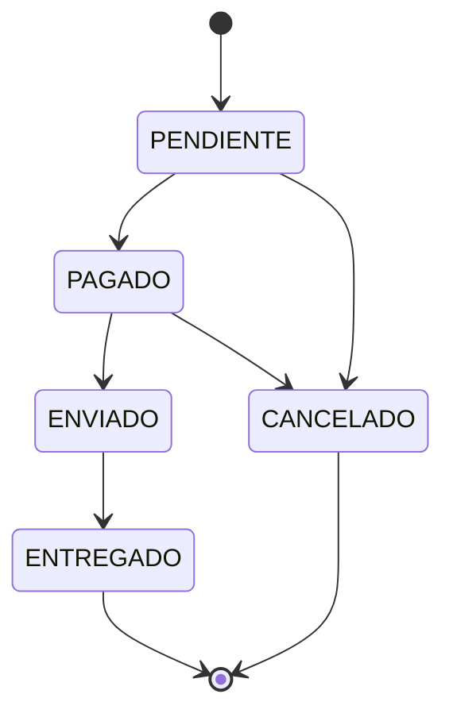

# Ejercicio 05 · Gestor de pedidos

[⬅️ Ejercicios del tema](../README.md)

**Dificultad:** ⭐⭐⭐⭐⭐
**Conceptos:** todo el tema: enum como **máquina de estados**, records validados, interfaz `sealed` con records, `switch` con **patrones de registro** y `case null`, `EnumMap` + clases, `static`, excepciones

## Enunciado

Una tienda online gestiona sus pedidos en [`Ej18_05_GestorDePedidos.java`](Ej18_05_GestorDePedidos.java). El `main` ya está hecho; completa las piezas.

**1. `EstadoPedido`: qué cambios de estado están permitidos.**



`puedePasarA(nuevo)` lo decide con un `switch (this)` exhaustivo. `Pedido.cambiarEstado(nuevo)` lanza `IllegalStateException("No se puede pasar de X a Y")` si el cambio no está permitido.

**2. `LineaPedido`** (record): su constructor compacto rechaza un producto vacío, un precio `<= 0` (`Precio no válido: X`) o una cantidad `<= 0` (`Cantidad no válida: X`).

**3. Descuentos.** La interfaz `sealed Descuento` solo admite tres records:

| Record | Descuento |
|---|---|
| `Porcentaje(porcentaje)` | `subtotal × porcentaje / 100` |
| `Fijo(euros)` | `euros`, pero nunca más que el subtotal |
| `TresPorDos(producto)` | Una unidad **gratis** de cada tres de ese producto |

Un pedido puede no tener descuento (`null`). Escribe `calcularDescuento` y `describir` con un `switch` que **desmonte** cada record (`case Porcentaje(double porcentaje) -> ...`) e incluya `case null`.

**4. `Pedido`**: subtotal, total y `mostrar()`. Si no hay descuento, la línea del resumen dice `sin descuento`.

**5. Resumen**: cuántos pedidos hay en cada estado (`EnumMap` con todos los estados) y la facturación de los que no están cancelados.

## Salida esperada

```
Pedido #1 [PENDIENTE]
  3 × Camiseta    15,00 € =  45,00 €
  1 × Gorra        9,50 € =   9,50 €
  Subtotal: 54,50 € · 3x2 en Camiseta: -15,00 € · Total: 39,50 €
Pedido #2 [PENDIENTE]
  2 × Libro       20,00 € =  40,00 €
  Subtotal: 40,00 € · 10 % de descuento: -4,00 € · Total: 36,00 €
Pedido #3 [PENDIENTE]
  1 × Taza         6,00 € =   6,00 €
  Subtotal: 6,00 € · 10,00 € de descuento: -6,00 € · Total: 0,00 €
Pedido #4 [PENDIENTE]
  4 × Cuaderno     2,50 € =  10,00 €
  Subtotal: 10,00 € · sin descuento · Total: 10,00 €
✘ Línea rechazada: Cantidad no válida: 0
=== Cambios de estado ===
  #1 → PAGADO
  #1 → ENVIADO
  #1 → ENTREGADO
  #2 ✘ No se puede pasar de PENDIENTE a ENVIADO
  #2 → CANCELADO
  #2 ✘ No se puede pasar de CANCELADO a PAGADO
  #3 → PAGADO
=== Resumen ===
Pedidos por estado: {PENDIENTE=1, PAGADO=1, ENVIADO=0, ENTREGADO=1, CANCELADO=1}
Facturación (sin cancelados): 49,50 €
```

## Pistas

<details>
<summary>Pista 1</summary>

```java
boolean puedePasarA(EstadoPedido nuevo) {
    return switch (this) {
        case PENDIENTE -> nuevo == PAGADO || nuevo == CANCELADO;
        ...
        case ENTREGADO, CANCELADO -> false;
    };
}
```

</details>

<details>
<summary>Pista 2</summary>

Un caso de un `switch` con patrones puede ser un bloque con `yield`:

```java
case TresPorDos(String producto) -> {
    double ahorro = 0;
    ...
    yield ahorro;
}
```

`linea.cantidad() / 3` es una división **entera**: con 3 camisetas sale 1 gratis; con 5, también 1.

</details>

<details>
<summary>Pista 3</summary>

Desde Java 21, un `switch` con patrones puede tratar el `null` en su propio caso: `case null -> 0;`. Sin él, un `switch` sobre `null` lanza `NullPointerException`.

</details>

<details>
<summary>Pista 4</summary>

Para que en el `EnumMap` aparezcan también los estados sin pedidos, mételos todos con valor 0 antes de contar:

```java
for (EstadoPedido e : EstadoPedido.values()) {
    porEstado.put(e, 0);
}
```

</details>

## Cómo ejecutarlo

```bash
java Ej18_05_GestorDePedidos.java
```

---

✅ ¿Terminado? Compara con la [solución](../soluciones/ejercicio-05-gestor-de-pedidos/SOLUCION.md).
