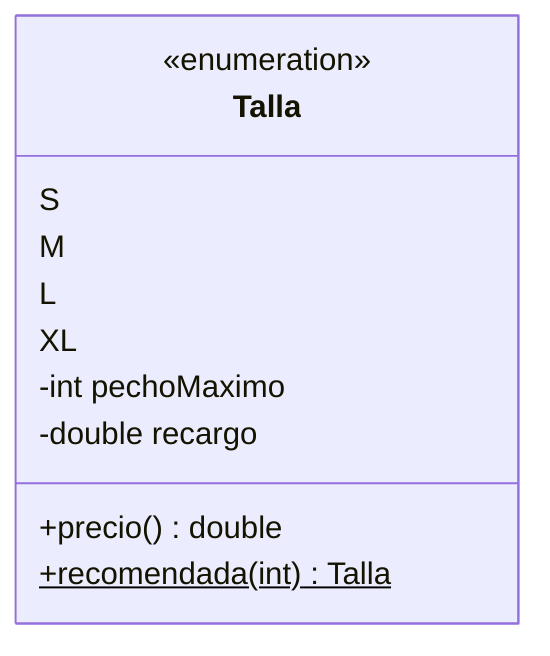

# Solución · Ejercicio 02 · Tienda de camisetas

[⬅️ Enunciado](../../ejercicio-02-tienda-de-camisetas/ENUNCIADO.md) · [Ejercicios del tema](../../README.md)

## Cómo pensarlo

Sin enums, los datos de las tallas acabarían en arrays paralelos (`String[] tallas`, `int[] pechos`, `double[] recargos`) y habría que mantenerlos sincronizados a mano. Con un enum, **cada talla lleva sus propios datos** y sus propios cálculos:



## Código explicado

**Constantes con datos:**

```java
enum Talla {
    S(92, 0.0),
    M(100, 0.0),
    L(108, 1.5),
    XL(116, 3.0);

    private final int pechoMaximo;
    private final double recargo;

    Talla(int pechoMaximo, double recargo) {
        this.pechoMaximo = pechoMaximo;
        this.recargo = recargo;
    }
    ...
}
```

Cada `S(92, 0.0)` es una llamada al constructor. Java crea los cuatro objetos una sola vez, al cargar el enum.

**Buscar recorriendo `values()`:**

```java
static Talla recomendada(int contornoPecho) {
    Talla[] tallas = values();
    Talla elegida = null;
    for (int i = 0; i < tallas.length && elegida == null; i++) {
        if (contornoPecho <= tallas[i].pechoMaximo) {
            elegida = tallas[i];
        }
    }
    return elegida == null ? XL : elegida;
}
```

Funciona porque las constantes están declaradas de **menor a mayor**: `values()` las devuelve en ese orden.

**Dos errores, dos `catch`:**

```java
try {
    Talla talla = Talla.valueOf(partes[0].toUpperCase());
    int cantidad = Integer.parseInt(partes[1]);
    ...
} catch (NumberFormatException e) {
    System.out.println("✘ \"" + linea + "\": cantidad no válida");
} catch (IllegalArgumentException e) {
    System.out.println("✘ \"" + linea + "\": talla desconocida");
}
```

## Errores comunes

- Olvidar el `;` después de `XL(116, 3.0)` → error de compilación en los atributos.
- Poner `public` al constructor del enum → error: los constructores de un enum solo pueden ser privados.
- Invertir el orden de los `catch` → no compila (el de `NumberFormatException` sería inalcanzable).

## Código completo

📄 [Sol18_02_TiendaDeCamisetas.java](Sol18_02_TiendaDeCamisetas.java)
