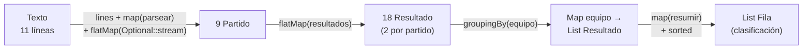

# Ejercicio 05 · Clasificación de liga

[⬅️ Ejercicios del tema](../README.md)

**Dificultad:** ⭐⭐⭐⭐⭐
**Conceptos:** todo el tema: leer y validar datos con `Optional`, `flatMap` (también con `Optional::stream`), `groupingBy`, resumir grupos con streams, `Comparator` de cuatro criterios, `max`, `average`, `joining` + records y excepciones

## Enunciado

En [`Ej19_05_ClasificacionDeLiga.java`](Ej19_05_ClasificacionDeLiga.java) tienes los resultados de una liga como texto (`local;visitante;golesLocal;golesVisitante`), con **dos líneas mal escritas**. Construye la clasificación usando streams.



1. **`parsear(linea)`** devuelve un `Optional<Partido>`: vacío si la línea no tiene 4 campos o si los goles no son números.
2. **`resultados(partido)`** devuelve un `Stream` con **dos** `Resultado`: el del local y el del visitante (desde el punto de vista de cada uno, sus goles a favor y en contra).
3. **`resumir(equipo, resultados)`** calcula la `Fila` del equipo: partidos jugados, ganados, empatados, perdidos, goles a favor y en contra. La `Fila` ya sabe calcular sus puntos (victoria 3, empate 1) y su diferencia de goles.
4. **`clasificacion(partidos)`**: agrupa los resultados por equipo, resume cada grupo y ordena por **puntos**, **diferencia de goles** y **goles a favor** (los tres de mayor a menor) y, si todo empata, por **nombre**.
5. En el `main`, muestra la tabla y algunos datos extra.

## Salida esperada

```
Partidos leídos: 9 · líneas descartadas: 2
=== Clasificación ===
   Equipo     PJ  G  E  P  GF  GC  DG  Pts
1. Atlético    5  3  1  1   9   5  +4   10
2. Betis       5  2  2  1   9   6  +3    8
3. Rayo        3  0  3  0   3   3  +0    3
4. Celta       5  0  2  3   3  10  -7    2
Partido con más goles: Betis 3-1 Celta (4)
Media de goles por partido: 2,67
Empates: 4
Invictos: Rayo
Ganaron fuera de casa: [Atlético]
```

El formato de cada fila es `"%d. %-9s %3d %2d %2d %2d %3d %3d %+3d %4d%n"` (`%+d` muestra siempre el signo).

## Pistas

<details>
<summary>Pista 1</summary>

`Optional::stream` convierte un `Optional` en un stream de 0 o 1 elementos. Con `flatMap`, los vacíos desaparecen solos:

```java
datos.lines()
        .map(Ej19_05_ClasificacionDeLiga::parsear)
        .flatMap(Optional::stream)
        .toList();
```

</details>

<details>
<summary>Pista 2</summary>

```java
static Stream<Resultado> resultados(Partido p) {
    return Stream.of(
            new Resultado(p.local(), p.golesLocal(), p.golesVisitante()),
            new Resultado(p.visitante(), p.golesVisitante(), p.golesLocal()));
}
```

Con `flatMap(...::resultados)`, cada partido se convierte en dos resultados y todos acaban en el mismo stream.

</details>

<details>
<summary>Pista 3</summary>

Contar con un stream devuelve `long`; la `Fila` guarda `int`: `(int) resultados.stream().filter(Resultado::ganado).count()`.

</details>

<details>
<summary>Pista 4</summary>

Para que cada criterio vaya de mayor a menor por separado, invierte cada uno dentro de su `thenComparing`:

```java
Comparator.comparingInt(Fila::puntos).reversed()
        .thenComparing(Comparator.comparingInt(Fila::diferencia).reversed())
        ...
```

</details>

## Cómo ejecutarlo

```bash
java Ej19_05_ClasificacionDeLiga.java
```

---

✅ ¿Terminado? Compara con la [solución](../soluciones/ejercicio-05-clasificacion-de-liga/SOLUCION.md).
