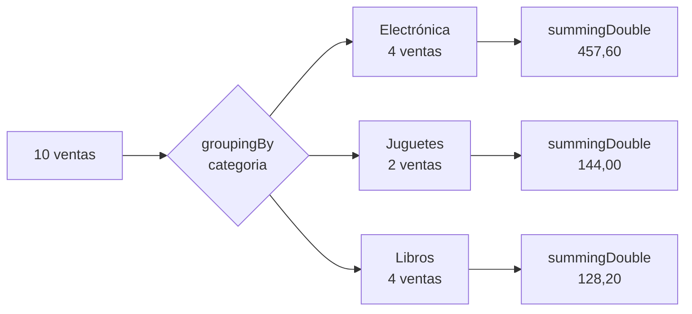

# Solución · Ejercicio 04 · Análisis de ventas

[⬅️ Enunciado](../../ejercicio-04-analisis-de-ventas/ENUNCIADO.md) · [Ejercicios del tema](../../README.md)

## Cómo pensarlo

Casi todo el informe es la misma pregunta con distintas palabras: **"agrupa por X y resume cada grupo con Y"**. `groupingBy` responde exactamente a eso:



| Pregunta | Agrupar por | Resumir con | Mapa |
|---|---|---|---|
| Facturación por categoría | `categoria` | `summingDouble(importe)` | `TreeMap` (alfabético) |
| Unidades por mes | `mes` | `summingInt(unidades)` | `LinkedHashMap` (orden de los datos) |
| Productos por categoría | `categoria` | `mapping(producto, toCollection(TreeSet::new))` | `TreeMap` |
| Grandes y pequeñas | `importe > 100` | `counting()` | `partitioningBy` |

Compáralo con el tema 16: cada una de estas líneas sustituye a un bucle con `containsKey`, `put` y `getOrDefault`.

## Código explicado

**Agrupar y resumir:**

```java
return ventas.stream().collect(Collectors.groupingBy(
        Venta::categoria, TreeMap::new, Collectors.summingDouble(Venta::importe)));
```

`TreeMap::new` es una referencia a constructor: le dice a `groupingBy` qué tipo de mapa crear.

**Ordenar un mapa por sus valores:**

```java
Map<String, Double> porProducto = ventas.stream().collect(Collectors.groupingBy(
        Venta::producto, Collectors.summingDouble(Venta::importe)));
return porProducto.entrySet().stream()
        .sorted(Map.Entry.comparingByValue(Comparator.reverseOrder()))
        .limit(cuantos)
        .toList();
```

Un mapa no se puede ordenar por valor, pero sus **pares** (`entrySet()`) sí se pueden meter en un stream y ordenar. Es la misma idea que la clase `Frecuencia` del tema 16, sin crear ninguna clase.

**Un resultado que puede no existir:**

```java
static Optional<Venta> mayorVentaDe(List<Venta> ventas, String categoria) {
    return ventas.stream()
            .filter(v -> v.categoria().equals(categoria))
            .max(Comparator.comparingInt(Venta::unidades));
}
```

Para "Juegos de mesa", el `filter` no deja pasar nada y `max` devuelve un `Optional` vacío. Quien lo usa decide qué mostrar con `orElse("sin ventas")`, sin ningún `null`.

**Dos mapas con las mismas claves:**

```java
unidades.forEach((mes, uds) -> System.out.printf("%-8s %3d uds. · %7.2f €%n", mes, uds, importes.get(mes)));
```

## Errores comunes

- `groupingBy(Venta::mes)` sin indicar el mapa → crea un `HashMap` y los meses pueden salir en cualquier orden.
- `summingInt(Venta::importe)` → no compila: `importe()` devuelve `double`, hace falta `summingDouble`.
- `mayorVentaDe(...).get()` → `NoSuchElementException` para "Juegos de mesa".
- `sorted(Map.Entry.comparingByValue())` sin `reverseOrder()` → el top saldría con los **menos** vendidos.

## Código completo

📄 [Sol19_04_AnalisisDeVentas.java](Sol19_04_AnalisisDeVentas.java)
