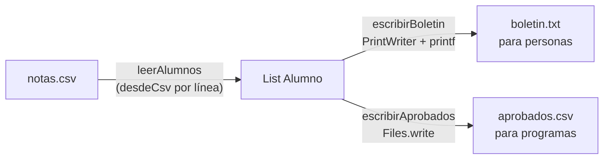

# Solución · Ejercicio 03 · Boletín desde CSV

[⬅️ Enunciado](../../ejercicio-03-boletin-desde-csv/ENUNCIADO.md) · [Ejercicios del tema](../../README.md)

## Cómo pensarlo

El programa es una pequeña "tubería" de datos:



Cada pieza hace una sola cosa. `desdeCsv` no sabe nada de ficheros ni de números de línea: solo convierte texto en un alumno (o lanza una excepción). `leerAlumnos` sabe de líneas y decide qué hacer con los errores. Es la misma idea que el importador de productos del tema 15, ahora leyendo de un fichero real.

## Código explicado

**De línea a objeto, lanzando excepciones:**

```java
static Alumno desdeCsv(String linea) {
    String[] partes = linea.split(";");
    if (partes.length != 4) {
        throw new IllegalArgumentException("faltan campos");
    }
    return new Alumno(partes[0], Double.parseDouble(partes[1]),
            Double.parseDouble(partes[2]), Double.parseDouble(partes[3]));
}
```

**Un `try` por línea:**

```java
List<String> lineas = Files.readAllLines(ruta);
for (int i = 1; i < lineas.size(); i++) {
    try {
        alumnos.add(Alumno.desdeCsv(lineas.get(i)));
    } catch (NumberFormatException e) {
        System.out.println("⚠ Línea " + (i + 1) + " ignorada: nota no válida (" + lineas.get(i) + ")");
    } catch (IllegalArgumentException e) {
        System.out.println("⚠ Línea " + (i + 1) + " ignorada: " + e.getMessage() + " (" + lineas.get(i) + ")");
    }
}
```

`i` es la posición en la lista (empezando en 0) y `i + 1` es el número de línea en el fichero.

**Dos salidas, dos formatos:**

```java
// Para personas: printf (coma decimal, columnas)
salida.printf("%-8s %5.2f %5.2f %5.2f %6.2f %s%n", ...);

// Para programas: concatenación (punto decimal)
lineas.add(a.nombre() + ";" + Math.round(a.media() * 100) / 100.0);
Files.write(destino, lineas);
```

Si `aprobados.csv` se escribiera con `printf`, contendría `8,17` y otro programa que usara `Double.parseDouble` no podría leerlo.

## Errores comunes

- Empezar el bucle en 0 → la cabecera produce un aviso de "nota no válida" (`"matematicas"` no es un número).
- Un único `try` fuera del bucle → la primera línea incorrecta detiene la lectura de todas las demás.
- Olvidar cerrar el `PrintWriter` → `boletin.txt` puede quedarse vacío.
- Guardar las notas como `int` → `8.5` o `9.25` lanzarían `NumberFormatException` con `Integer.parseInt`.

## Código completo

📄 [Sol20_03_BoletinDesdeCsv.java](Sol20_03_BoletinDesdeCsv.java)
