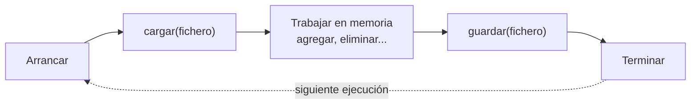

# Solución · Ejercicio 04 · Agenda persistente

[⬅️ Enunciado](../../ejercicio-04-agenda-persistente/ENUNCIADO.md) · [Ejercicios del tema](../../README.md)

## Cómo pensarlo

Un programa con datos persistentes sigue siempre el mismo ciclo:



Mientras el programa funciona, los datos viven en memoria (el `TreeMap`). El fichero solo se toca al **empezar** y al **terminar**. Por eso cada "sesión" del `main` crea una agenda nueva con `cargar`: así se comprueba que de verdad todo pasa por el disco.

## Código explicado

**Cargar, tolerando la primera ejecución:**

```java
static Agenda cargar(Path ruta) throws IOException {
    Agenda agenda = new Agenda();
    if (Files.exists(ruta)) {
        List<String> lineas = Files.readAllLines(ruta);
        for (int i = 1; i < lineas.size(); i++) {
            agenda.agregar(Contacto.desdeCsv(lineas.get(i)));
        }
    }
    return agenda;
}
```

Es un método `static` "de fábrica": crea y devuelve un objeto ya rellenado.

**Guardar con copia de seguridad:**

```java
void guardar(Path ruta, Path copia) throws IOException {
    if (Files.exists(ruta)) {
        Files.copy(ruta, copia, StandardCopyOption.REPLACE_EXISTING);
    }
    List<String> lineas = new ArrayList<>();
    lineas.add(CABECERA);
    for (Contacto c : contactos.values()) {
        lineas.add(c.aCsv());
    }
    Files.write(ruta, lineas);
}
```

Si al escribir algo saliera mal (por ejemplo, se va la luz a mitad), la versión anterior sigue en `agenda.bak`. Muchos programas reales hacen algo parecido.

**El record sabe convertirse:**

```java
record Contacto(String nombre, String telefono, String email) {
    String aCsv() {
        return nombre + ";" + telefono + ";" + email;
    }

    static Contacto desdeCsv(String linea) {
        String[] partes = linea.split(";");
        return new Contacto(partes[0], partes[1], partes[2]);
    }
}
```

Tener `aCsv` y `desdeCsv` juntos, en la misma clase, garantiza que el formato de escritura y el de lectura coinciden.

## Errores comunes

- Capturar `NoSuchFileException` para la primera ejecución → funciona, pero usa una excepción para un caso normal.
- Guardar sin cabecera y cargar saltando la primera línea → se pierde un contacto cada vez.
- `Files.copy` sin `REPLACE_EXISTING` → falla a partir del segundo guardado.
- Reutilizar el mismo objeto `Agenda` entre sesiones → el programa parece funcionar aunque `guardar` o `cargar` estén mal.

## Código completo

📄 [Sol20_04_AgendaPersistente.java](Sol20_04_AgendaPersistente.java)
