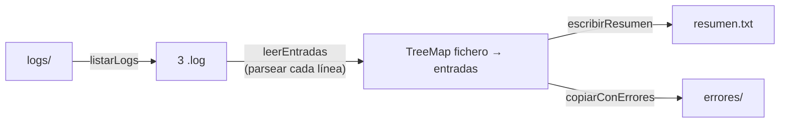

# Solución · Ejercicio 05 · Analizador de logs

[⬅️ Enunciado](../../ejercicio-05-analizador-de-logs/ENUNCIADO.md) · [Ejercicios del tema](../../README.md)

## Cómo pensarlo

El programa mezcla tres tipos de trabajo, y conviene mantenerlos separados:

| Tipo | Métodos | Herramientas |
|---|---|---|
| **Entrada** (leer del disco) | `listarLogs`, `leerEntradas` | `Files.list`, `Files.lines`, try-with-resources |
| **Lógica** (interpretar y calcular) | `Entrada.parsear`, los cálculos del resumen | records, enums, `Optional`, streams, `groupingBy` |
| **Salida** (escribir en el disco) | `escribirResumen`, `copiarConErrores` | `PrintWriter`, `createDirectories`, `copy` |



## Código explicado

**Interpretar una línea sin lanzar nada hacia fuera:**

```java
static Optional<Entrada> parsear(String linea) {
    Optional<Entrada> resultado = Optional.empty();
    String[] partes = linea.split(" ", 5);
    if (partes.length == 5 && partes[3].startsWith("[") && partes[3].endsWith("]")) {
        try {
            Nivel nivel = Nivel.valueOf(partes[2]);
            String modulo = partes[3].substring(1, partes[3].length() - 1);
            resultado = Optional.of(new Entrada(partes[0], partes[1], nivel, modulo, partes[4]));
        } catch (IllegalArgumentException e) {
            resultado = Optional.empty();
        }
    }
    return resultado;
}
```

El nivel se convierte con `valueOf` del enum (tema 18): `DEBUG` no existe y lanza `IllegalArgumentException`.

**Streams de ficheros, siempre cerrados:**

```java
List<String> lineas;
try (Stream<String> stream = Files.lines(fichero)) {
    lineas = stream.filter(l -> !l.isBlank()).toList();
}
List<Entrada> validas = lineas.stream()
        .map(Entrada::parsear)
        .flatMap(Optional::stream)
        .toList();
return new Lectura(validas, lineas.size() - validas.size());
```

Se recogen las líneas dentro del `try` y se procesan fuera: así el fichero se cierra cuanto antes. El record `Lectura` permite devolver dos datos a la vez.

**Un fichero que falla no detiene a los demás:**

```java
for (Path fichero : ficheros) {
    try {
        Lectura lectura = leerEntradas(fichero);
        porFichero.put(fichero, lectura.validas());
        descartadas += lectura.descartadas();
    } catch (IOException e) {
        System.out.println("✘ No se pudo leer " + fichero.getFileName() + ": " + e.getMessage());
    }
}
```

**Resumir con streams y escribir con `PrintWriter`:**

```java
Map<String, Long> erroresPorModulo = todas.stream()
        .filter(e -> e.nivel() == Nivel.ERROR)
        .collect(Collectors.groupingBy(Entrada::modulo, TreeMap::new, Collectors.counting()));

try (PrintWriter salida = new PrintWriter(Files.newBufferedWriter(destino))) {
    ...
    salida.println("Errores por módulo: " + erroresPorModulo);
}
```

**Copiar los ficheros con errores:**

```java
Files.createDirectories(destino);
...
if (par.getValue().stream().anyMatch(e -> e.nivel() == Nivel.ERROR)) {
    Files.copy(origen, destino.resolve(origen.getFileName()), StandardCopyOption.REPLACE_EXISTING);
}
```

`destino.resolve(origen.getFileName())` construye `errores/lunes.log`: el mismo nombre, en otra carpeta.

## Errores comunes

- `split(" ")` sin límite → el mensaje `Tarjeta rechazada` se parte en dos y `partes.length` es 6.
- Usar `Files.list` o `Files.lines` sin try-with-resources → en Windows, la carpeta temporal no se puede borrar al final porque sigue abierta.
- No filtrar por `.log` → `leeme.txt` se analiza y suma una línea descartada más.
- Lanzar `Files.lines` dentro de un `map` de otro stream → no compila sin un `try` dentro de la lambda (las lambdas no pueden lanzar excepciones checked).
- Usar `Files.copy` sin crear antes la carpeta `errores` → `NoSuchFileException`.

## Código completo

📄 [Sol20_05_AnalizadorDeLogs.java](Sol20_05_AnalizadorDeLogs.java)
