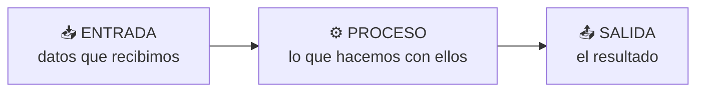
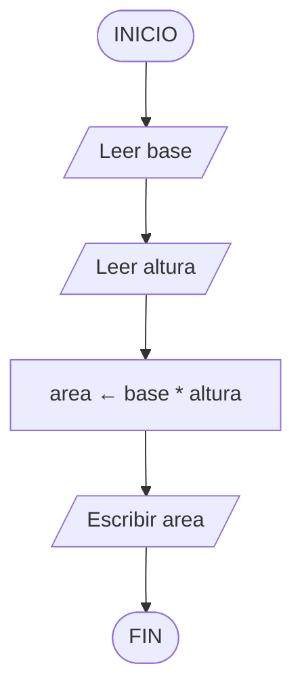
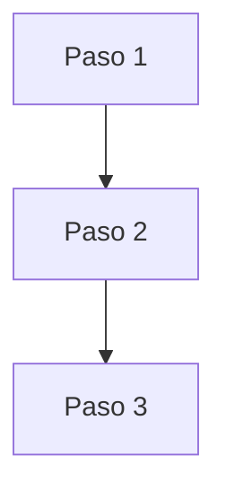
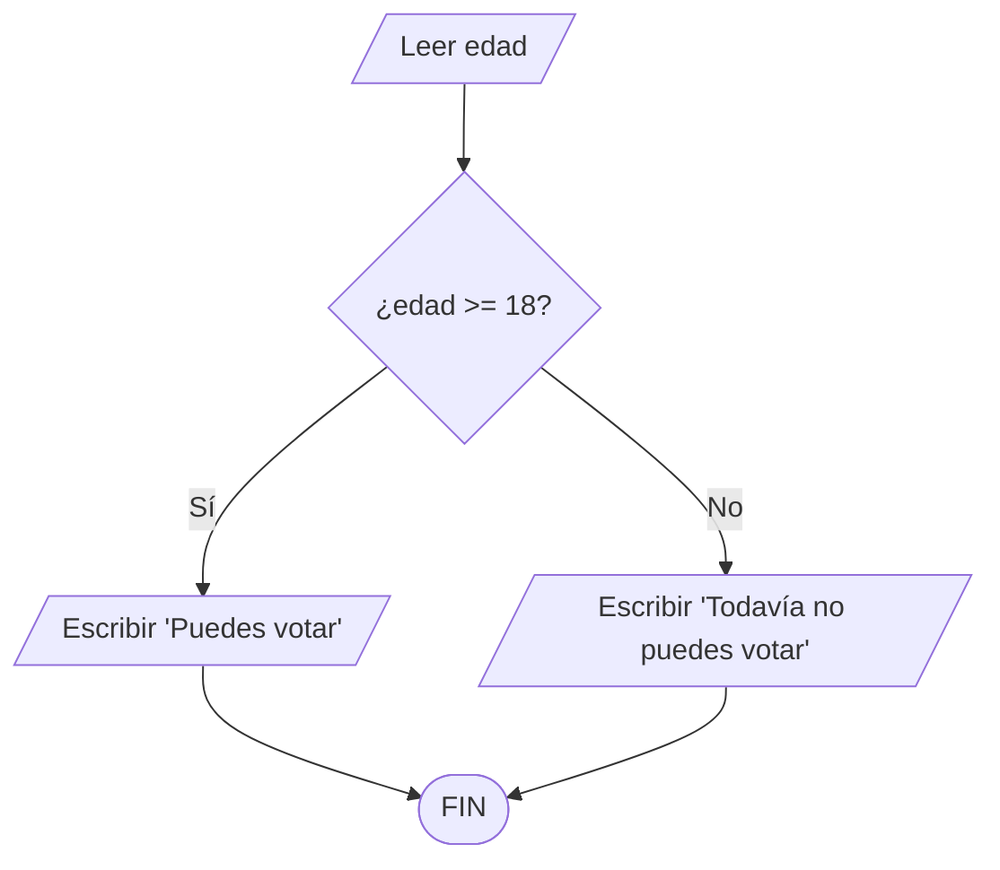
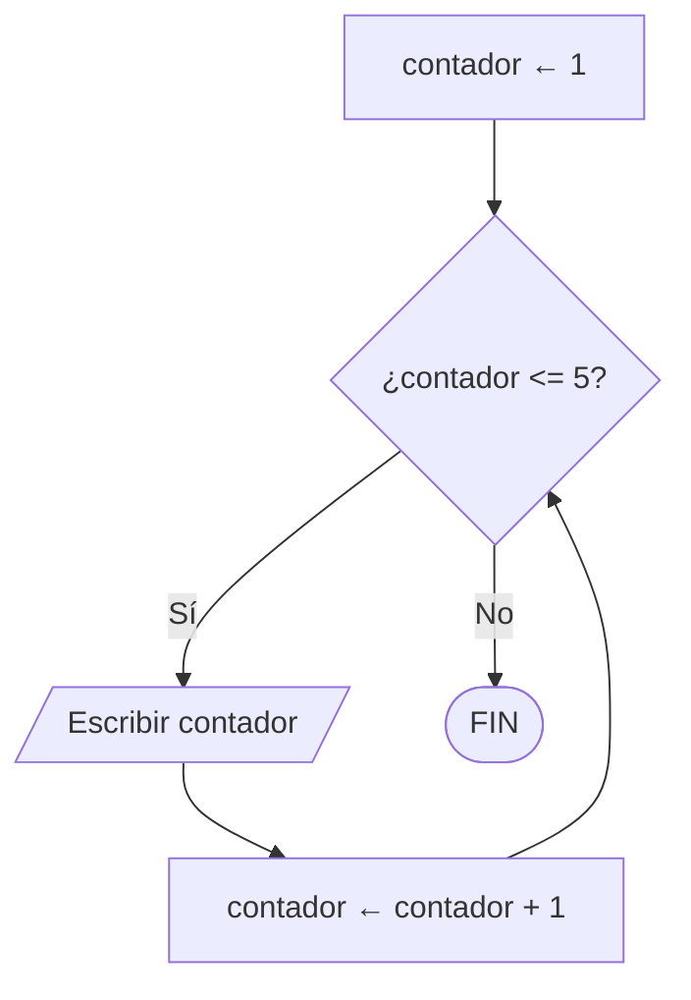

# Tema 01 · Lógica de programación

[🏠 Índice](../../INDICE.md) · [Siguiente tema ➡️](../02-entorno-y-primer-programa/README.md)

Antes de escribir código hay que aprender a **pensar como un programador**: dividir un problema en pasos pequeños, claros y ordenados. En este tema verás esa forma de pensar y, a la vez, un primer vistazo a cómo se escribe en Java. No te preocupes por entender cada símbolo del código todavía; lo importante es la **lógica**.

## 🎯 Objetivos

- Entender qué es programar y qué es un algoritmo.
- Describir un problema como **entrada → proceso → salida**.
- Escribir algoritmos en **pseudocódigo** y leer **diagramas de flujo**.
- Reconocer las tres estructuras básicas: **secuencia**, **decisión** y **repetición**.
- Hacer la **traza** de un algoritmo (seguirlo paso a paso a mano).
- Ver cómo se traduce todo eso a Java.

## 📚 Contenido

1. [¿Qué es programar?](#1-qué-es-programar)
2. [¿Qué es un algoritmo?](#2-qué-es-un-algoritmo)
3. [Entrada, proceso y salida](#3-entrada-proceso-y-salida)
4. [Pseudocódigo](#4-pseudocódigo)
5. [Diagramas de flujo](#5-diagramas-de-flujo)
6. [Variables: cajas con nombre](#6-variables-cajas-con-nombre)
7. [Las tres estructuras básicas](#7-las-tres-estructuras-básicas)
8. [La traza: ejecutar a mano](#8-la-traza-ejecutar-a-mano)
9. [Del pseudocódigo a Java](#9-del-pseudocódigo-a-java)
10. [Errores típicos al pensar un algoritmo](#10-errores-típicos-al-pensar-un-algoritmo)
11. [Resumen](#11-resumen)

---

## 1. ¿Qué es programar?

Un ordenador es muy rápido, pero **no piensa**. Solo sabe seguir instrucciones al pie de la letra. Programar es escribir esas instrucciones en un idioma que el ordenador pueda entender: un **lenguaje de programación**, como Java.

Piensa en un GPS. Tú le dices a dónde quieres ir y él te da instrucciones exactas: *"gira a la derecha"*, *"sigue recto 200 metros"*. Si una instrucción fuera ambigua (*"gira por ahí"*), te perderías. Con el ordenador pasa lo mismo: cada instrucción debe ser **precisa**.

> 💡 El ordenador hace exactamente lo que le dices, no lo que *quieres decir*. La mayoría de errores al programar vienen de esa diferencia.

## 2. ¿Qué es un algoritmo?

Un **algoritmo** es una lista ordenada de pasos para resolver un problema. Usamos algoritmos todo el tiempo sin darnos cuenta: una receta de cocina, las instrucciones de un mueble o la forma de atarte los zapatos.

Un buen algoritmo tiene que ser:

| Característica | Significado | Ejemplo malo ❌ | Ejemplo bueno ✅ |
|---|---|---|---|
| **Preciso** | Cada paso indica exactamente qué hacer | "Echa algo de sal" | "Echa 5 gramos de sal" |
| **Definido** | Con los mismos datos, da siempre el mismo resultado | "Elige un número que te guste" | "Usa el número que te dé el usuario" |
| **Finito** | Termina en algún momento | "Repite para siempre" | "Repite 10 veces" |

Ejemplo de algoritmo cotidiano, **preparar un vaso de leche con cacao**:

```
1. Coger un vaso
2. Llenar el vaso de leche
3. Echar dos cucharadas de cacao
4. Remover hasta que no queden grumos
5. Beber
```

Fíjate en que el **orden importa**: si bebes antes de echar la leche, el algoritmo no funciona.

## 3. Entrada, proceso y salida

Casi todos los programas siguen el mismo esquema:



| Problema | Entrada | Proceso | Salida |
|---|---|---|---|
| Calcular el área de un rectángulo | base y altura | multiplicar base × altura | el área |
| Saber si puedo votar | mi edad | comparar la edad con 18 | "Sí" o "No" |
| Hacer un batido | fruta, leche | triturar | el batido |

Antes de programar, pregúntate siempre: **¿qué datos tengo?, ¿qué tengo que hacer con ellos? y ¿qué quiero obtener?**

## 4. Pseudocódigo

El **pseudocódigo** es una forma de escribir algoritmos con palabras normales pero con una estructura parecida a la de un programa. No lo entiende el ordenador; sirve para **pensar** sin preocuparse por la sintaxis de un lenguaje concreto.

```
INICIO
    ESCRIBIR "¿Cuál es la base?"
    LEER base
    ESCRIBIR "¿Cuál es la altura?"
    LEER altura
    area ← base * altura
    ESCRIBIR "El área es ", area
FIN
```

Palabras que usaremos en pseudocódigo:

| Palabra | Significado |
|---|---|
| `INICIO` / `FIN` | Principio y final del algoritmo |
| `LEER x` | Pedir un dato y guardarlo en `x` |
| `ESCRIBIR ...` | Mostrar algo por pantalla |
| `x ← valor` | Guardar un valor en `x` (asignación) |
| `SI ... ENTONCES ... SINO ... FIN SI` | Decisión |
| `MIENTRAS ... HACER ... FIN MIENTRAS` | Repetición |

## 5. Diagramas de flujo

Un **diagrama de flujo** es un dibujo del algoritmo. Cada forma tiene un significado:

| Forma | Significado |
|---|---|
| Óvalo / rectángulo redondeado | Inicio o fin |
| Rectángulo | Una acción o cálculo |
| Paralelogramo | Entrada o salida de datos |
| Rombo | Una pregunta (decisión): sale un camino para *sí* y otro para *no* |
| Flechas | El orden en que se siguen los pasos |

El algoritmo del área del rectángulo como diagrama:



## 6. Variables: cajas con nombre

Para recordar datos, los programas usan **variables**. Imagina una variable como una **caja con una etiqueta**: la etiqueta es el nombre y dentro guardas un valor.

```
edad ← 15        La caja "edad" guarda 15
edad ← edad + 1  Sacamos 15, le sumamos 1 y guardamos 16 en la misma caja
```

- Una caja solo guarda **un valor a la vez**. Si metes uno nuevo, el anterior desaparece.
- El nombre debe explicar qué guarda: `edad` es mejor que `x`.

En Java, además, cada caja tiene un **tipo** que indica qué puede guardar: números enteros (`int`), números con decimales (`double`), texto (`String`)... Lo verás a fondo en el [tema 03](../03-variables-y-tipos-de-datos/README.md).

```java
int edad = 15;          // Caja "edad" para números enteros, con un 15 dentro
edad = edad + 1;        // Ahora guarda 16
String nombre = "Ana";  // Caja "nombre" para texto
```

## 7. Las tres estructuras básicas

Cualquier programa, por complicado que sea, se construye combinando solo **tres estructuras**.

### 7.1 Secuencia

Los pasos se ejecutan **uno detrás de otro**, en orden, de arriba abajo.



```
INICIO
    ESCRIBIR "Buenos días"
    ESCRIBIR "Hoy aprendemos a programar"
FIN
```

### 7.2 Decisión (condicional)

El programa **elige un camino** según si una condición es verdadera o falsa.



```
SI edad >= 18 ENTONCES
    ESCRIBIR "Puedes votar"
SINO
    ESCRIBIR "Todavía no puedes votar"
FIN SI
```

Una condición es una pregunta que solo puede responderse con **verdadero** o **falso**: *¿edad es mayor o igual que 18?*, *¿la contraseña es correcta?*

### 7.3 Repetición (bucle)

Un grupo de pasos se **repite mientras** se cumpla una condición.



```
contador ← 1
MIENTRAS contador <= 5 HACER
    ESCRIBIR contador
    contador ← contador + 1
FIN MIENTRAS
```

> ⚠️ Dentro del bucle tiene que cambiar algo que, tarde o temprano, haga **falsa** la condición. Si no, el bucle nunca termina (**bucle infinito**).

> 📏 **Regla del repositorio:** un bucle termina únicamente porque su condición se vuelve falsa. No usaremos `continue` y solo usaremos `break` dentro de un `switch` (lo verás en el tema 06). Si necesitas salir antes de tiempo, añade esa idea a la condición, por ejemplo con una variable `encontrado`.

### 7.4 Combinándolas

Las estructuras se pueden meter unas dentro de otras. Por ejemplo, una decisión dentro de un bucle:

```
numero ← 1
MIENTRAS numero <= 10 HACER
    SI numero es par ENTONCES
        ESCRIBIR numero, " es par"
    SINO
        ESCRIBIR numero, " es impar"
    FIN SI
    numero ← numero + 1
FIN MIENTRAS
```

## 8. La traza: ejecutar a mano

Hacer una **traza** es seguir el algoritmo paso a paso con papel y lápiz, anotando el valor de cada variable. Es la mejor herramienta para entender un algoritmo y para encontrar errores.

Algoritmo:

```
suma ← 0
n ← 1
MIENTRAS n <= 4 HACER
    suma ← suma + n
    n ← n + 1
FIN MIENTRAS
ESCRIBIR suma
```

Traza:

| Vuelta | `n` al empezar | ¿`n <= 4`? | `suma` después | `n` después |
|---|---|---|---|---|
| 1 | 1 | Sí | 0 + 1 = 1 | 2 |
| 2 | 2 | Sí | 1 + 2 = 3 | 3 |
| 3 | 3 | Sí | 3 + 3 = 6 | 4 |
| 4 | 4 | Sí | 6 + 4 = 10 | 5 |
| — | 5 | **No** → sale | 10 | 5 |

Se escribe **10**. El algoritmo suma 1 + 2 + 3 + 4.

## 9. Del pseudocódigo a Java

Todo lo anterior se traduce casi palabra por palabra a Java:

| Pseudocódigo | Java |
|---|---|
| `ESCRIBIR "Hola"` | `System.out.println("Hola");` |
| `edad ← 15` | `int edad = 15;` |
| `SI edad >= 18 ENTONCES ... SINO ... FIN SI` | `if (edad >= 18) { ... } else { ... }` |
| `MIENTRAS n <= 5 HACER ... FIN MIENTRAS` | `while (n <= 5) { ... }` |

El algoritmo de la traza anterior en Java:

```java
int suma = 0;
int n = 1;
while (n <= 4) {
    suma = suma + n;
    n = n + 1;
}
System.out.println(suma); // Muestra 10
```

Todo programa de Java necesita además un "envoltorio" (la `class` y el `main`). De momento, cópialo tal cual; en el [tema 02](../02-entorno-y-primer-programa/README.md) verás qué significa cada palabra.

```java
public class MiPrograma {
    public static void main(String[] args) {
        // Aquí van las instrucciones de tu algoritmo
    }
}
```

## 10. Errores típicos al pensar un algoritmo

| Error | Ejemplo | Solución |
|---|---|---|
| **Saltarse pasos** "obvios" | Calcular la media sin dividir entre el número de datos | Escribe todos los pasos, aunque parezcan evidentes |
| **Orden incorrecto** | Mostrar el resultado antes de calcularlo | Haz la traza y comprueba que cada dato existe cuando se usa |
| **Condición al revés** | `SI edad < 18 ENTONCES "Puedes votar"` | Prueba con un valor de cada caso (17, 18 y 19) |
| **Bucle infinito** | Olvidar `n ← n + 1` dentro del `MIENTRAS` | Comprueba que algo cambia en cada vuelta |
| **Un paso de más o de menos** | Usar `n < 4` cuando querías incluir el 4 | Revisa los casos límite: el primero y el último |

## 11. Resumen

- Programar es dar instrucciones **precisas, ordenadas y finitas** a un ordenador.
- Un **algoritmo** describe cómo resolver un problema: **entrada → proceso → salida**.
- El **pseudocódigo** y los **diagramas de flujo** sirven para pensar antes de programar.
- Una **variable** es una caja con nombre que guarda un valor.
- Todo programa combina **secuencia**, **decisión** y **repetición**.
- La **traza** te permite comprobar a mano qué hace un algoritmo.

---

## 💻 Ejemplos de código

Ejecútalos en orden y lee los comentarios:

| Archivo | Qué muestra |
|---|---|
| [T01_01_Secuencia.java](ejemplos/T01_01_Secuencia.java) | Instrucciones que se ejecutan una detrás de otra |
| [T01_02_Variables.java](ejemplos/T01_02_Variables.java) | Variables como cajas que guardan y cambian valores |
| [T01_03_Decision.java](ejemplos/T01_03_Decision.java) | Elegir un camino con `if` / `else` |
| [T01_04_Repeticion.java](ejemplos/T01_04_Repeticion.java) | Repetir pasos con `while` y bucles con variable de control |
| [T01_05_AlgoritmoCompleto.java](ejemplos/T01_05_AlgoritmoCompleto.java) | Las tres estructuras juntas en un mismo programa |

## ✏️ Ejercicios

Practica lo aprendido en los [ejercicios del tema 01](../../ejercicios/01-logica-de-programacion/README.md).

---

[🏠 Índice](../../INDICE.md) · [Siguiente tema ➡️](../02-entorno-y-primer-programa/README.md)
