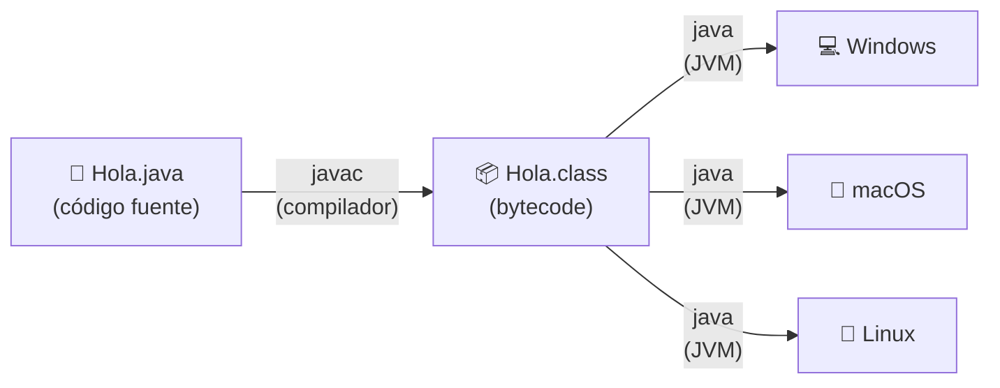
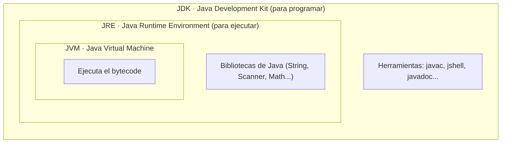

# Tema 02 · Entorno y primer programa

[⬅️ Tema anterior](../01-logica-de-programacion/README.md) · [🏠 Índice](../../INDICE.md) · [Siguiente tema ➡️](../03-variables-y-tipos-de-datos/README.md)

En el tema 01 copiaste un "envoltorio" (`class` y `main`) sin saber muy bien qué era. Ahora toca entenderlo: cómo pasa tu código de ser un texto a ser un programa que se ejecuta, qué significa cada palabra del `main` y cómo leer los errores que te dará Java.

## 🎯 Objetivos

- Saber qué son el **JDK**, la **JRE** y la **JVM**.
- Entender la diferencia entre **compilar** e **interpretar**, y qué es el **bytecode**.
- Compilar y ejecutar un programa desde la terminal.
- Conocer la **anatomía** de un programa en Java.
- Mostrar texto con `print` y `println`, y usar **secuencias de escape**.
- Escribir **comentarios**.
- Distinguir errores de **compilación**, de **ejecución** y **lógicos**.

## 📚 Contenido

1. [Cómo entiende el ordenador tu código](#1-cómo-entiende-el-ordenador-tu-código)
2. [JDK, JRE y JVM](#2-jdk-jre-y-jvm)
3. [Compilar y ejecutar](#3-compilar-y-ejecutar)
4. [Anatomía de un programa](#4-anatomía-de-un-programa)
5. [Mostrar texto: print y println](#5-mostrar-texto-print-y-println)
6. [Secuencias de escape](#6-secuencias-de-escape)
7. [Comentarios](#7-comentarios)
8. [Tipos de errores](#8-tipos-de-errores)
9. [Normas de escritura](#9-normas-de-escritura)
10. [Curiosidad: el main simplificado de Java 25](#10-curiosidad-el-main-simplificado-de-java-25)
11. [Resumen](#11-resumen)

---

## 1. Cómo entiende el ordenador tu código

El procesador de un ordenador solo entiende **código máquina**: ceros y unos. Escribir así sería imposible, por eso usamos lenguajes como Java, que se parecen más al idioma humano. Alguien tiene que **traducir** de un lenguaje a otro, y hay dos formas de hacerlo:

| Forma | Cómo funciona | Analogía |
|---|---|---|
| **Compilar** | Se traduce todo el programa de una vez, antes de ejecutarlo | Traducir un libro entero y luego leerlo |
| **Interpretar** | Se traduce línea a línea mientras se ejecuta | Un intérprete que traduce en directo una conversación |

Java hace **las dos cosas**:



1. El **compilador** (`javac`) traduce tu `.java` a **bytecode** (un archivo `.class`). El bytecode no es código máquina de ningún ordenador concreto: es un lenguaje intermedio.
2. La **JVM** (Máquina Virtual de Java) lee ese bytecode y lo ejecuta en el ordenador donde esté.

Gracias a esto, el mismo `.class` funciona en Windows, macOS o Linux sin cambiar nada. Es el famoso lema de Java: *"Write once, run anywhere"* (escríbelo una vez y ejecútalo en cualquier sitio).

## 2. JDK, JRE y JVM

Son tres piezas que van una dentro de otra:



| Pieza | Qué es | ¿Quién lo necesita? |
|---|---|---|
| **JVM** | El programa que ejecuta el bytecode | Cualquiera que ejecute Java |
| **JRE** | JVM + bibliotecas estándar | Quien solo quiere *usar* programas Java |
| **JDK** | JRE + herramientas para programar (compilador...) | **Tú**, que vas a programar |

Hoy en día solo se distribuye el **JDK**, que ya lo incluye todo.

## 3. Compilar y ejecutar

### En dos pasos (la forma clásica)

```bash
javac Hola.java     # 1. Compila: crea Hola.class
java Hola           # 2. Ejecuta: la JVM lee Hola.class (sin poner .class)
```

### En un paso (desde Java 11)

```bash
java Hola.java      # Compila en memoria y ejecuta directamente
```

Es la forma que usaremos en el repositorio porque es más cómoda. No crea ningún `.class` en la carpeta.

### Desde el editor

En VS Code o IntelliJ aparece un botón **Run ▶** encima del `main`. Por debajo, el editor hace los dos pasos anteriores.

### JShell: probar código suelto

El JDK incluye **JShell**, una consola donde escribes una instrucción y ves el resultado al momento. Es útil para hacer pruebas rápidas:

```bash
jshell
jshell> 2 + 3
$1 ==> 5
jshell> System.out.println("Hola")
Hola
jshell> /exit
```

## 4. Anatomía de un programa

```java
public class Hola {                              // 1
    public static void main(String[] args) {     // 2
        System.out.println("¡Hola, mundo!");     // 3
    }                                            // 4
}                                                // 5
```

| Línea | Qué significa |
|---|---|
| `public class Hola` | Define una **clase** llamada `Hola`. En Java todo el código va dentro de clases. El archivo **debe llamarse igual**: `Hola.java`. |
| `{` ... `}` | Las **llaves** marcan dónde empieza y dónde acaba un bloque. Cada `{` necesita su `}`. |
| `public static void main(String[] args)` | El método **main**: el **punto de entrada**. La JVM empieza a ejecutar por aquí. |
| `System.out.println("...")` | Instrucción que muestra un texto en la consola. |
| `;` | Cada instrucción termina en **punto y coma**. |

Cada palabra del `main` tiene su motivo, aunque de momento basta con saber que **tiene que escribirse exactamente así**:

| Palabra | Significado | Lo verás en |
|---|---|---|
| `public` | Se puede usar desde fuera de la clase (la JVM necesita llamarlo) | Tema 12 |
| `static` | Pertenece a la clase, no hace falta crear un objeto | Tema 12 |
| `void` | No devuelve ningún resultado | Tema 10 |
| `main` | El nombre que la JVM busca para empezar | — |
| `String[] args` | Datos que se le pueden pasar al programa al lanzarlo | Tema 08 |

## 5. Mostrar texto: print y println

`System.out` es la **salida estándar** (la consola). Tiene dos formas principales de escribir:

| Instrucción | Qué hace |
|---|---|
| `System.out.println("texto")` | Escribe el texto **y salta de línea** (*print line*) |
| `System.out.print("texto")` | Escribe el texto y **se queda en la misma línea** |
| `System.out.println()` | Solo salta de línea (deja una línea en blanco) |

```java
System.out.print("Hola ");
System.out.print("a ");
System.out.println("todos");
System.out.println("Segunda línea");
```

```
Hola a todos
Segunda línea
```

Con `+` puedes **unir** textos (y también números, como viste en el tema 01):

```java
System.out.println("Tengo " + 15 + " años");   // Tengo 15 años
System.out.println("2 + 3 = " + (2 + 3));        // 2 + 3 = 5
System.out.println("2 + 3 = " + 2 + 3);          // 2 + 3 = 23  ⚠️
```

En la última línea, Java une de izquierda a derecha: primero `"2 + 3 = " + 2` da el texto `"2 + 3 = 2"`, y luego le pega el `3`. Los paréntesis obligan a sumar primero.

## 6. Secuencias de escape

Algunos caracteres no se pueden escribir directamente dentro de un texto. Para ellos se usa la barra invertida `\` seguida de una letra:

| Secuencia | Resultado |
|---|---|
| `\n` | Salto de línea |
| `\t` | Tabulación (útil para alinear columnas) |
| `\"` | Comillas dobles dentro del texto |
| `\\` | Una barra invertida `\` |
| `\'` | Comilla simple |

```java
System.out.println("Línea 1\nLínea 2");
System.out.println("Nombre:\tAna");
System.out.println("Dijo: \"Hola\"");
System.out.println("C:\\Usuarios\\Ana");
```

```
Línea 1
Línea 2
Nombre:	Ana
Dijo: "Hola"
C:\Usuarios\Ana
```

### Bloques de texto (text blocks)

Para textos de varias líneas, desde Java 15 existen los **bloques de texto**, que van entre tres comillas `"""`:

```java
System.out.println("""
        Menú del día:
          - Primero: sopa
          - Segundo: pescado
        """);
```

Se respetan los saltos de línea tal y como los escribes, sin necesidad de `\n`.

## 7. Comentarios

Los comentarios son notas para las personas que leen el código. **Java los ignora** al compilar.

```java
// Comentario de una línea: desde // hasta el final de la línea

/*
 * Comentario de varias líneas.
 * Todo lo que hay entre la apertura y el cierre se ignora.
 */

/**
 * Comentario de documentación (Javadoc).
 * Se pone antes de clases y métodos para describirlos.
 * La herramienta javadoc genera páginas web a partir de ellos.
 */
```

Buenas costumbres:

- Explica el **porqué**, no el **qué**. `// Sumamos 1` sobra encima de `x = x + 1;`; `// La semana 0 no cuenta, empezamos en 1` aporta información.
- Usa comentarios para **desactivar** una línea temporalmente mientras pruebas (en VS Code e IntelliJ: `Ctrl + /`).

## 8. Tipos de errores

Te vas a equivocar muchísimo, y es normal. Lo importante es saber **qué tipo de error** tienes:

| Tipo | Cuándo aparece | Quién lo detecta | Ejemplo |
|---|---|---|---|
| **De compilación** | Al compilar, antes de ejecutar | El compilador (`javac`) | Falta un `;`, una llave o una comilla |
| **De ejecución** | Mientras el programa se ejecuta | La JVM (el programa "peta") | Dividir un número entero entre 0 |
| **Lógico** | Nunca "salta": el programa funciona pero da un resultado incorrecto | **Tú**, probando | Restar en lugar de sumar |

### Leer un error de compilación

```
Hola.java:3: error: ';' expected
        System.out.println("Hola")
                                  ^
1 error
```

- `Hola.java:3` → archivo y **número de línea**.
- `';' expected` → qué esperaba encontrar el compilador.
- `^` → la posición exacta.

Errores de compilación habituales:

| Mensaje | Causa probable |
|---|---|
| `';' expected` | Falta un punto y coma |
| `cannot find symbol` | Nombre mal escrito (`system` en lugar de `System`, `printn`...) |
| `unclosed string literal` | Falta cerrar unas comillas |
| `reached end of file while parsing` | Falta una llave `}` de cierre |
| `class X is public, should be declared in a file named X.java` | El nombre de la clase y el del archivo no coinciden |

> 💡 Si hay muchos errores, arregla **el primero** y vuelve a compilar. A menudo un solo fallo provoca varios mensajes.

### Leer un error de ejecución

```
Exception in thread "main" java.lang.ArithmeticException: / by zero
	at Division.main(Division.java:5)
```

- `ArithmeticException: / by zero` → qué ha pasado (división entre cero).
- `Division.java:5` → en qué línea. Aprenderás a gestionarlos en el tema 15.

## 9. Normas de escritura

Java distingue **mayúsculas y minúsculas**: `System`, `system` y `SYSTEM` son tres cosas diferentes. Además, hay convenciones que todo el mundo sigue:

| Elemento | Convención | Ejemplo |
|---|---|---|
| Clases | `PascalCase` (cada palabra empieza en mayúscula) | `MiPrimerPrograma` |
| Variables y métodos | `camelCase` (la primera en minúscula) | `precioTotal`, `calcularMedia` |
| Constantes | `MAYUSCULAS_CON_GUIONES` | `IVA_GENERAL` |

**Indentación:** el código dentro de unas llaves se desplaza hacia la derecha (4 espacios). A Java le da igual, pero a las personas no: sin indentar, el código es muy difícil de leer.

```java
// ❌ Funciona, pero es ilegible
public class Mal{public static void main(String[] args){System.out.println("Hola");}}

// ✅ Igual, pero se entiende
public class Bien {
    public static void main(String[] args) {
        System.out.println("Hola");
    }
}
```

## 10. Curiosidad: el main simplificado de Java 25

Desde **Java 25** se puede escribir un programa sin `class` ni `public static`:

```java
void main() {
    IO.println("¡Hola, mundo!");
}
```

Está pensado precisamente para quien empieza. En este repositorio usamos la forma clásica porque es la que vas a encontrar en casi todo el código, los libros y las ofertas de trabajo, y porque funciona en cualquier versión de Java.

## 11. Resumen

- `javac` **compila** el `.java` a **bytecode** (`.class`) y la **JVM** lo **ejecuta**.
- El **JDK** incluye todo lo necesario para programar.
- Con `java Archivo.java` compilas y ejecutas en un solo paso.
- Todo programa tiene una **clase** (que se llama igual que el archivo) y un método **`main`**.
- `println` salta de línea al final; `print` no.
- Las **secuencias de escape** (`\n`, `\t`, `\"`, `\\`) permiten escribir caracteres especiales.
- Hay tres tipos de error: **compilación**, **ejecución** y **lógicos**.

---

## 💻 Ejemplos de código

| Archivo | Qué muestra |
|---|---|
| [T02_01_HolaMundo.java](ejemplos/T02_01_HolaMundo.java) | Anatomía de un programa, línea a línea |
| [T02_02_PrintYPrintln.java](ejemplos/T02_02_PrintYPrintln.java) | `print`, `println`, unir textos y números |
| [T02_03_SecuenciasDeEscape.java](ejemplos/T02_03_SecuenciasDeEscape.java) | `\n`, `\t`, `\"`, `\\` y bloques de texto |
| [T02_04_Comentarios.java](ejemplos/T02_04_Comentarios.java) | Los tres tipos de comentario y cuándo usarlos |
| [T02_05_TiposDeErrores.java](ejemplos/T02_05_TiposDeErrores.java) | Errores de compilación, de ejecución y lógicos |

## ✏️ Ejercicios

Practica lo aprendido en los [ejercicios del tema 02](../../ejercicios/02-entorno-y-primer-programa/README.md).

---

[⬅️ Tema anterior](../01-logica-de-programacion/README.md) · [🏠 Índice](../../INDICE.md) · [Siguiente tema ➡️](../03-variables-y-tipos-de-datos/README.md)
