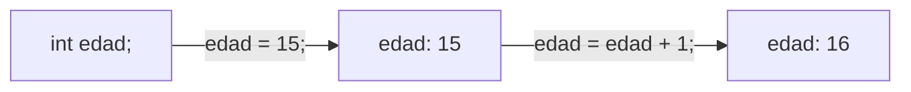
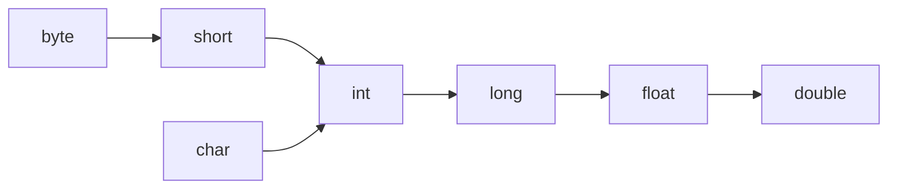

# Tema 03 · Variables y tipos de datos

[⬅️ Tema anterior](../02-entorno-y-primer-programa/README.md) · [🏠 Índice](../../INDICE.md) · [Siguiente tema ➡️](../04-operadores/README.md)

En el tema 01 viste que una variable es una caja con nombre. En Java, además, cada caja tiene un **tipo** que decide qué puede guardar y cuánto espacio ocupa. En este tema conocerás todos los tipos básicos, cómo pasar de uno a otro y los errores típicos que aparecen al mezclarlos.

## 🎯 Objetivos

- Declarar, inicializar y asignar variables.
- Conocer los **8 tipos primitivos** y cuándo usar cada uno.
- Usar `String` y `char` para trabajar con texto.
- Crear **constantes** con `final` y usar `var`.
- Convertir entre tipos: conversión **implícita**, **casting** y conversión desde texto.
- Entender el **desbordamiento** y la **imprecisión** de los decimales.

## 📚 Contenido

1. [Declarar, inicializar y asignar](#1-declarar-inicializar-y-asignar)
2. [Nombres de variables](#2-nombres-de-variables)
3. [Los tipos primitivos](#3-los-tipos-primitivos)
4. [Literales](#4-literales)
5. [char y String](#5-char-y-string)
6. [Constantes con final](#6-constantes-con-final)
7. [Inferencia de tipos con var](#7-inferencia-de-tipos-con-var)
8. [Conversiones entre tipos](#8-conversiones-entre-tipos)
9. [De texto a número y de número a texto](#9-de-texto-a-número-y-de-número-a-texto)
10. [Desbordamiento e imprecisión](#10-desbordamiento-e-imprecisión)
11. [Errores típicos](#11-errores-típicos)
12. [Resumen](#12-resumen)

---

## 1. Declarar, inicializar y asignar

```java
int edad;          // DECLARAR: crear la caja "edad" para enteros (todavía vacía)
edad = 15;         // ASIGNAR: meter un valor en la caja
int nivel = 1;     // DECLARAR + INICIALIZAR en una sola línea (lo más habitual)
nivel = 2;         // REASIGNAR: el 1 desaparece y queda el 2
int x = 1, y = 2;  // Varias del mismo tipo a la vez (mejor una por línea)
```

Reglas importantes:

- Una variable solo se **declara una vez**. Después se usa por su nombre, sin repetir el tipo.
- Una variable **local** (dentro de `main`) debe tener valor antes de usarse. Si no, error de compilación: `variable edad might not have been initialized`.
- El tipo **no puede cambiar**: si `edad` es `int`, no puedes meterle un texto.



## 2. Nombres de variables

| Regla (obligatoria) | ✅ Válido | ❌ No válido |
|---|---|---|
| Empieza por letra, `_` o `$` | `total`, `_dato` | `2total` |
| Sin espacios ni símbolos como `-`, `#`, `.` | `precioFinal` | `precio-final`, `precio final` |
| No puede ser una palabra reservada | `clase` | `class`, `int`, `public` |
| Distingue mayúsculas | `edad` y `Edad` son distintas | — |

| Convención (recomendada) | Ejemplo |
|---|---|
| `camelCase` | `numeroDeAlumnos` |
| Nombres descriptivos | `precioConIva` mejor que `p` |
| `boolean` como pregunta | `esMayorDeEdad`, `tieneDescuento` |
| Sin tildes ni ñ (aunque Java las permite) | `anio`, `tamanio` |

## 3. Los tipos primitivos

Java tiene **8 tipos primitivos**. Guardan directamente el valor, ocupan un tamaño fijo y se escriben en minúscula.

| Tipo | Guarda | Tamaño | Rango aproximado | Ejemplo |
|---|---|---|---|---|
| `byte` | Entero | 1 byte | −128 a 127 | `byte b = 100;` |
| `short` | Entero | 2 bytes | −32 768 a 32 767 | `short s = 3000;` |
| **`int`** | Entero | 4 bytes | ± 2 100 millones | `int edad = 15;` |
| `long` | Entero | 8 bytes | ± 9 trillones | `long poblacion = 8_000_000_000L;` |
| `float` | Decimal | 4 bytes | ~7 cifras de precisión | `float f = 3.14f;` |
| **`double`** | Decimal | 8 bytes | ~15 cifras de precisión | `double precio = 19.99;` |
| **`char`** | Un carácter | 2 bytes | Un carácter Unicode | `char letra = 'A';` |
| **`boolean`** | Verdadero/falso | — | `true` o `false` | `boolean activo = true;` |

**¿Cuál uso?** En el día a día:

- Enteros → **`int`**. Si el número puede pasar de 2 100 millones (milisegundos, población mundial...) → `long`.
- Decimales → **`double`**.
- Sí/no → **`boolean`**.
- Una letra o símbolo → **`char`**.
- `byte`, `short` y `float` se usan para ahorrar memoria en casos muy concretos.

Puedes consultar los límites exactos con `Integer.MAX_VALUE`, `Long.MIN_VALUE`, etc.

## 4. Literales

Un **literal** es un valor escrito directamente en el código.

| Literal | Tipo | Nota |
|---|---|---|
| `42` | `int` | Cualquier entero sin sufijo es `int` |
| `42L` | `long` | Sufijo `L` (mejor mayúscula, la `l` se confunde con un 1) |
| `3.14` | `double` | Cualquier decimal sin sufijo es `double` |
| `3.14f` | `float` | Sufijo `f` |
| `1_000_000` | `int` | Los `_` solo ayudan a leer; Java los ignora |
| `0xFF` | `int` | Hexadecimal (255) |
| `'A'` | `char` | **Comillas simples**, un solo carácter |
| `"Hola"` | `String` | **Comillas dobles** |
| `true`, `false` | `boolean` | Sin comillas |

## 5. char y String

### char

Un `char` guarda **un único carácter** entre comillas simples. Por dentro es un **número** (su código Unicode), por eso se puede operar con él:

```java
char letra = 'A';
int codigo = letra;              // 65
char siguiente = (char) (letra + 1);  // 'B'
```

### String

`String` guarda **texto** de cualquier longitud. No es un tipo primitivo sino una **clase** (por eso empieza en mayúscula); lo verás a fondo en el [tema 09](../09-strings/README.md).

```java
String nombre = "Ana";
String vacio = "";               // Texto vacío: válido
String saludo = "Hola, " + nombre;
int letras = nombre.length();    // 3
```

| | `char` | `String` |
|---|---|---|
| Comillas | Simples `'A'` | Dobles `"A"` |
| Contenido | Exactamente 1 carácter | 0 o más caracteres |
| Tipo | Primitivo | Clase (tipo de referencia) |

## 6. Constantes con final

Si un valor **no debe cambiar nunca**, se declara con `final`. Si intentas modificarlo, el compilador da error.

```java
final double IVA = 0.21;
final int DIAS_SEMANA = 7;
// IVA = 0.10;  ❌ error: cannot assign a value to final variable IVA
```

Por convención, las constantes se escriben en `MAYUSCULAS_CON_GUIONES_BAJOS`. Ventajas:

- El código se lee mejor: `precio * IVA` dice más que `precio * 0.21`.
- Si el valor cambia algún día, solo se toca en un sitio.

## 7. Inferencia de tipos con var

Desde Java 10, en variables locales puedes escribir `var` y Java **deduce el tipo** a partir del valor:

```java
var edad = 15;          // int
var precio = 9.99;      // double
var nombre = "Ana";     // String
```

- El tipo sigue siendo fijo: `edad` es `int` para siempre.
- Hay que inicializar en la misma línea: `var x;` es un error.
- Úsalo cuando el tipo sea **evidente** por el valor. Mientras aprendes, es mejor escribir el tipo: te obliga a pensar qué estás guardando.

## 8. Conversiones entre tipos

### Conversión implícita (automática, de pequeño a grande)

Cuando pasas un valor a un tipo **más grande**, Java lo hace solo, porque no se pierde nada:



```java
int entero = 10;
double decimal = entero;   // 10.0  ✅ automático
long grande = entero;      // 10    ✅ automático
```

### Casting (explícito, de grande a pequeño)

Para ir en sentido contrario, tienes que **pedirlo** poniendo el tipo entre paréntesis, porque **puedes perder información**:

```java
double nota = 7.9;
int notaEntera = (int) nota;     // 7  ← el casting a int CORTA los decimales, no redondea

long mucho = 3_000_000_000L;
int poco = (int) mucho;          // -1294967296  ← no cabe: resultado sin sentido
```

Para **redondear** se usa `Math.round`:

```java
long redondeada = Math.round(7.9);   // 8
```

### Mezclar tipos en una operación

Si en una operación hay tipos distintos, el resultado es del tipo **más grande**:

```java
int a = 7;
double b = 2.0;
double r = a / b;          // 3.5   (int / double → double)
int c = 7 / 2;             // 3     (int / int → int: ¡se pierden los decimales!)
double d = (double) 7 / 2; // 3.5   (convertimos uno a double antes de dividir)
```

La división entera es una de las fuentes de errores más típicas. La verás a fondo en el [tema 04](../04-operadores/README.md).

## 9. De texto a número y de número a texto

Cada tipo primitivo tiene una **clase envoltorio** (*wrapper*) con utilidades: `Integer`, `Double`, `Long`, `Boolean`, `Character`...

```java
// Texto → número
int edad = Integer.parseInt("15");
double precio = Double.parseDouble("9.99");
boolean activo = Boolean.parseBoolean("true");

// Número → texto
String texto1 = String.valueOf(42);   // "42"
String texto2 = "" + 42;              // "42" (truco habitual)
```

Si el texto no es un número válido (`Integer.parseInt("hola")`), el programa se detiene con un `NumberFormatException` (error de ejecución). Aprenderás a controlarlo en el [tema 15](../15-excepciones/README.md).

Esto es importante porque **todo lo que escribe el usuario llega como texto**. Lo verás en el [tema 05](../05-entrada-y-salida/README.md).

## 10. Desbordamiento e imprecisión

### Desbordamiento (overflow)

Si un resultado no cabe en su tipo, **no da error**: "da la vuelta" al rango y aparece un número absurdo.

```java
int maximo = Integer.MAX_VALUE;   // 2147483647
int masUno = maximo + 1;          // -2147483648  😱
```

Solución: usar un tipo más grande (`long`) cuando los números puedan ser enormes. Ojo: el cálculo debe hacerse ya en `long`:

```java
long malo = 1_000_000 * 1_000_000;    // ❌ se calcula en int, desborda y luego se guarda
long bueno = 1_000_000L * 1_000_000;  // ✅ 1000000000000
```

### Imprecisión de los decimales

`double` guarda los decimales en binario y algunos números (como 0.1) no se pueden representar exactamente:

```java
System.out.println(0.1 + 0.2);   // 0.30000000000000004
```

No es un fallo de Java: pasa en casi todos los lenguajes. Consecuencias:

- No compares decimales con `==` esperando exactitud.
- Para mostrarlos, redondea al imprimir (tema 05, `printf`).
- Para dinero en programas reales se usa `BigDecimal` o se trabaja en céntimos con `long`.

## 11. Errores típicos

| Error | Ejemplo | Mensaje / efecto |
|---|---|---|
| Usar sin inicializar | `int x; System.out.println(x);` | `variable x might not have been initialized` |
| Declarar dos veces | `int x = 1; int x = 2;` | `variable x is already defined` |
| Tipo incompatible | `int x = "5";` | `incompatible types: String cannot be converted to int` |
| Decimal en un `int` | `int x = 3.5;` | `possible lossy conversion from double to int` |
| Comillas equivocadas | `char c = "A";` / `String s = 'Hola';` | `incompatible types` / `unclosed character literal` |
| Olvidar la `L` | `long x = 3000000000;` | `integer number too large` |
| División entera | `double m = 7 / 2;` | Guarda `3.0`, no `3.5` (error lógico) |

## 12. Resumen

- Una variable se **declara** con su tipo y se puede **reasignar** cuantas veces quieras.
- Los tipos que más usarás: `int`, `double`, `boolean`, `char` y `String`.
- `final` crea **constantes**; `var` deja que Java deduzca el tipo.
- De pequeño a grande la conversión es **automática**; de grande a pequeño necesitas **casting** y puedes perder información.
- `(int)` **corta** los decimales; `Math.round` **redondea**.
- `Integer.parseInt` y `Double.parseDouble` convierten **texto en números**.
- Cuidado con el **desbordamiento** de los enteros y la **imprecisión** de los `double`.

---

## 💻 Ejemplos de código

| Archivo | Qué muestra |
|---|---|
| [T03_01_DeclararYAsignar.java](ejemplos/T03_01_DeclararYAsignar.java) | Declarar, inicializar, reasignar y nombrar variables |
| [T03_02_TiposPrimitivos.java](ejemplos/T03_02_TiposPrimitivos.java) | Los 8 primitivos, sus límites y sus literales |
| [T03_03_CharYString.java](ejemplos/T03_03_CharYString.java) | `char` como número y primeros pasos con `String` |
| [T03_04_ConstantesYVar.java](ejemplos/T03_04_ConstantesYVar.java) | `final` y `var` |
| [T03_05_Conversiones.java](ejemplos/T03_05_Conversiones.java) | Conversión implícita, casting, `parse`, desbordamiento e imprecisión |

## ✏️ Ejercicios

Practica lo aprendido en los [ejercicios del tema 03](../../ejercicios/03-variables-y-tipos-de-datos/README.md).

---

[⬅️ Tema anterior](../02-entorno-y-primer-programa/README.md) · [🏠 Índice](../../INDICE.md) · [Siguiente tema ➡️](../04-operadores/README.md)
