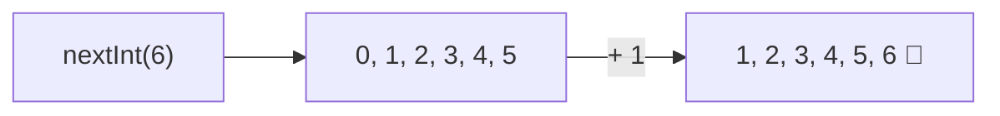

# Tema 04 · Operadores

[⬅️ Tema anterior](../03-variables-y-tipos-de-datos/README.md) · [🏠 Índice](../../INDICE.md) · [Siguiente tema ➡️](../05-entrada-y-salida/README.md)

Los operadores son los símbolos que permiten **calcular**, **comparar** y **combinar condiciones**. Ya has usado algunos (`+`, `*`, `>=`); aquí los verás todos, junto con el orden en que Java los evalúa, las funciones matemáticas de la clase `Math` y cómo generar **números aleatorios** con `Random`.

## 🎯 Objetivos

- Usar los operadores **aritméticos**, en especial la división entera y el **módulo** (`%`).
- Usar la **asignación compuesta** (`+=`, `-=`...) y el **incremento** (`++`, `--`).
- Escribir comparaciones con operadores **relacionales**.
- Combinar condiciones con operadores **lógicos** (`&&`, `||`, `!`).
- Conocer la **precedencia** de los operadores.
- Usar la clase **`Math`**.
- Generar **números aleatorios** con `Random` y `Math.random()`.

## 📚 Contenido

1. [Operadores aritméticos](#1-operadores-aritméticos)
2. [División entera y módulo](#2-división-entera-y-módulo)
3. [Asignación compuesta](#3-asignación-compuesta)
4. [Incremento y decremento](#4-incremento-y-decremento)
5. [Operadores relacionales](#5-operadores-relacionales)
6. [Operadores lógicos](#6-operadores-lógicos)
7. [Precedencia](#7-precedencia)
8. [La clase Math](#8-la-clase-math)
9. [Números aleatorios](#9-números-aleatorios)
10. [Errores típicos](#10-errores-típicos)
11. [Resumen](#11-resumen)

---

## 1. Operadores aritméticos

| Operador | Operación | Ejemplo | Resultado |
|---|---|---|---|
| `+` | Suma (o concatenación con `String`) | `7 + 2` | `9` |
| `-` | Resta | `7 - 2` | `5` |
| `*` | Multiplicación | `7 * 2` | `14` |
| `/` | División | `7 / 2` | `3` (¡entera!) |
| `%` | Módulo (resto de la división) | `7 % 2` | `1` |
| `-` (unario) | Cambio de signo | `-x` | El opuesto de `x` |

El tipo del resultado depende de los operandos (lo viste en el tema 03): `int` con `int` da `int`; si alguno es `double`, el resultado es `double`.

## 2. División entera y módulo

Recuerda cómo dividías en el colegio:

```
  17 | 5
  -15  3   ← cociente:  17 / 5 = 3
   2       ← resto:     17 % 5 = 2
```

`/` entre enteros da el **cociente** y `%` da el **resto**. Juntos son muy útiles:

| Para... | Expresión | Ejemplo |
|---|---|---|
| Saber si `n` es **par** | `n % 2 == 0` | `8 % 2` → `0` |
| Saber si `n` es **múltiplo** de `m` | `n % m == 0` | `15 % 5` → `0` |
| Obtener la **última cifra** | `n % 10` | `1234 % 10` → `4` |
| **Quitar** la última cifra | `n / 10` | `1234 / 10` → `123` |
| Pasar segundos a minutos y segundos | `s / 60` y `s % 60` | `135` s → `2` min `15` s |
| Algo que se repite en **ciclo** | `n % tamaño` | Día de la semana: `(dia + 3) % 7` |

Con números negativos, el resto tiene el **signo del dividendo**: `-7 % 3` da `-1`.

Dividir un **entero** entre `0` provoca `ArithmeticException`. Con `double`, en cambio, da `Infinity` o `NaN` (*Not a Number*) sin error.

## 3. Asignación compuesta

Son atajos para "operar y guardar en la misma variable":

| Atajo | Equivale a |
|---|---|
| `x += 5` | `x = x + 5` |
| `x -= 5` | `x = x - 5` |
| `x *= 5` | `x = x * 5` |
| `x /= 5` | `x = x / 5` |
| `x %= 5` | `x = x % 5` |

Detalle: la asignación compuesta incluye un **casting automático**. `int x = 10; x += 2.7;` compila y deja `x = 12`, mientras que `x = x + 2.7;` da error. Cómodo, pero puede esconder pérdidas de decimales.

`+=` también sirve con textos: `mensaje += "!";` añade al final.

## 4. Incremento y decremento

`++` suma 1 y `--` resta 1. Pueden ir **antes** o **después** de la variable:

| Forma | Nombre | Qué hace |
|---|---|---|
| `x++` | Postincremento | Usa el valor **actual** y **después** suma 1 |
| `++x` | Preincremento | Suma 1 **primero** y luego usa el valor nuevo |

```java
int a = 5;
int b = a++;   // b = 5, a = 6  (primero copia, luego suma)

int c = 5;
int d = ++c;   // d = 6, c = 6  (primero suma, luego copia)
```

Si el `++` va **solo** en su línea (`contador++;`), las dos formas hacen lo mismo. **Consejo:** úsalo siempre así, solo en su línea. Mezclarlo dentro de otras expresiones (`y = x++ + ++x;`) hace el código difícil de leer.

## 5. Operadores relacionales

Comparan dos valores y dan un `boolean` (`true` o `false`):

| Operador | Significado | Ejemplo | Resultado |
|---|---|---|---|
| `==` | Igual a | `5 == 5` | `true` |
| `!=` | Distinto de | `5 != 3` | `true` |
| `>` | Mayor que | `5 > 3` | `true` |
| `<` | Menor que | `5 < 3` | `false` |
| `>=` | Mayor o igual | `5 >= 5` | `true` |
| `<=` | Menor o igual | `3 <= 2` | `false` |

- **`=` asigna, `==` compara.** Es uno de los errores más típicos.
- Con `double`, evita `==`: `0.1 + 0.2 == 0.3` da `false`. Compara la diferencia con un margen: `Math.abs(a - b) < 0.0001`.
- Para comparar **textos** no se usa `==`, sino `.equals()` (tema 09).

## 6. Operadores lógicos

Combinan condiciones:

| Operador | Nombre | Es `true` cuando... |
|---|---|---|
| `&&` | Y (AND) | **Las dos** son `true` |
| `\|\|` | O (OR) | **Al menos una** es `true` |
| `!` | NO (NOT) | La condición es `false` (la invierte) |

Tablas de verdad:

| `a` | `b` | `a && b` | `a \|\| b` | `!a` |
|---|---|---|---|---|
| `true` | `true` | `true` | `true` | `false` |
| `true` | `false` | `false` | `true` | `false` |
| `false` | `true` | `false` | `true` | `true` |
| `false` | `false` | `false` | `false` | `true` |

```java
boolean puedeConducir = edad >= 18 && tieneCarnet;
boolean esFinDeSemana = dia == 6 || dia == 7;
boolean estaEnRango = nota >= 0 && nota <= 10;   // En Java NO se puede escribir 0 <= nota <= 10
```

### Evaluación en cortocircuito

`&&` y `||` dejan de evaluar en cuanto saben el resultado:

- En `a && b`, si `a` es `false`, **no se evalúa** `b` (el resultado ya es `false`).
- En `a || b`, si `a` es `true`, **no se evalúa** `b`.

Esto permite escribir condiciones seguras:

```java
boolean esDivisible = divisor != 0 && numero % divisor == 0;   // Nunca divide entre 0
```

> Existen también `&`, `|` y `^`, que no hacen cortocircuito (y otros operadores *de bits*). Casi nunca los necesitarás al empezar.

## 7. Precedencia

Cuando hay varios operadores, Java sigue este orden (de mayor a menor prioridad):

| Prioridad | Operadores |
|---|---|
| 1 | `()` paréntesis |
| 2 | `++` `--` `!` `-` (unarios), casting `(tipo)` |
| 3 | `*` `/` `%` |
| 4 | `+` `-` |
| 5 | `<` `>` `<=` `>=` |
| 6 | `==` `!=` |
| 7 | `&&` |
| 8 | `\|\|` |
| 9 | `=` `+=` `-=` ... (asignación) |

Operadores del mismo nivel se evalúan de **izquierda a derecha** (salvo la asignación, que va de derecha a izquierda).

```java
int r = 2 + 3 * 4;          // 14, no 20
int s = (2 + 3) * 4;        // 20
boolean b = 5 > 3 && 2 > 4 || true;   // (true && false) || true → true
```

**Regla práctica:** si dudas, pon paréntesis. No cuestan nada y hacen el código más claro.

## 8. La clase Math

`Math` reúne funciones matemáticas. No hace falta importarla.

| Método | Qué hace | Ejemplo | Resultado |
|---|---|---|---|
| `Math.pow(b, e)` | Potencia bᵉ | `Math.pow(2, 10)` | `1024.0` |
| `Math.sqrt(x)` | Raíz cuadrada | `Math.sqrt(81)` | `9.0` |
| `Math.abs(x)` | Valor absoluto | `Math.abs(-7)` | `7` |
| `Math.max(a, b)` | El mayor | `Math.max(3, 9)` | `9` |
| `Math.min(a, b)` | El menor | `Math.min(3, 9)` | `3` |
| `Math.round(x)` | Redondea | `Math.round(2.5)` | `3` |
| `Math.floor(x)` | Redondea hacia abajo | `Math.floor(2.9)` | `2.0` |
| `Math.ceil(x)` | Redondea hacia arriba | `Math.ceil(2.1)` | `3.0` |
| `Math.PI` | Constante π | `Math.PI` | `3.141592653589793` |

`pow`, `sqrt`, `floor` y `ceil` devuelven siempre `double`.

Para redondear a **dos decimales**: `Math.round(x * 100) / 100.0`.

## 9. Números aleatorios

Los juegos, los sorteos o las simulaciones necesitan números al azar. Java tiene dos formas principales.

### 9.1 La clase Random (recomendada)

`Random` está en el paquete `java.util`, así que hay que **importarla** al principio del archivo, antes de la clase:

```java
import java.util.Random;

public class Dados {
    public static void main(String[] args) {
        Random random = new Random();           // Creamos el generador (una sola vez)
        int dado = random.nextInt(1, 7);        // Entero entre 1 y 6
    }
}
```

`import` le dice a Java dónde encontrar una clase que no está disponible por defecto. `new Random()` **crea** un objeto generador; entenderás bien qué significa `new` en el tema 11.

| Método | Devuelve | Rango |
|---|---|---|
| `nextInt(n)` | `int` | De `0` a `n - 1` |
| `nextInt(min, max)` | `int` | De `min` a `max - 1` (Java 17+) |
| `nextDouble()` | `double` | De `0.0` a `1.0` (sin llegar a 1) |
| `nextDouble(min, max)` | `double` | De `min` a `max` (sin llegar a `max`, Java 17+) |
| `nextBoolean()` | `boolean` | `true` o `false` |

⚠️ El límite superior **nunca se incluye**. Para un dado de 6 caras: `nextInt(6)` da 0–5, así que se usa `nextInt(6) + 1` o `nextInt(1, 7)`.



**Fórmula general** para un entero entre `min` y `max` (ambos incluidos):

```java
int n = random.nextInt(max - min + 1) + min;
// o, desde Java 17:
int n = random.nextInt(min, max + 1);
```

### 9.2 Semilla: aleatorios que se repiten

Si creas el generador con un número (**semilla**), la secuencia de "aleatorios" será **siempre la misma**:

```java
Random random = new Random(42);   // Misma semilla → mismos números en cada ejecución
```

Es muy útil para **probar** un programa y reproducir un error. En realidad estos números son *pseudoaleatorios*: los calcula una fórmula a partir de la semilla. Sin semilla, Java usa una distinta cada vez.

### 9.3 Math.random()

Devuelve un `double` entre `0.0` y `1.0` (sin incluir el 1). Para obtener un entero hay que escalarlo y hacer casting:

```java
int dado = (int) (Math.random() * 6) + 1;   // 1 a 6
```

Funciona sin `import`, pero es menos cómodo y no permite semilla. En este repositorio usaremos `Random`.

## 10. Errores típicos

| Error | Ejemplo | Qué pasa |
|---|---|---|
| `=` en lugar de `==` | `boolean b = (x = 5);` | Error de compilación (con `int`) |
| División entera inesperada | `double m = (a + b) / 2;` | Pierde decimales |
| Cadena de comparaciones | `0 <= x <= 10` | Error de compilación |
| Olvidar paréntesis | `a + b / 2` | Divide solo `b` |
| `&` o `\|` en lugar de `&&` o `\|\|` | `x != 0 & 10 / x > 1` | Sin cortocircuito: puede dividir entre 0 |
| Rango aleatorio mal calculado | `nextInt(6)` para un dado | Da 0–5 en lugar de 1–6 |
| Crear un `Random` en cada número | `new Random().nextInt(...)` repetido | Funciona, pero desperdicia recursos; crea uno y reutilízalo |

## 11. Resumen

- `/` entre enteros da el **cociente** y `%` el **resto**: sirven para pares, múltiplos, cifras y conversiones de tiempo.
- `+=`, `-=`... y `++`, `--` son atajos. Usa `++` solo en su propia línea.
- Los relacionales (`==`, `!=`, `<`...) dan `boolean`. **`=` asigna, `==` compara.**
- `&&` (Y), `||` (O) y `!` (NO) combinan condiciones, con **cortocircuito**.
- Ante la duda con la **precedencia**, usa paréntesis.
- `Math` ofrece potencias, raíces, redondeos, máximos y mínimos.
- `Random` genera aleatorios: `nextInt(min, max + 1)` para un entero entre `min` y `max`.

---

## 💻 Ejemplos de código

| Archivo | Qué muestra |
|---|---|
| [T04_01_Aritmeticos.java](ejemplos/T04_01_Aritmeticos.java) | Operaciones básicas, división entera y usos del módulo |
| [T04_02_AsignacionEIncremento.java](ejemplos/T04_02_AsignacionEIncremento.java) | `+=`, `-=`... y la diferencia entre `x++` y `++x` |
| [T04_03_RelacionalesYLogicos.java](ejemplos/T04_03_RelacionalesYLogicos.java) | Comparaciones, `&&`, `\|\|`, `!` y cortocircuito |
| [T04_04_PrecedenciaYMath.java](ejemplos/T04_04_PrecedenciaYMath.java) | Orden de evaluación y la clase `Math` |
| [T04_05_NumerosAleatorios.java](ejemplos/T04_05_NumerosAleatorios.java) | `Random`, rangos, semillas y `Math.random()` |

## ✏️ Ejercicios

Practica lo aprendido en los [ejercicios del tema 04](../../ejercicios/04-operadores/README.md).

---

[⬅️ Tema anterior](../03-variables-y-tipos-de-datos/README.md) · [🏠 Índice](../../INDICE.md) · [Siguiente tema ➡️](../05-entrada-y-salida/README.md)
