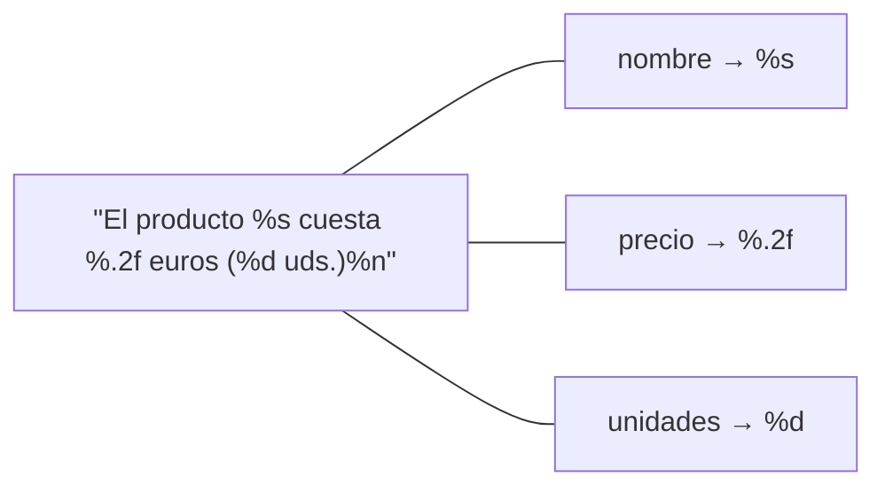
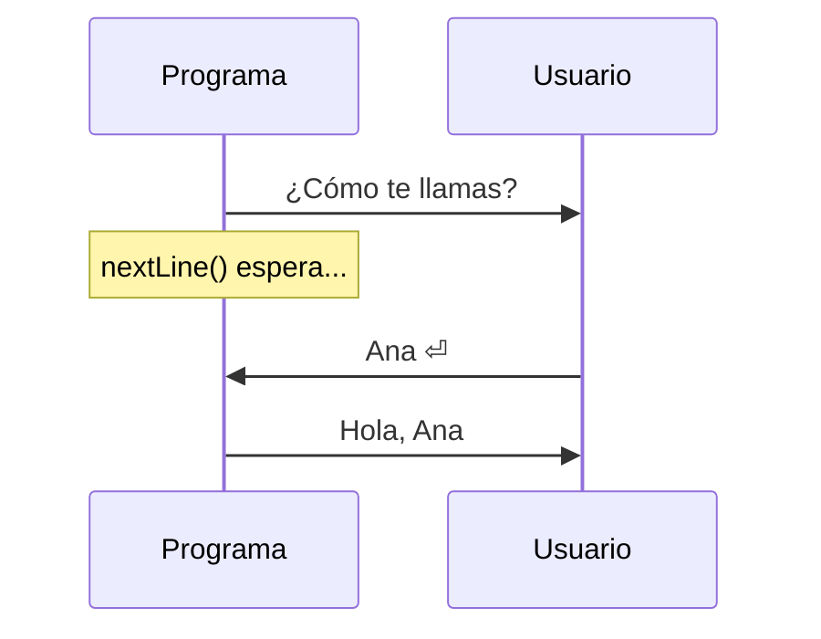

# Tema 05 · Entrada y salida

[⬅️ Tema anterior](../04-operadores/README.md) · [🏠 Índice](../../INDICE.md) · [Siguiente tema ➡️](../06-condicionales/README.md)

Hasta ahora todos los datos estaban escritos dentro del código. Un programa de verdad necesita **preguntar** al usuario y **mostrar** los resultados de forma clara. En este tema aprenderás a leer del teclado con `Scanner` y a dar formato a la salida con `printf` y `String.format`.

## 🎯 Objetivos

- Dar formato a la salida con `printf` y `String.format`.
- Leer datos del teclado con `Scanner`.
- Entender y resolver el problema del **salto de línea pendiente** con `nextLine`.
- Saber cómo afecta la **configuración regional** (coma o punto decimal).
- Escribir programas interactivos completos: entrada → proceso → salida.

## 📚 Contenido

1. [Repaso: print y println](#1-repaso-print-y-println)
2. [Salida con formato: printf](#2-salida-con-formato-printf)
3. [Ancho, alineación y relleno](#3-ancho-alineación-y-relleno)
4. [String.format](#4-stringformat)
5. [Entrada: la clase Scanner](#5-entrada-la-clase-scanner)
6. [Métodos de Scanner](#6-métodos-de-scanner)
7. [El problema del salto de línea pendiente](#7-el-problema-del-salto-de-línea-pendiente)
8. [Coma o punto decimal: la configuración regional](#8-coma-o-punto-decimal-la-configuración-regional)
9. [Errores al leer datos](#9-errores-al-leer-datos)
10. [Estructura de un programa interactivo](#10-estructura-de-un-programa-interactivo)
11. [Resumen](#11-resumen)

---

## 1. Repaso: print y println

| Método | Salta de línea al final |
|---|---|
| `System.out.print(x)` | No |
| `System.out.println(x)` | Sí |

Con `+` se unen textos y valores, pero cuando hay muchos datos o quieres controlar los decimales, el código se vuelve difícil de leer:

```java
System.out.println("El producto " + nombre + " cuesta " + precio + " euros (" + unidades + " uds.)");
```

## 2. Salida con formato: printf

`printf` (*print formatted*) escribe un texto con **huecos** que se rellenan con los valores que pongas después, en orden:

```java
System.out.printf("El producto %s cuesta %.2f euros (%d uds.)%n", nombre, precio, unidades);
```



### Especificadores más usados

| Especificador | Para | Ejemplo | Resultado |
|---|---|---|---|
| `%d` | Enteros (`int`, `long`) | `printf("%d", 42)` | `42` |
| `%f` | Decimales (6 decimales por defecto) | `printf("%f", 3.5)` | `3,500000` |
| `%.2f` | Decimales con 2 cifras (redondea) | `printf("%.2f", 3.14159)` | `3,14` |
| `%s` | Textos (y cualquier valor) | `printf("%s", "Ana")` | `Ana` |
| `%c` | Un carácter | `printf("%c", 'A')` | `A` |
| `%b` | `boolean` | `printf("%b", true)` | `true` |
| `%n` | Salto de línea | | |
| `%%` | El símbolo `%` | `printf("21%%")` | `21%` |

- `printf` **no salta de línea** solo: hay que terminar con `%n`.
- Si el tipo no encaja (`%d` con un `double`), el programa se detiene con `IllegalFormatConversionException`.
- ¿Por qué `3,14` con coma? Lo verás en la [sección 8](#8-coma-o-punto-decimal-la-configuración-regional).

## 3. Ancho, alineación y relleno

Entre el `%` y la letra puedes indicar el **ancho mínimo** del hueco. Es la forma correcta de hacer tablas (mucho mejor que `\t`):

| Formato | Significado | Ejemplo | Resultado |
|---|---|---|---|
| `%5d` | Ancho 5, alineado a la derecha | `printf("[%5d]", 42)` | `[   42]` |
| `%-5d` | Ancho 5, alineado a la izquierda | `printf("[%-5d]", 42)` | `[42   ]` |
| `%05d` | Ancho 5, relleno con ceros | `printf("[%05d]", 42)` | `[00042]` |
| `%10s` | Texto, ancho 10 a la derecha | `printf("[%10s]", "Ana")` | `[       Ana]` |
| `%-10s` | Texto, ancho 10 a la izquierda | `printf("[%-10s]", "Ana")` | `[Ana       ]` |
| `%8.2f` | Decimal, ancho 8, 2 decimales | `printf("[%8.2f]", 3.5)` | `[    3,50]` |
| `%,d` | Separador de miles | `printf("%,d", 1234567)` | `1.234.567` |

Ejemplo de tabla:

```java
System.out.printf("%-10s %5s %8s%n", "Producto", "Uds.", "Precio");
System.out.printf("%-10s %5d %8.2f%n", "Pan", 2, 1.2);
System.out.printf("%-10s %5d %8.2f%n", "Chocolate", 10, 2.5);
```

```
Producto    Uds.   Precio
Pan            2     1,20
Chocolate     10     2,50
```

## 4. String.format

`String.format` usa exactamente los mismos especificadores que `printf`, pero en lugar de mostrar el texto, lo **devuelve** para que lo guardes:

```java
String linea = String.format("%-10s %8.2f", "Pan", 1.2);
String codigo = String.format("F-%04d", 7);    // "F-0007"
```

También existe la forma `"texto %d".formatted(valor)` (Java 15+), que hace lo mismo.

Es útil cuando el texto se va a usar más tarde, guardar en un fichero, o combinar con otros.

## 5. Entrada: la clase Scanner

`Scanner` lee lo que el usuario escribe en la consola. Está en `java.util`, así que hay que importarla:

```java
import java.util.Scanner;

public class Saludo {
    public static void main(String[] args) {
        Scanner teclado = new Scanner(System.in);   // 1. Crear el Scanner (una sola vez)

        System.out.print("¿Cómo te llamas? ");       // 2. Preguntar (print: el cursor se queda en la línea)
        String nombre = teclado.nextLine();          // 3. Leer: el programa ESPERA a que pulses Enter

        System.out.println("Hola, " + nombre);       // 4. Usar el dato
    }
}
```

- `System.in` es la **entrada estándar** (el teclado), igual que `System.out` es la salida.
- El programa se **detiene** en cada lectura hasta que el usuario pulsa **Enter**.
- Pregunta siempre **antes** de leer (si no, el usuario verá un cursor parpadeando sin saber qué escribir). Con `print` en lugar de `println`, la respuesta aparece en la misma línea que la pregunta.



## 6. Métodos de Scanner

| Método | Lee | Ejemplo de entrada |
|---|---|---|
| `nextLine()` | Toda la línea, con espacios, hasta el Enter | `Ana María López` |
| `next()` | Una palabra (hasta el primer espacio) | `Ana` |
| `nextInt()` | Un `int` | `25` |
| `nextLong()` | Un `long` | `8000000000` |
| `nextDouble()` | Un `double` | `72,5` (o `72.5`, ver sección 8) |
| `nextBoolean()` | Un `boolean` | `true` |

No hay `nextChar()`. Para leer un carácter se lee una palabra y se toma su primera letra:

```java
char opcion = teclado.next().charAt(0);
```

## 7. El problema del salto de línea pendiente

Es **el error más típico** con `Scanner`. Mira este programa:

```java
System.out.print("Edad: ");
int edad = teclado.nextInt();
System.out.print("Nombre: ");
String nombre = teclado.nextLine();   // ⚠️ ¡No espera! nombre queda vacío
```

### ¿Qué pasa?

Cuando escribes `25` y pulsas Enter, en el teclado se guarda `25⏎`. `nextInt()` se lleva el `25`, pero **deja el `⏎` pendiente**. Después, `nextLine()` lee "hasta el siguiente Enter", lo encuentra inmediatamente y devuelve un texto vacío.

```
Lo que hay en el teclado:   2  5  ⏎
nextInt() se lleva:         2  5
Queda pendiente:                  ⏎   ← nextLine() lee esto y termina
```

Solo pasa con `nextLine()` **después de** `nextInt()`, `nextDouble()`, `next()`... Los demás métodos se saltan los espacios y saltos de línea iniciales, así que no les afecta.

### Soluciones

**Opción A · Limpiar el salto de línea** con un `nextLine()` extra:

```java
int edad = teclado.nextInt();
teclado.nextLine();                    // Se "come" el ⏎ pendiente
String nombre = teclado.nextLine();    // ✅ Ahora sí espera
```

**Opción B · Leer siempre con `nextLine()`** y convertir (tema 03):

```java
int edad = Integer.parseInt(teclado.nextLine());
String nombre = teclado.nextLine();    // ✅ No queda nada pendiente
```

La opción B es la más robusta: nunca deja nada pendiente. Eso sí, con `parseDouble` siempre se usa el **punto** decimal, independientemente de la configuración regional.

## 8. Coma o punto decimal: la configuración regional

`Scanner` y `printf` usan la **configuración regional** (*locale*) del sistema. En un ordenador configurado en español:

| Operación | Usa | Ejemplo |
|---|---|---|
| `teclado.nextDouble()` | **Coma** | Hay que escribir `72,5` (con `72.5` da error) |
| `printf("%.2f", x)` | **Coma** | Muestra `72,50` |
| `println(x)` | **Punto** (siempre) | Muestra `72.5` |
| `Double.parseDouble(texto)` | **Punto** (siempre) | Necesita `"72.5"` |

En un ordenador en inglés, `nextDouble` y `printf` usan punto. Si quieres que el programa se comporte igual en cualquier ordenador, indica la configuración:

```java
import java.util.Locale;

teclado.useLocale(Locale.US);                        // nextDouble espera punto
System.out.printf(Locale.US, "%.2f%n", 72.5);        // Muestra 72.50
```

En los ejemplos y ejercicios de este repositorio **no** forzamos la configuración, así que verás coma en `printf` si tu sistema está en español. Las salidas de los enunciados están escritas así.

## 9. Errores al leer datos

| Situación | Qué pasa |
|---|---|
| Se pide `nextInt()` y el usuario escribe `hola` | `InputMismatchException`: el programa se detiene |
| Se pide `nextDouble()` y se escribe `72.5` en un sistema en español | `InputMismatchException` |
| `Integer.parseInt("")` (texto vacío) | `NumberFormatException` |
| `next().charAt(0)` | Funciona siempre que se escriba algo |

De momento supondremos que el usuario escribe datos correctos. Aprenderás a **validar** la entrada con bucles en el [tema 07](../07-bucles/README.md) y a **capturar** estos errores en el [tema 15](../15-excepciones/README.md).

### Tildes y eñes al leer en la consola de Windows

Si escribes `López` y el programa muestra `López` o símbolos raros, la consola y Java están usando codificaciones distintas. Ejecuta `chcp 65001` en la terminal antes de lanzar el programa (o usa la consola integrada de VS Code o IntelliJ, que ya trabaja en UTF-8).

### ¿Hay que cerrar el Scanner?

`teclado.close()` libera el recurso. En programas pequeños no es imprescindible, pero ten en cuenta que **cerrar un Scanner de `System.in` cierra también el teclado**: después no podrás volver a leer, ni siquiera con otro `Scanner`. Por eso, si lo cierras, hazlo **al final** del programa.

## 10. Estructura de un programa interactivo

```java
import java.util.Scanner;

public class AreaRectangulo {
    public static void main(String[] args) {
        Scanner teclado = new Scanner(System.in);

        // ENTRADA
        System.out.print("Base: ");
        double base = teclado.nextDouble();
        System.out.print("Altura: ");
        double altura = teclado.nextDouble();

        // PROCESO
        double area = base * altura;

        // SALIDA
        System.out.printf("El área es %.2f%n", area);

        teclado.close();
    }
}
```

Es el mismo esquema **entrada → proceso → salida** del tema 01, ahora con datos reales del usuario.

## 11. Resumen

- `printf` y `String.format` usan **huecos**: `%d` enteros, `%.2f` decimales, `%s` textos, `%n` salto de línea.
- El **ancho** (`%-10s`, `%8.2f`) permite alinear tablas.
- `Scanner` lee del teclado: `nextLine()`, `next()`, `nextInt()`, `nextDouble()`...
- `nextLine()` después de `nextInt()` lee un **texto vacío**: limpia con un `nextLine()` extra o lee siempre con `nextLine()` y convierte.
- `nextDouble()` y `printf` usan la **coma** en sistemas en español; `println` y `parseDouble` usan siempre el **punto**.

---

## 💻 Ejemplos de código

| Archivo | Qué muestra |
|---|---|
| [T05_01_Printf.java](ejemplos/T05_01_Printf.java) | Especificadores de `printf`, ancho, alineación y `String.format` |
| [T05_02_TablasConFormato.java](ejemplos/T05_02_TablasConFormato.java) | Construir una tabla alineada con `printf` |
| [T05_03_ScannerBasico.java](ejemplos/T05_03_ScannerBasico.java) | Leer textos, enteros, decimales y caracteres |
| [T05_04_ProblemaNextLine.java](ejemplos/T05_04_ProblemaNextLine.java) | El salto de línea pendiente y sus dos soluciones |
| [T05_05_ProgramaInteractivo.java](ejemplos/T05_05_ProgramaInteractivo.java) | Programa completo: entrada, proceso y salida con formato |

> Los ejemplos 03, 04 y 05 **esperan que escribas** datos en la consola.

## ✏️ Ejercicios

Practica lo aprendido en los [ejercicios del tema 05](../../ejercicios/05-entrada-y-salida/README.md).

---

[⬅️ Tema anterior](../04-operadores/README.md) · [🏠 Índice](../../INDICE.md) · [Siguiente tema ➡️](../06-condicionales/README.md)
