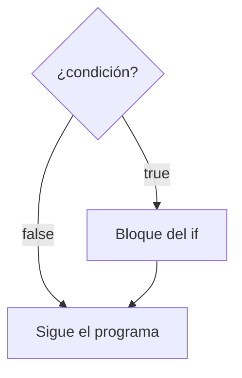
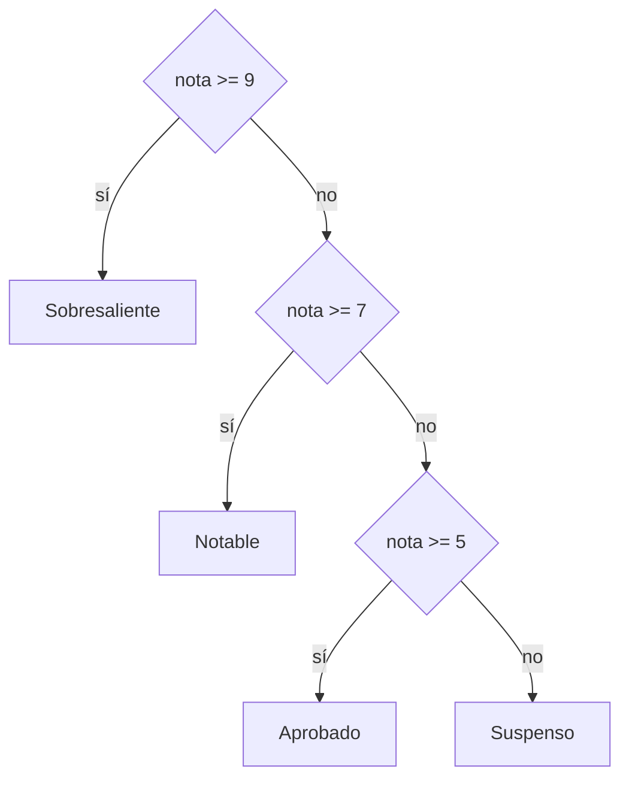

# Tema 06 · Condicionales

[⬅️ Tema anterior](../05-entrada-y-salida/README.md) · [🏠 Índice](../../INDICE.md) · [Siguiente tema ➡️](../07-bucles/README.md)

En el tema 01 viste la **decisión** como una de las tres estructuras básicas, y en el tema 04 aprendiste a escribir condiciones (`>=`, `&&`, `||`...). Ahora toca usarlas para que el programa **elija qué hacer**: `if`, `else if`, `else`, el operador ternario y `switch` en sus dos versiones.

## 🎯 Objetivos

- Escribir decisiones con `if`, `if-else` y `else if`.
- Anidar condicionales y saber cuándo conviene evitarlo.
- Usar el **operador ternario** para elegir entre dos valores.
- Usar `switch` **clásico** (con `break`) y **moderno** (con `->` y `yield`).
- Comparar textos con `equals`.
- Evitar los errores típicos de los condicionales.

## 📚 Contenido

1. [if: hacer algo solo si se cumple una condición](#1-if-hacer-algo-solo-si-se-cumple-una-condición)
2. [if-else: dos caminos](#2-if-else-dos-caminos)
3. [else if: varios caminos](#3-else-if-varios-caminos)
4. [Condicionales anidados](#4-condicionales-anidados)
5. [Bloques y ámbito de las variables](#5-bloques-y-ámbito-de-las-variables)
6. [El operador ternario](#6-el-operador-ternario)
7. [switch clásico](#7-switch-clásico)
8. [switch moderno](#8-switch-moderno)
9. [Comparar textos](#9-comparar-textos)
10. [¿if o switch?](#10-if-o-switch)
11. [Errores típicos](#11-errores-típicos)
12. [Resumen](#12-resumen)

---

## 1. if: hacer algo solo si se cumple una condición

```java
if (condición) {
    // Solo se ejecuta si la condición es true
}
```



```java
if (temperatura > 30) {
    System.out.println("Hace calor, bebe agua");
}
System.out.println("Fin del informe");   // Se ejecuta siempre
```

La condición tiene que ser un `boolean`: una comparación, una variable `boolean` o una combinación con `&&`, `||` y `!`.

## 2. if-else: dos caminos

```java
if (edad >= 18) {
    System.out.println("Mayor de edad");
} else {
    System.out.println("Menor de edad");
}
```

Siempre se ejecuta **exactamente uno** de los dos bloques: nunca los dos, nunca ninguno.

## 3. else if: varios caminos

```java
if (nota >= 9) {
    System.out.println("Sobresaliente");
} else if (nota >= 7) {
    System.out.println("Notable");
} else if (nota >= 5) {
    System.out.println("Aprobado");
} else {
    System.out.println("Suspenso");
}
```



- Las condiciones se comprueban **en orden, de arriba abajo**.
- En cuanto una es `true`, se ejecuta su bloque y **se saltan todas las demás**.
- Por eso, en el segundo `else if` no hace falta escribir `nota >= 7 && nota < 9`: si hemos llegado ahí, ya sabemos que `nota < 9`.
- El `else` final es opcional y recoge "todo lo demás".

⚠️ **El orden importa.** Si pones `nota >= 5` primero, un 9.5 mostraría "Aprobado".

### Varios if sueltos frente a else if

```java
// Con else if: solo se ejecuta UN bloque
if (x > 0) { ... } else if (x > 10) { ... }

// Con if sueltos: se comprueban TODOS y se pueden ejecutar varios
if (x > 0) { ... }
if (x > 10) { ... }
```

Usa `else if` cuando los casos son **excluyentes** (solo uno puede ocurrir) y `if` sueltos cuando son **independientes**.

## 4. Condicionales anidados

Un `if` puede ir dentro de otro:

```java
if (tieneEntrada) {
    if (edad >= 18) {
        System.out.println("Adelante");
    } else {
        System.out.println("Necesitas ir acompañado");
    }
} else {
    System.out.println("Primero compra una entrada");
}
```

Anidar es útil cuando la segunda pregunta **solo tiene sentido** si la primera se cumple. Pero muchos niveles hacen el código difícil de leer. A menudo se puede **aplanar** con `&&` o con `else if`:

```java
// Anidado
if (edad >= 18) {
    if (tieneCarnet) {
        System.out.println("Puede conducir");
    }
}

// Aplanado (mismo resultado)
if (edad >= 18 && tieneCarnet) {
    System.out.println("Puede conducir");
}
```

## 5. Bloques y ámbito de las variables

Una variable declarada **dentro** de unas llaves solo existe dentro de ellas (su **ámbito**):

```java
if (edad >= 18) {
    String mensaje = "Mayor";      // Solo existe dentro de este bloque
}
// System.out.println(mensaje);   // ❌ Error: cannot find symbol
```

Si necesitas usarla después, declárala **antes** del `if`:

```java
String mensaje;
if (edad >= 18) {
    mensaje = "Mayor";
} else {
    mensaje = "Menor";
}
System.out.println(mensaje);       // ✅
```

Java comprueba que la variable tenga valor en **todos** los caminos. Si quitas el `else`, da error: `variable mensaje might not have been initialized`.

### ¿Y las llaves opcionales?

Si el bloque tiene una sola instrucción, Java permite omitir las llaves. **No lo hagas**: es una fuente clásica de errores.

```java
if (saldo < 0)
    System.out.println("Saldo negativo");
    System.out.println("Avisando al banco...");   // ⚠️ ¡Se ejecuta SIEMPRE! No está dentro del if
```

En este repositorio usamos **siempre** llaves.

## 6. El operador ternario

Es un `if-else` en forma de **expresión**: devuelve un valor u otro según la condición.

```java
condición ? valorSiTrue : valorSiFalse
```

```java
String estado = edad >= 18 ? "mayor" : "menor";
int maximo = a > b ? a : b;
System.out.println("Tienes " + n + (n == 1 ? " mensaje" : " mensajes"));
```

Úsalo para elegir **un valor** en casos sencillos. Si hay que ejecutar instrucciones, o hay más de dos opciones, usa `if`. Encadenar ternarios (`a ? b : c ? d : e`) es legal, pero difícil de leer.

## 7. switch clásico

`switch` compara **una variable** con varios valores concretos:

```java
switch (dia) {
    case 1:
        System.out.println("Lunes");
        break;
    case 2:
        System.out.println("Martes");
        break;
    // ...
    default:
        System.out.println("Día no válido");
        break;
}
```

- Funciona con `int`, `char`, `String`, `byte`, `short` y `enum` (tema 18). **No** con `double`, `long` ni `boolean`.
- Cada `case` lleva un valor **constante** (no se pueden poner rangos ni condiciones).
- `default` se ejecuta si ningún `case` coincide (es opcional, pero conviene ponerlo).
- **`break`** termina el `switch`. Es el **único** sitio donde usaremos `break` en este repositorio.

### El "fall-through": olvidar el break

Si un `case` no tiene `break`, la ejecución **sigue en el siguiente `case`** sin comprobarlo:

```java
switch (nivel) {
    case 1:
        System.out.println("Nivel 1");   // Si nivel es 1...
    case 2:
        System.out.println("Nivel 2");   // ...¡también se ejecuta esto!
        break;
}
```

Normalmente es un error, pero se aprovecha para **agrupar casos**:

```java
switch (mes) {
    case 12:
    case 1:
    case 2:
        System.out.println("Invierno");
        break;
    case 3:
    case 4:
    case 5:
        System.out.println("Primavera");
        break;
    // ...
}
```

## 8. switch moderno

Desde Java 14 existe una forma más segura y compacta, con flechas `->`:

```java
switch (dia) {
    case 1 -> System.out.println("Lunes");
    case 2 -> System.out.println("Martes");
    case 6, 7 -> System.out.println("Fin de semana");   // Varios valores separados por comas
    default -> System.out.println("Otro día");
}
```

- **No hay fall-through**: cada `case` ejecuta solo lo suyo. No hace falta `break`.
- Varios valores en el mismo `case`, separados por comas.
- Si un caso necesita varias instrucciones, se ponen entre llaves: `case 1 -> { ...; ...; }`.

### switch como expresión

El `switch` moderno puede **devolver un valor**, igual que el ternario:

```java
String nombreDia = switch (dia) {
    case 1 -> "Lunes";
    case 2 -> "Martes";
    case 3 -> "Miércoles";
    case 6, 7 -> "Fin de semana";
    default -> "Desconocido";
};   // ← punto y coma: es una asignación
```

Cuando un caso necesita **varias instrucciones** antes de dar el valor, se usa un bloque con **`yield`**:

```java
int diasDelMes = switch (mes) {
    case 4, 6, 9, 11 -> 30;
    case 2 -> {
        boolean bisiesto = (anio % 4 == 0 && anio % 100 != 0) || anio % 400 == 0;
        yield bisiesto ? 29 : 28;      // yield "devuelve" el valor de este caso
    }
    default -> 31;
};
```

Un `switch` como expresión tiene que cubrir **todos** los casos posibles; con `int` o `String` eso significa que el `default` es obligatorio.

| | switch clásico | switch moderno |
|---|---|---|
| Sintaxis | `case X:` | `case X ->` |
| ¿Necesita `break`? | Sí | No |
| Fall-through | Sí (si olvidas `break`) | No |
| Varios valores | Casos apilados | `case 1, 2, 3 ->` |
| ¿Puede devolver un valor? | No | Sí (`yield` en bloques) |

En código nuevo, **prefiere el switch moderno**. El clásico lo seguirás encontrando en mucho código existente.

## 9. Comparar textos

Para comparar `String` **no se usa `==`**, sino `equals`:

```java
String respuesta = teclado.nextLine();

if (respuesta.equals("si")) { ... }                 // Distingue mayúsculas: "Si" no coincide
if (respuesta.equalsIgnoreCase("si")) { ... }       // "si", "Si", "SI"... todos coinciden
```

`==` con objetos compara si son **el mismo objeto en memoria**, no si tienen el mismo contenido. A veces funciona por casualidad y otras no, así que no te fíes. Lo verás en detalle en el [tema 09](../09-strings/README.md).

Dentro de un `switch`, en cambio, los `String` sí se comparan por contenido automáticamente:

```java
switch (comando) {
    case "salir" -> System.out.println("Adiós");
    case "ayuda" -> System.out.println("Comandos: salir, ayuda");
    default -> System.out.println("Comando desconocido");
}
```

## 10. ¿if o switch?

| Situación | Mejor opción |
|---|---|
| Rangos (`nota >= 5`), condiciones compuestas | `if` / `else if` |
| Comparar una variable con varios valores **exactos** | `switch` |
| Elegir entre dos valores | Ternario |
| Elegir un valor entre muchos valores exactos | `switch` como expresión |

## 11. Errores típicos

| Error | Ejemplo | Qué pasa |
|---|---|---|
| `;` detrás del `if` | `if (x > 0); { ... }` | El `;` es una instrucción vacía: el bloque se ejecuta **siempre** |
| `=` en lugar de `==` | `if (x = 5)` | Error de compilación |
| Comparar textos con `==` | `if (nombre == "Ana")` | Puede dar `false` aunque el texto sea igual |
| Orden incorrecto en `else if` | `>= 5` antes que `>= 9` | Los casos más concretos nunca se alcanzan |
| Olvidar `break` en el switch clásico | | Se ejecutan también los casos siguientes |
| Sin llaves | `if (c) a(); b();` | `b()` se ejecuta siempre |
| Variable declarada dentro del `if` | | No existe fuera del bloque |
| Casos límite | `nota > 5` en lugar de `>= 5` | Un 5 justo queda fuera |

## 12. Resumen

- `if` ejecuta un bloque si la condición es `true`; `else` cubre el caso contrario.
- `else if` encadena casos **excluyentes**, comprobados en orden.
- Las variables viven dentro de su bloque `{ }`. Usa **siempre llaves**.
- El **ternario** `c ? a : b` elige entre dos valores.
- `switch` compara una variable con valores exactos. El **clásico** necesita `break`; el **moderno** (`->`) no, y puede devolver un valor con `yield`.
- Los textos se comparan con `equals` o `equalsIgnoreCase`, nunca con `==`.

---

## 💻 Ejemplos de código

| Archivo | Qué muestra |
|---|---|
| [T06_01_IfElse.java](ejemplos/T06_01_IfElse.java) | `if`, `if-else`, ámbito de variables y el peligro de no usar llaves |
| [T06_02_ElseIfYAnidados.java](ejemplos/T06_02_ElseIfYAnidados.java) | Cadenas `else if`, orden de las condiciones y anidamiento |
| [T06_03_OperadorTernario.java](ejemplos/T06_03_OperadorTernario.java) | El ternario y cuándo usarlo |
| [T06_04_SwitchClasico.java](ejemplos/T06_04_SwitchClasico.java) | `switch` con `break`, fall-through y agrupación de casos |
| [T06_05_SwitchModerno.java](ejemplos/T06_05_SwitchModerno.java) | `switch` con `->`, como expresión, `yield` y con `String` |

> El ejemplo 02 **espera que escribas** una nota y una edad.

## ✏️ Ejercicios

Practica lo aprendido en los [ejercicios del tema 06](../../ejercicios/06-condicionales/README.md).

---

[⬅️ Tema anterior](../05-entrada-y-salida/README.md) · [🏠 Índice](../../INDICE.md) · [Siguiente tema ➡️](../07-bucles/README.md)
