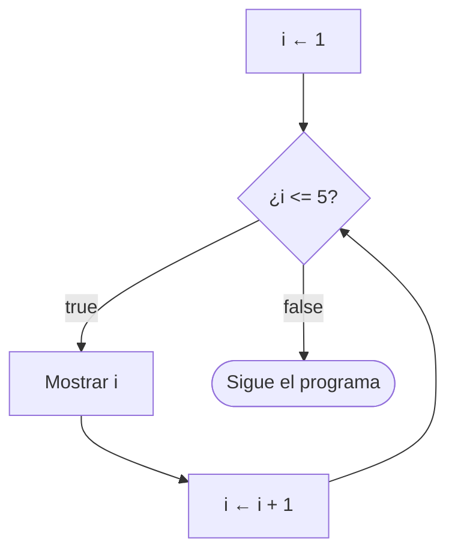
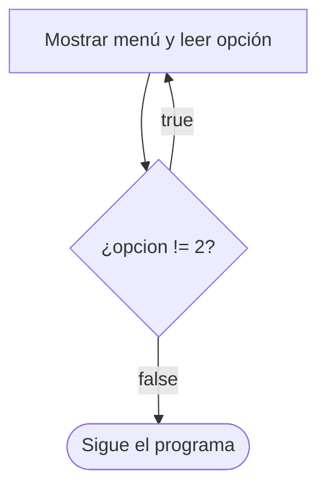

# Tema 07 · Bucles

[⬅️ Tema anterior](../06-condicionales/README.md) · [🏠 Índice](../../INDICE.md) · [Siguiente tema ➡️](../08-arrays-y-matrices/README.md)

La **repetición** es la tercera estructura básica que viste en el tema 01. Con los bucles, un programa puede repetir instrucciones cientos de veces, mostrar menús hasta que el usuario quiera salir o validar lo que escribe. En este tema verás `while`, `do-while` y `for`, los patrones más usados (contadores, acumuladores, máximos, banderas) y cómo terminar un bucle de forma limpia.

## 🎯 Objetivos

- Usar `while`, `do-while` y `for`, y saber cuál elegir en cada caso.
- Aplicar los patrones **contador**, **acumulador**, **máximo/mínimo** y **bandera**.
- Terminar un bucle antes de tiempo **con su propia condición** (sin `break` ni `continue`).
- Escribir **bucles anidados**.
- **Validar** lo que escribe el usuario.
- Evitar los bucles infinitos y los errores de "uno de más o de menos".

## 📚 Contenido

1. [¿Por qué bucles?](#1-por-qué-bucles)
2. [while](#2-while)
3. [do-while](#3-do-while)
4. [for](#4-for)
5. [Patrones: contador, acumulador, máximo y mínimo](#5-patrones-contador-acumulador-máximo-y-mínimo)
6. [Terminar un bucle con su condición: banderas](#6-terminar-un-bucle-con-su-condición-banderas)
7. [Bucles anidados](#7-bucles-anidados)
8. [Validar la entrada del usuario](#8-validar-la-entrada-del-usuario)
9. [¿Qué bucle elijo?](#9-qué-bucle-elijo)
10. [Errores típicos](#10-errores-típicos)
11. [Resumen](#11-resumen)

---

## 1. ¿Por qué bucles?

Mostrar los números del 1 al 5 sin bucle exige cinco líneas casi iguales. Del 1 al 1000, mil líneas. Con un bucle, se escribe la instrucción **una vez** y se indica **cuántas veces** o **hasta cuándo** repetirla.

Todo bucle tiene tres piezas:

| Pieza | Pregunta | Ejemplo |
|---|---|---|
| **Inicialización** | ¿Desde dónde empiezo? | `int i = 1;` |
| **Condición** | ¿Sigo repitiendo? | `i <= 5` |
| **Actualización** | ¿Qué cambia en cada vuelta? | `i++` |

Si falta la actualización, la condición nunca cambia y el bucle no termina: un **bucle infinito**.

## 2. while

Repite **mientras** la condición sea `true`. La condición se comprueba **antes** de cada vuelta, así que puede que no se ejecute **ninguna** vez.

```java
int i = 1;                 // Inicialización
while (i <= 5) {           // Condición
    System.out.println(i);
    i++;                   // Actualización
}
```



`while` es la opción natural cuando **no sabes cuántas vueltas** dará el bucle: "mientras el usuario no acierte", "mientras quede saldo", "mientras no lleguemos al objetivo".

## 3. do-while

Igual que `while`, pero la condición se comprueba **después** de cada vuelta: el cuerpo se ejecuta **al menos una vez**.

```java
int opcion;
do {
    System.out.println("1. Jugar  2. Salir");
    opcion = teclado.nextInt();
} while (opcion != 2);     // ← punto y coma obligatorio
```



Es perfecto para **menús** y para **pedir un dato hasta que sea válido**: siempre hay que preguntar al menos una vez.

⚠️ La variable de la condición (`opcion`) tiene que estar declarada **fuera** del `do { }`; si se declara dentro, no existe en el `while`.

## 4. for

Reúne las tres piezas en una sola línea. Es la opción natural cuando **sabes cuántas vueltas** quieres dar.

```java
for (int i = 1; i <= 5; i++) {
    System.out.println(i);
}
```

```
for ( inicialización ; condición ; actualización ) {
      se hace 1 vez    antes de     después de
      al empezar       cada vuelta  cada vuelta
}
```

Variaciones habituales:

```java
for (int i = 0; i < 10; i++) { ... }        // 10 vueltas: 0, 1, ..., 9
for (int i = 10; i >= 1; i--) { ... }       // Cuenta atrás: 10, 9, ..., 1
for (int i = 0; i <= 100; i += 5) { ... }   // De 5 en 5: 0, 5, 10, ..., 100
```

- La variable `i` declarada en el `for` **solo existe dentro** del bucle.
- **No cambies** la variable del `for` dentro del cuerpo: el bucle se vuelve impredecible. Si necesitas controlar el avance a mano, usa `while`.

### for y while son equivalentes

```java
for (int i = 1; i <= 5; i++) {          int i = 1;
    System.out.println(i);              while (i <= 5) {
}                                           System.out.println(i);
                                            i++;
                                        }
```

Cualquier `for` se puede escribir como `while` y viceversa. Elegimos el que **comunica mejor** la intención.

> Existe un cuarto bucle, el **for-each** (`for (int x : lista)`), para recorrer colecciones de datos. Lo verás con los arrays en el [tema 08](../08-arrays-y-matrices/README.md).

## 5. Patrones: contador, acumulador, máximo y mínimo

Casi todos los bucles usan alguno de estos patrones:

| Patrón | Para qué | Inicialización | En cada vuelta |
|---|---|---|---|
| **Contador** | Contar cuántas veces pasa algo | `int contador = 0;` | `contador++;` (a veces dentro de un `if`) |
| **Acumulador (suma)** | Sumar valores | `int suma = 0;` | `suma += valor;` |
| **Acumulador (producto)** | Multiplicar valores | `long producto = 1;` | `producto *= valor;` |
| **Máximo** | Guardar el mayor | Con el **primer** valor | `if (valor > maximo) maximo = valor;` |
| **Mínimo** | Guardar el menor | Con el **primer** valor | `if (valor < minimo) minimo = valor;` |

```java
int suma = 0;
int pares = 0;
for (int i = 1; i <= 10; i++) {
    suma += i;              // Acumulador
    if (i % 2 == 0) {
        pares++;            // Contador condicional
    }
}
double media = (double) suma / 10;
```

**¿Por qué el máximo empieza con el primer valor y no con 0?** Si todos los valores fueran negativos (−5, −2, −8), un máximo inicializado a 0 diría que el mayor es 0, que ni siquiera está en los datos. Si no tienes el primer valor a mano, otra opción segura es `Integer.MIN_VALUE` (para el máximo) o `Integer.MAX_VALUE` (para el mínimo).

## 6. Terminar un bucle con su condición: banderas

A veces quieres **parar antes de tiempo**: en cuanto encuentras lo que buscabas, en cuanto el usuario acierta... Java tiene las instrucciones `break` (salir del bucle) y `continue` (saltar a la siguiente vuelta), pero **en este repositorio no las usamos en bucles**.

> 📏 **Regla del repositorio:** un bucle termina **solo** porque su condición se vuelve `false`. No se usa `continue`, y `break` solo se usa dentro de un `switch`.

¿Por qué? Porque así, **leyendo solo la condición**, sabes todas las formas en que el bucle puede terminar. Con `break` repartidos por el cuerpo, hay que leer todo el código para saberlo.

### La bandera (flag)

Una **bandera** es una variable `boolean` que indica si algo ha pasado. Se añade a la condición del bucle:

```java
// Buscar el primer múltiplo de 7 entre 50 y 100
boolean encontrado = false;
int numero = 50;
while (numero <= 100 && !encontrado) {
    if (numero % 7 == 0) {
        encontrado = true;      // En lugar de break
    } else {
        numero++;
    }
}
// Al salir, sabemos POR QUÉ ha terminado mirando la bandera
if (encontrado) {
    System.out.println("El primero es " + numero);
}
```

La condición se lee: *"sigue mientras queden números **y** no lo hayas encontrado"*. Las dos formas de terminar están a la vista.

### Sustituir continue

`continue` salta el resto de la vuelta. Se sustituye simplemente poniendo ese resto dentro de un `if`:

```java
// Con continue (NO lo usamos)          // Sin continue (así lo hacemos)
for (int i = 1; i <= 10; i++) {         for (int i = 1; i <= 10; i++) {
    if (i % 3 == 0) {                       if (i % 3 != 0) {
        continue;                               System.out.println(i);
    }                                       }
    System.out.println(i);              }
}
```

## 7. Bucles anidados

Un bucle puede ir dentro de otro. Por **cada vuelta** del bucle exterior, el interior hace **todas** sus vueltas.

```java
for (int fila = 1; fila <= 3; fila++) {
    for (int columna = 1; columna <= 4; columna++) {
        System.out.print("* ");
    }
    System.out.println();      // Salto de línea al terminar cada fila
}
```

```
* * * *
* * * *
* * * *
```

El cuerpo interior se ejecuta 3 × 4 = **12** veces. Usos típicos: tablas (filas × columnas), patrones de dibujo, comparar todos los elementos con todos y, en el tema 08, recorrer **matrices**.

El bucle interior puede depender del exterior:

```java
for (int fila = 1; fila <= 4; fila++) {
    for (int i = 1; i <= fila; i++) {    // La fila 1 tiene 1 asterisco, la 2 tiene 2...
        System.out.print("*");
    }
    System.out.println();
}
```

```
*
**
***
****
```

Usa nombres de variables que expliquen qué recorre cada bucle (`fila`, `columna`) en lugar de `i` y `j` cuando ayude a entender el código.

## 8. Validar la entrada del usuario

Con `do-while` puedes repetir la pregunta hasta que el dato sea **correcto**:

```java
int edad;
do {
    System.out.print("Edad (0-120): ");
    edad = teclado.nextInt();
    if (edad < 0 || edad > 120) {
        System.out.println("Edad fuera de rango, prueba otra vez");
    }
} while (edad < 0 || edad > 120);
```

¿Y si el usuario escribe **letras**? `nextInt()` lanzaría `InputMismatchException`. `Scanner` permite **comprobar antes de leer** con `hasNextInt()`, `hasNextDouble()`...:

```java
System.out.print("Escribe un número: ");
while (!teclado.hasNextInt()) {             // ¿Lo siguiente NO es un int?
    String basura = teclado.next();         // Lo descartamos...
    System.out.print("'" + basura + "' no es un número. Otra vez: ");
}
int numero = teclado.nextInt();             // Ahora es seguro
```

| Método | Devuelve `true` si lo siguiente es... |
|---|---|
| `hasNextInt()` | Un `int` |
| `hasNextDouble()` | Un `double` (con la coma o el punto de tu sistema) |
| `hasNextLine()` | Otra línea |

## 9. ¿Qué bucle elijo?

| Situación | Bucle |
|---|---|
| Sé **cuántas** vueltas (recorrer del 1 al N, repetir 10 veces) | `for` |
| Repito **mientras** se cumpla algo, quizá ninguna vez | `while` |
| Tengo que hacerlo **al menos una vez** (menú, pedir un dato) | `do-while` |
| Recorrer todos los elementos de un array o colección | for-each (tema 08) |

## 10. Errores típicos

| Error | Ejemplo | Efecto |
|---|---|---|
| Olvidar la actualización | `while (i <= 5) { print(i); }` | Bucle infinito (para pararlo: `Ctrl + C`) |
| Actualizar en sentido contrario | `for (int i = 10; i > 0; i++)` | Bucle (casi) infinito |
| `;` tras el `for` o el `while` | `for (int i = 0; i < 5; i++);` | El cuerpo se ejecuta **una sola vez**, después del bucle |
| Uno de más o de menos | `i < 5` cuando querías incluir el 5 | Una vuelta de menos |
| Reiniciar dentro del bucle | `suma = 0;` dentro del `for` | El acumulador se borra en cada vuelta |
| Mostrar el resultado dentro del bucle | `println(suma)` dentro del `for` | Se muestra en cada vuelta en lugar de al final |
| Olvidar el `;` del `do-while` | `} while (x > 0)` | Error de compilación |
| Máximo inicializado a 0 | Con datos negativos | Resultado incorrecto |

**Truco para depurar:** si un bucle no hace lo que esperas, añade un `println` dentro que muestre las variables en cada vuelta. Es una **traza** automática, como las del tema 01.

## 11. Resumen

- `while` comprueba **antes**; `do-while` comprueba **después** (al menos una vuelta); `for` agrupa inicialización, condición y actualización.
- Patrones clave: **contador**, **acumulador**, **máximo/mínimo** (empezando por el primer valor) y **bandera**.
- En este repositorio, un bucle termina **solo por su condición**: para salir antes, usa una **bandera** en la condición; en lugar de `continue`, usa un `if`.
- En los **bucles anidados**, el interior completa todas sus vueltas por cada vuelta del exterior.
- `do-while` + `hasNextInt()` permiten **validar** la entrada sin que el programa falle.

---

## 💻 Ejemplos de código

| Archivo | Qué muestra |
|---|---|
| [T07_01_While.java](ejemplos/T07_01_While.java) | `while`: contar, cuenta atrás, repetir sin saber cuántas veces |
| [T07_02_DoWhile.java](ejemplos/T07_02_DoWhile.java) | `do-while` con un menú |
| [T07_03_For.java](ejemplos/T07_03_For.java) | `for`: rangos, pasos, cuenta atrás y equivalencia con `while` |
| [T07_04_PatronesYBanderas.java](ejemplos/T07_04_PatronesYBanderas.java) | Contador, acumulador, máximo, mínimo y salida con bandera |
| [T07_05_BuclesAnidados.java](ejemplos/T07_05_BuclesAnidados.java) | Tablas y patrones con bucles anidados |
| [T07_06_ValidarEntrada.java](ejemplos/T07_06_ValidarEntrada.java) | Validar rangos y tipos con `do-while` y `hasNextInt()` |

> Los ejemplos 02 y 06 **esperan que escribas** datos.

## ✏️ Ejercicios

Practica lo aprendido en los [ejercicios del tema 07](../../ejercicios/07-bucles/README.md).

---

[⬅️ Tema anterior](../06-condicionales/README.md) · [🏠 Índice](../../INDICE.md) · [Siguiente tema ➡️](../08-arrays-y-matrices/README.md)
