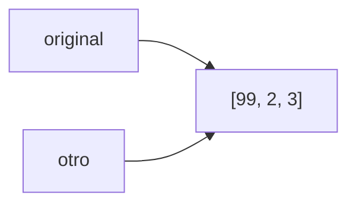

# Tema 08 · Arrays y matrices

[⬅️ Tema anterior](../07-bucles/README.md) · [🏠 Índice](../../INDICE.md) · [Siguiente tema ➡️](../09-strings/README.md)

Hasta ahora, cada dato vivía en su propia variable. Pero ¿y si tienes las notas de 30 alumnos, las temperaturas de un año o el tablero de un juego? Un **array** guarda muchos valores del mismo tipo bajo un único nombre, y una **matriz** los organiza en filas y columnas. Junto con los bucles del tema 07, son la base de casi todos los algoritmos.

## 🎯 Objetivos

- Declarar, crear e inicializar arrays.
- Acceder a sus elementos por **índice** y recorrerlos con `for` y **for-each**.
- Aplicar los algoritmos típicos: suma, media, máximo, mínimo, contar, **buscar** e **invertir**.
- **Ordenar** con el método de la burbuja y con `Arrays.sort`.
- Entender que un array es una **referencia** y saber copiarlo.
- Usar la clase **`Arrays`**.
- Trabajar con **matrices** (arrays de dos dimensiones).

## 📚 Contenido

1. [¿Qué es un array?](#1-qué-es-un-array)
2. [Declarar y crear arrays](#2-declarar-y-crear-arrays)
3. [Acceder a los elementos](#3-acceder-a-los-elementos)
4. [Recorrer un array](#4-recorrer-un-array)
5. [Algoritmos básicos](#5-algoritmos-básicos)
6. [Buscar en un array](#6-buscar-en-un-array)
7. [Ordenar un array](#7-ordenar-un-array)
8. [Arrays y referencias: copiar un array](#8-arrays-y-referencias-copiar-un-array)
9. [La clase Arrays](#9-la-clase-arrays)
10. [Matrices](#10-matrices)
11. [Recorrer matrices](#11-recorrer-matrices)
12. [Errores típicos](#12-errores-típicos)
13. [Resumen](#13-resumen)

---

## 1. ¿Qué es un array?

Imagina una **cajonera** con cajones numerados. Toda la cajonera tiene un nombre (`notas`), cada cajón tiene un número (su **índice**) y dentro de cada cajón hay un valor.

```
notas →  ┌─────┬─────┬─────┬─────┬─────┐
         │  7  │  5  │  9  │  6  │  8  │
         └─────┴─────┴─────┴─────┴─────┘
índice:     0     1     2     3     4
```

Características de un array en Java:

- Todos los elementos son del **mismo tipo** (`int`, `double`, `String`...).
- Tiene un **tamaño fijo**: se decide al crearlo y no puede cambiar.
- Los índices empiezan en **0**: el último es `tamaño - 1`.

> Si necesitas una lista que crezca y encoja, existe `ArrayList`, que verás en el [tema 16](../16-colecciones/README.md).

## 2. Declarar y crear arrays

### Con un tamaño

```java
int[] notas = new int[5];          // 5 cajones, todos con el valor por defecto
String[] nombres = new String[3];
```

Al crear un array con `new`, cada elemento recibe un **valor por defecto**:

| Tipo | Valor por defecto |
|---|---|
| `int`, `long`, `short`, `byte` | `0` |
| `double`, `float` | `0.0` |
| `boolean` | `false` |
| `char` | `'\u0000'` (carácter nulo) |
| `String` y otros objetos | `null` (no hay nada) |

### Con sus valores

Si ya conoces los valores, puedes escribirlos entre llaves. El tamaño se deduce solo:

```java
int[] notas = {7, 5, 9, 6, 8};                    // Tamaño 5
String[] dias = {"lunes", "martes", "miércoles"};  // Tamaño 3
```

> También se puede escribir `int notas[]`, con los corchetes detrás del nombre (herencia del lenguaje C), pero la forma recomendada en Java es `int[] notas`: el tipo es "array de int".

## 3. Acceder a los elementos

Se usa el nombre y el índice entre corchetes:

```java
int[] notas = {7, 5, 9, 6, 8};

System.out.println(notas[0]);   // 7  (el primero)
System.out.println(notas[4]);   // 8  (el último)
notas[1] = 10;                  // Cambiamos el segundo: {7, 10, 9, 6, 8}
notas[2]++;                     // Cada elemento se usa como una variable normal
```

El tamaño está en **`length`** (sin paréntesis: es un atributo, no un método):

```java
int tamanio = notas.length;              // 5
int ultimo = notas[notas.length - 1];    // 8
```

Si usas un índice que no existe, el programa se detiene:

```java
notas[5] = 3;   // ❌ ArrayIndexOutOfBoundsException: Index 5 out of bounds for length 5
```

## 4. Recorrer un array

### Con for (cuando necesitas el índice)

```java
for (int i = 0; i < notas.length; i++) {
    System.out.println("Nota " + i + ": " + notas[i]);
}
```

Fíjate en la condición: `i < notas.length` (no `<=`). Así `i` va de 0 a `length - 1`.

### Con for-each (cuando solo necesitas los valores)

```java
for (int nota : notas) {         // "para cada nota de notas"
    System.out.println(nota);
}
```

| | `for` clásico | for-each |
|---|---|---|
| ¿Conoces la posición? | Sí (`i`) | No |
| ¿Puedes **modificar** el array? | Sí: `notas[i] = ...` | No: cambiar `nota` no cambia el array |
| ¿Puedes recorrer solo una parte o al revés? | Sí | No: siempre todo, de principio a fin |
| Legibilidad | Normal | Muy clara |

Regla práctica: usa **for-each** para leer todos los valores y **`for`** cuando necesites el índice, modificar o recorrer de otra forma.

## 5. Algoritmos básicos

Son los patrones del tema 07 (acumulador, contador, máximo...) aplicados a un array.

```java
int[] datos = {4, 8, 15, 16, 23, 42};

// Suma y media
int suma = 0;
for (int dato : datos) {
    suma += dato;
}
double media = (double) suma / datos.length;

// Máximo y su posición (empezando por el primer elemento)
int maximo = datos[0];
int posicionMaximo = 0;
for (int i = 1; i < datos.length; i++) {
    if (datos[i] > maximo) {
        maximo = datos[i];
        posicionMaximo = i;
    }
}

// Contar los que cumplen una condición
int pares = 0;
for (int dato : datos) {
    if (dato % 2 == 0) {
        pares++;
    }
}
```

### Invertir un array

Se intercambian los elementos de los extremos hacia el centro (con una variable auxiliar, como en el tema 03):

```java
for (int i = 0; i < datos.length / 2; i++) {
    int auxiliar = datos[i];
    datos[i] = datos[datos.length - 1 - i];
    datos[datos.length - 1 - i] = auxiliar;
}
```

```
{4, 8, 15, 16, 23, 42}
 ↑                  ↑   i = 0: intercambia posiciones 0 y 5
     ↑          ↑       i = 1: intercambia posiciones 1 y 4
         ↑  ↑           i = 2: intercambia posiciones 2 y 3
{42, 23, 16, 15, 8, 4}
```

Solo se recorre **la mitad**: si se recorriera entero, cada par se intercambiaría dos veces y el array volvería a quedar igual.

## 6. Buscar en un array

### Búsqueda lineal

Se revisa elemento a elemento hasta encontrarlo. Para parar en cuanto aparece, usamos una **bandera** en la condición (sin `break`, como en el tema 07):

```java
int buscado = 15;
int posicion = -1;              // -1 significa "no encontrado"
int i = 0;
while (i < datos.length && posicion == -1) {
    if (datos[i] == buscado) {
        posicion = i;
    }
    i++;
}
```

Aquí la propia variable `posicion` hace de bandera: mientras valga −1, seguimos buscando.

### Búsqueda binaria

Si el array está **ordenado**, se puede buscar mucho más rápido: mirar el elemento del medio y descartar la mitad donde seguro que no está (como en el juego de adivinar el número del tema 07). `Arrays.binarySearch(array, valor)` lo hace por ti.

| | Lineal | Binaria |
|---|---|---|
| Requisito | Ninguno | El array debe estar **ordenado** |
| Comparaciones (1 000 000 elementos) | Hasta 1 000 000 | Unas 20 |

## 7. Ordenar un array

### Método de la burbuja

Es el algoritmo de ordenación más sencillo de entender. Se recorre el array comparando cada elemento con el siguiente; si están en mal orden, se intercambian. Así, en cada pasada el mayor "sube" hasta el final, como una burbuja.

```java
int[] v = {5, 1, 4, 2, 8};
boolean hayCambios = true;
int pasada = 0;
while (hayCambios) {
    hayCambios = false;
    for (int i = 0; i < v.length - 1 - pasada; i++) {
        if (v[i] > v[i + 1]) {
            int auxiliar = v[i];
            v[i] = v[i + 1];
            v[i + 1] = auxiliar;
            hayCambios = true;
        }
    }
    pasada++;
}
```

```
Inicio:    5 1 4 2 8
Pasada 1:  1 4 2 5 8   ← el 8 ya está en su sitio
Pasada 2:  1 2 4 5 8
Pasada 3:  1 2 4 5 8   ← sin cambios: termina
```

- `- pasada` evita comparar la parte final, que ya está ordenada.
- La bandera `hayCambios` termina el bucle en cuanto una pasada no cambia nada: el array ya está ordenado.

La burbuja es lenta con muchos datos. En programas reales se usa **`Arrays.sort`**, que es mucho más eficiente:

```java
Arrays.sort(v);   // Ordena de menor a mayor
```

## 8. Arrays y referencias: copiar un array

Un array **no** es un tipo primitivo: la variable no guarda los datos, sino una **referencia** (la dirección de la cajonera). Esto tiene una consecuencia importante:

```java
int[] original = {1, 2, 3};
int[] otro = original;     // ⚠️ NO es una copia: las dos variables apuntan a la MISMA cajonera
otro[0] = 99;
System.out.println(original[0]);   // 99 😱
```



Para tener una **copia independiente**:

```java
int[] copia = Arrays.copyOf(original, original.length);
// o bien:
int[] copia2 = original.clone();
```

Por el mismo motivo, `==` entre arrays compara si son **la misma cajonera**, no si tienen el mismo contenido. Para comparar contenidos: `Arrays.equals(a, b)`.

## 9. La clase Arrays

`java.util.Arrays` tiene utilidades para trabajar con arrays (hay que importarla):

| Método | Qué hace |
|---|---|
| `Arrays.toString(v)` | Devuelve un texto como `[1, 2, 3]` (ideal para mostrar) |
| `Arrays.sort(v)` | Ordena de menor a mayor |
| `Arrays.fill(v, valor)` | Rellena todo el array con un valor |
| `Arrays.copyOf(v, n)` | Copia los `n` primeros (si `n` es mayor, rellena con valores por defecto) |
| `Arrays.copyOfRange(v, desde, hasta)` | Copia un trozo (`hasta` no incluido) |
| `Arrays.equals(a, b)` | ¿Mismo contenido? |
| `Arrays.binarySearch(v, x)` | Busca en un array **ordenado** (devuelve la posición, o un número negativo si no está) |

```java
System.out.println(notas);                   // [I@1b6d3586  ← la referencia, no sirve
System.out.println(Arrays.toString(notas));  // [7, 5, 9, 6, 8]
```

### El array de main: String[] args

Ahora ya puedes entender el `String[] args` del `main`: es un array con los **textos que se escriben al lanzar el programa** desde la terminal:

```bash
java Saludo.java Ana Luis
```

```java
// args = {"Ana", "Luis"}
for (String nombre : args) {
    System.out.println("Hola, " + nombre);
}
```

## 10. Matrices

Una **matriz** es un array de **dos dimensiones**: una tabla con **filas** y **columnas**. En Java es, en realidad, un array cuyos elementos son arrays (cada fila es un array).

```java
int[][] tabla = new int[3][4];   // 3 filas y 4 columnas, todo a 0
```

```
              columna 0  columna 1  columna 2  columna 3
fila 0   →  [    0     ,     0     ,     0     ,     0    ]
fila 1   →  [    0     ,     0     ,     0     ,     0    ]
fila 2   →  [    0     ,     0     ,     0     ,     0    ]
```

Con valores iniciales, cada fila va entre sus propias llaves:

```java
int[][] notas = {
    {7, 8, 6},     // Fila 0: alumno 0
    {5, 9, 7},     // Fila 1: alumno 1
    {8, 6, 9}      // Fila 2: alumno 2
};
```

Para acceder a un elemento se indican **dos índices**: primero la fila y luego la columna.

```java
int nota = notas[1][2];     // Fila 1, columna 2 → 7
notas[0][0] = 10;
```

| Expresión | Significado | En el ejemplo |
|---|---|---|
| `notas.length` | Número de **filas** | 3 |
| `notas[0].length` | Número de **columnas** (de la fila 0) | 3 |
| `notas[i]` | La fila `i` completa (un `int[]`) | `notas[1]` = `{5, 9, 7}` |
| `notas[i][j]` | El elemento de la fila `i`, columna `j` | `notas[1][2]` = 7 |

Se pueden crear arrays de más dimensiones (`int[][][]`), pero rara vez hacen falta.

### Matrices irregulares

Como cada fila es un array independiente, las filas pueden tener **tamaños distintos**:

```java
int[][] triangulo = {
    {1},
    {1, 1},
    {1, 2, 1}
};
```

Por eso, al recorrer, se usa `matriz[fila].length` para las columnas de **cada** fila, en lugar de suponer que todas miden lo mismo.

## 11. Recorrer matrices

Con **bucles anidados** (tema 07): el exterior recorre las filas y el interior las columnas.

```java
for (int fila = 0; fila < notas.length; fila++) {
    for (int columna = 0; columna < notas[fila].length; columna++) {
        System.out.print(notas[fila][columna] + " ");
    }
    System.out.println();
}
```

Con for-each, cada vuelta del exterior es una fila completa (un `int[]`):

```java
for (int[] filaNotas : notas) {
    for (int nota : filaNotas) {
        System.out.print(nota + " ");
    }
    System.out.println();
}
```

### Operaciones típicas

```java
// Suma de cada FILA (media de cada alumno)
for (int fila = 0; fila < notas.length; fila++) {
    int sumaFila = 0;                              // Se reinicia para cada fila
    for (int columna = 0; columna < notas[fila].length; columna++) {
        sumaFila += notas[fila][columna];
    }
    System.out.println("Fila " + fila + ": " + sumaFila);
}

// Suma de cada COLUMNA (media de cada asignatura): se intercambian los bucles
for (int columna = 0; columna < notas[0].length; columna++) {
    int sumaColumna = 0;
    for (int fila = 0; fila < notas.length; fila++) {
        sumaColumna += notas[fila][columna];
    }
    System.out.println("Columna " + columna + ": " + sumaColumna);
}

// Diagonal principal (solo en matrices cuadradas): fila == columna
int sumaDiagonal = 0;
for (int i = 0; i < notas.length; i++) {
    sumaDiagonal += notas[i][i];
}
```

Para mostrar una matriz rápidamente: `Arrays.deepToString(notas)` → `[[7, 8, 6], [5, 9, 7], [8, 6, 9]]`.

## 12. Errores típicos

| Error | Ejemplo | Qué pasa |
|---|---|---|
| Índice fuera de rango | `v[v.length]` | `ArrayIndexOutOfBoundsException` |
| `<=` en el recorrido | `for (int i = 0; i <= v.length; i++)` | La última vuelta se sale del array |
| Confundir `length` | `v.length()` | Error de compilación (en arrays no lleva paréntesis; en `String` sí) |
| Mostrar el array directamente | `println(v)` | Muestra algo como `[I@1b6d3586` |
| "Copiar" con `=` | `int[] b = a;` | Las dos variables comparten el array |
| Comparar con `==` | `a == b` | Compara referencias, no contenidos |
| Usar un elemento `null` | `nombres[0].length()` en un `String[]` recién creado | `NullPointerException` |
| Modificar con for-each | `for (int x : v) { x = 0; }` | El array no cambia |
| Intercambiar filas y columnas | `m[columna][fila]` | Resultados incorrectos o fuera de rango |

## 13. Resumen

- Un **array** guarda varios valores del mismo tipo con un **tamaño fijo**; los índices van de `0` a `length - 1`.
- Se recorre con `for` (si necesitas el índice) o con **for-each** (si solo lees los valores).
- Algoritmos clave: suma, media, máximo/mínimo con su posición, contar, invertir, **búsqueda lineal** (con bandera) y **burbuja**.
- Una variable de array es una **referencia**: `=` no copia. Usa `Arrays.copyOf` o `clone()`, y `Arrays.equals` para comparar.
- `Arrays.toString`, `Arrays.sort` y compañía ahorran mucho trabajo.
- Una **matriz** (`int[][]`) es una tabla de filas y columnas; se recorre con **bucles anidados**: `m.length` filas y `m[fila].length` columnas.

---

## 💻 Ejemplos de código

| Archivo | Qué muestra |
|---|---|
| [T08_01_CrearYAcceder.java](ejemplos/T08_01_CrearYAcceder.java) | Declarar, crear, valores por defecto, índices y `length` |
| [T08_02_Recorridos.java](ejemplos/T08_02_Recorridos.java) | `for`, for-each, suma, media, máximo, mínimo, contar e invertir |
| [T08_03_BuscarYOrdenar.java](ejemplos/T08_03_BuscarYOrdenar.java) | Búsqueda lineal con bandera, burbuja, `Arrays.sort` y `binarySearch` |
| [T08_04_ReferenciasYClaseArrays.java](ejemplos/T08_04_ReferenciasYClaseArrays.java) | Referencias, copias y los métodos de `Arrays` |
| [T08_05_Matrices.java](ejemplos/T08_05_Matrices.java) | Crear matrices, acceder, recorrer, sumas por filas y columnas, diagonal |
| [T08_06_MatricesAplicadas.java](ejemplos/T08_06_MatricesAplicadas.java) | Un tablero de juego y una tabla de notas con matrices |

## ✏️ Ejercicios

Practica lo aprendido en los [ejercicios del tema 08](../../ejercicios/08-arrays-y-matrices/README.md).

---

[⬅️ Tema anterior](../07-bucles/README.md) · [🏠 Índice](../../INDICE.md) · [Siguiente tema ➡️](../09-strings/README.md)
