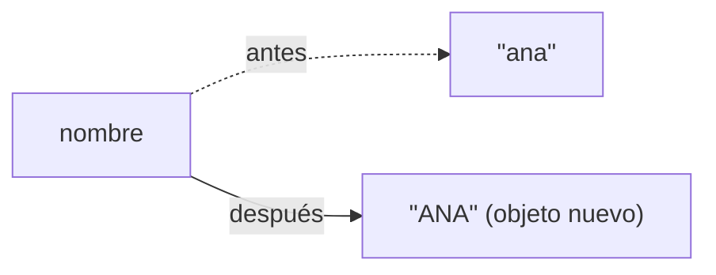

# Tema 09 · Strings

[⬅️ Tema anterior](../08-arrays-y-matrices/README.md) · [🏠 Índice](../../INDICE.md) · [Siguiente tema ➡️](../10-metodos/README.md)

Llevas usando `String` desde el primer programa, pero solo para mostrar mensajes. Los textos son uno de los datos más habituales: nombres, contraseñas, correos, comandos, ficheros... En este tema aprenderás a **analizarlos**, **compararlos**, **transformarlos** y **construirlos** de forma eficiente.

## 🎯 Objetivos

- Entender qué es un `String` y por qué es **inmutable**.
- **Comparar** textos correctamente (`equals` frente a `==`).
- Usar los **métodos** principales de `String`.
- Recorrer un texto **carácter a carácter** y usar la clase `Character`.
- Entender la relación entre `char` y los **códigos de carácter** (ASCII / Unicode).
- Dividir y unir textos con `split` y `join`.
- Construir textos de forma eficiente con **`StringBuilder`**.

## 📚 Contenido

1. [¿Qué es un String?](#1-qué-es-un-string)
2. [Inmutabilidad](#2-inmutabilidad)
3. [Comparar textos](#3-comparar-textos)
4. [Métodos principales](#4-métodos-principales)
5. [Recorrer un texto](#5-recorrer-un-texto)
6. [char, ASCII y Unicode](#6-char-ascii-y-unicode)
7. [La clase Character](#7-la-clase-character)
8. [split y join](#8-split-y-join)
9. [StringBuilder](#9-stringbuilder)
10. [Errores típicos](#10-errores-típicos)
11. [Resumen](#11-resumen)

---

## 1. ¿Qué es un String?

Un `String` es una **secuencia de caracteres**. Igual que un array, cada carácter tiene una posición que empieza en 0:

```
texto  →  ┌───┬───┬───┬───┬───┐
          │ H │ o │ l │ a │ ! │
          └───┴───┴───┴───┴───┘
índice:     0   1   2   3   4         texto.length() = 5
```

`String` **no es un tipo primitivo**, es una **clase**: las variables guardan una referencia a un objeto (como los arrays del tema 08). Por eso tiene **métodos** que se llaman con un punto: `texto.length()`, `texto.toUpperCase()`...

Formas de crear un `String`:

```java
String saludo = "Hola";              // Literal (la forma habitual)
String vacio = "";                   // Texto vacío: existe, pero no tiene caracteres
String nada = null;                  // No hay ningún texto (¡cuidado!)
String copia = new String("Hola");   // Posible, pero casi nunca necesario
```

> `""` y `null` no son lo mismo: `"".length()` es 0, pero `null.length()` provoca `NullPointerException`.

## 2. Inmutabilidad

Un `String` **no se puede modificar** una vez creado. Los métodos que "cambian" el texto en realidad **devuelven un `String` nuevo** y dejan el original intacto:

```java
String nombre = "ana";
nombre.toUpperCase();              // ⚠️ Crea "ANA"... y se pierde, porque no se guarda
System.out.println(nombre);        // ana

nombre = nombre.toUpperCase();     // ✅ Guardamos el nuevo texto en la variable
System.out.println(nombre);        // ANA
```



Ventajas de la inmutabilidad: los textos se pueden compartir sin miedo a que alguien los cambie, y Java puede **reutilizar** los literales iguales (los guarda en una zona llamada *String pool*). La desventaja: construir un texto pieza a pieza en un bucle crea muchos objetos intermedios. Para eso está `StringBuilder` (sección 9).

## 3. Comparar textos

### equals, no ==

```java
String a = "hola";
String b = "hola";
String c = new String("hola");

a == b          // true  (por casualidad: los dos literales son el mismo objeto del pool)
a == c          // false (c es otro objeto, aunque tenga el mismo texto)
a.equals(c)     // true  ✅ compara el CONTENIDO
```

- **`==`** compara si son **el mismo objeto** en memoria.
- **`equals`** compara si tienen **el mismo texto**.

Los textos que vienen del teclado, de un fichero o de un cálculo **no** salen del pool, así que con `==` fallarían. **Usa siempre `equals`.**

| Método | Qué compara | Ejemplo |
|---|---|---|
| `a.equals(b)` | Mismo texto exacto | `"Hola".equals("hola")` → `false` |
| `a.equalsIgnoreCase(b)` | Mismo texto sin importar mayúsculas | `"Hola".equalsIgnoreCase("hola")` → `true` |
| `a.compareTo(b)` | Orden alfabético | Negativo si `a` va antes, 0 si son iguales, positivo si va después |
| `a.isEmpty()` | ¿Longitud 0? | `"".isEmpty()` → `true` |
| `a.isBlank()` | ¿Vacío o solo espacios? | `"   ".isBlank()` → `true` |

`compareTo` compara por el **código** de cada carácter, así que las mayúsculas van antes que las minúsculas (`"Zebra".compareTo("abeja")` es negativo) y las letras con tilde van después de la `z`. Para comparar sin distinguir mayúsculas: `compareToIgnoreCase`.

> **Truco contra `null`:** `"si".equals(respuesta)` no falla aunque `respuesta` sea `null`, mientras que `respuesta.equals("si")` lanzaría `NullPointerException`.

## 4. Métodos principales

### Información

| Método | Devuelve | Ejemplo con `t = "Programar en Java"` |
|---|---|---|
| `length()` | Número de caracteres | `17` |
| `charAt(i)` | Carácter de la posición `i` | `t.charAt(0)` → `'P'` |
| `indexOf(x)` | Primera posición de `x` (o `-1`) | `t.indexOf("a")` → `5` |
| `lastIndexOf(x)` | Última posición de `x` (o `-1`) | `t.lastIndexOf("a")` → `16` |
| `contains(x)` | ¿Contiene `x`? | `t.contains("Java")` → `true` |
| `startsWith(x)` / `endsWith(x)` | ¿Empieza / termina por `x`? | `t.endsWith("Java")` → `true` |

### Transformación (devuelven un String **nuevo**)

| Método | Ejemplo | Resultado |
|---|---|---|
| `toUpperCase()` / `toLowerCase()` | `"Hola".toUpperCase()` | `"HOLA"` |
| `substring(desde)` | `"Programar".substring(3)` | `"gramar"` |
| `substring(desde, hasta)` | `"Programar".substring(0, 3)` | `"Pro"` (el `hasta` **no** se incluye) |
| `trim()` / `strip()` | `"  hola  ".strip()` | `"hola"` (quita espacios de los extremos) |
| `replace(a, b)` | `"casa".replace("a", "o")` | `"coso"` (reemplaza **todas**) |
| `repeat(n)` | `"ab".repeat(3)` | `"ababab"` |
| `concat(x)` | `"Hola".concat("!")` | `"Hola!"` (igual que `+`) |

```
"Programar".substring(3, 6)

 P  r  o  g  r  a  m  a  r
 0  1  2  3  4  5  6  7  8
          ↑        ↑
        desde    hasta (no incluido) → "gra"
```

La longitud del trozo es siempre `hasta - desde`.

### Conversiones

```java
String.valueOf(42)              // "42"
String.valueOf(3.5)             // "3.5"
String.valueOf('A')             // "A"
Integer.parseInt("42")          // 42  (tema 03)
"Hola".toCharArray()            // {'H', 'o', 'l', 'a'}
new String(arrayDeChars)        // De char[] a String
```

Los métodos se pueden **encadenar**, porque cada uno devuelve un `String`:

```java
String limpio = "   Hola Mundo  ".strip().toLowerCase().replace(" ", "-");   // "hola-mundo"
```

## 5. Recorrer un texto

Igual que un array, con un `for` y `charAt`:

```java
String palabra = "Java";
for (int i = 0; i < palabra.length(); i++) {     // length() CON paréntesis
    System.out.println(i + ": " + palabra.charAt(i));
}
```

O convirtiéndolo en array de `char` para usar for-each:

```java
for (char c : palabra.toCharArray()) {
    System.out.print(c + " ");
}
```

| | Arrays | String |
|---|---|---|
| Tamaño | `array.length` (sin paréntesis) | `texto.length()` (con paréntesis) |
| Elemento | `array[i]` | `texto.charAt(i)` |
| ¿Se puede modificar un elemento? | Sí | No (es inmutable) |
| Fuera de rango | `ArrayIndexOutOfBoundsException` | `StringIndexOutOfBoundsException` |

## 6. char, ASCII y Unicode

Como viste en el tema 03, cada `char` es en realidad un **número**: su código en la tabla **Unicode**. Los primeros 128 códigos coinciden con la antigua tabla **ASCII**:

| Caracteres | Códigos | Detalle |
|---|---|---|
| `'0'` a `'9'` | 48 a 57 | Consecutivos |
| `'A'` a `'Z'` | 65 a 90 | Consecutivos |
| `'a'` a `'z'` | 97 a 122 | Consecutivos; cada minúscula = mayúscula + 32 |
| `' '` (espacio) | 32 | |
| `'ñ'`, `'á'`, `'é'`... | 241, 225, 233... | Fuera de ASCII, pero dentro de Unicode |

Como las letras y los dígitos son **consecutivos**, se puede calcular con ellos:

```java
char c = 'C';
int posicionEnAlfabeto = c - 'A';      // 2  ('C' es la tercera letra, contando desde 0)
char siguiente = (char) (c + 1);       // 'D'

char digito = '7';
int valor = digito - '0';              // 7   (el truco clásico para pasar de '7' a 7)

boolean esMayuscula = c >= 'A' && c <= 'Z';
```

Esto permite, por ejemplo, programar un **cifrado César** (desplazar cada letra varias posiciones): lo verás en los ejemplos.

## 7. La clase Character

`Character` tiene métodos para preguntar y transformar caracteres sueltos. Funcionan también con letras como `ñ` o `á`, a diferencia de las comparaciones con rangos de la sección anterior.

| Método | Devuelve `true` si... / Resultado |
|---|---|
| `Character.isLetter(c)` | Es una letra (incluye `ñ`, `á`...) |
| `Character.isDigit(c)` | Es un dígito |
| `Character.isLetterOrDigit(c)` | Letra o dígito |
| `Character.isUpperCase(c)` / `isLowerCase(c)` | Es mayúscula / minúscula |
| `Character.isWhitespace(c)` | Es un espacio, tabulación o salto de línea |
| `Character.toUpperCase(c)` / `toLowerCase(c)` | Devuelve el `char` convertido |
| `Character.getNumericValue(c)` | El valor numérico (`'7'` → 7) |

```java
int vocales = 0;
for (char c : frase.toLowerCase().toCharArray()) {
    if ("aeiouáéíóúü".indexOf(c) != -1) {     // ¿Está c en la lista de vocales?
        vocales++;
    }
}
```

El truco de `"aeiou".indexOf(c) != -1` es una forma compacta de preguntar "¿es `c` uno de estos caracteres?".

## 8. split y join

`split` **divide** un texto en un array de trozos usando un separador. `String.join` hace lo contrario.

```java
String csv = "Ana;15;Valencia";
String[] partes = csv.split(";");            // {"Ana", "15", "Valencia"}
int edad = Integer.parseInt(partes[1]);      // 15

String frase = "Me   gusta   programar";
String[] palabras = frase.split(" +");       // " +" = uno o más espacios → {"Me", "gusta", "programar"}

String unido = String.join(" - ", palabras); // "Me - gusta - programar"
```

El separador de `split` es una **expresión regular** (un patrón de búsqueda). Para la mayoría de casos basta con escribir el carácter, pero algunos tienen significado especial: para dividir por un punto hay que escribir `split("\\.")` y por una barra vertical `split("\\|")`.

## 9. StringBuilder

Como los `String` son inmutables, concatenar en un bucle crea un objeto nuevo en **cada** vuelta:

```java
String resultado = "";
for (int i = 0; i < 10000; i++) {
    resultado += i + ",";        // ⚠️ 10 000 Strings intermedios que se tiran a la basura
}
```

**`StringBuilder`** es un texto **modificable**: se van añadiendo trozos sobre el mismo objeto, mucho más rápido.

```java
StringBuilder sb = new StringBuilder();
for (int i = 0; i < 10000; i++) {
    sb.append(i).append(",");    // Modifica el mismo objeto
}
String resultado = sb.toString();   // Al final, se convierte en String
```

| Método | Qué hace |
|---|---|
| `append(x)` | Añade al final (cualquier tipo) |
| `insert(pos, x)` | Inserta en una posición |
| `delete(desde, hasta)` | Borra un trozo |
| `deleteCharAt(pos)` | Borra un carácter |
| `setCharAt(pos, c)` | Cambia un carácter |
| `reverse()` | Le da la vuelta |
| `length()` | Longitud actual |
| `toString()` | Lo convierte en `String` |

```java
String alReves = new StringBuilder("Java").reverse().toString();   // "avaJ"
```

**¿Cuándo usarlo?** Cuando construyas un texto **en un bucle** o con muchas piezas. Para unir unas pocas cosas en una línea, `+` es perfectamente válido (Java lo optimiza por dentro).

## 10. Errores típicos

| Error | Ejemplo | Qué pasa |
|---|---|---|
| Comparar con `==` | `if (respuesta == "si")` | Puede dar `false` aunque el texto coincida |
| Olvidar guardar el resultado | `nombre.trim();` | El String no cambia (es inmutable) |
| `length` sin paréntesis | `texto.length` | Error de compilación (en String es un método) |
| Índice fuera de rango | `"Hola".charAt(4)` | `StringIndexOutOfBoundsException` |
| `substring` con `hasta` incluido | `"Hola".substring(0, 2)` esperando `"Hol"` | Da `"Ho"` |
| Llamar a un método sobre `null` | `String s = null; s.length();` | `NullPointerException` |
| Confundir `char` y `String` | `texto.charAt(0) == "H"` | Error de compilación: `'H'` va con comillas simples |
| `split(".")` | | El punto es especial: usa `split("\\.")` |
| Concatenar en bucles largos | `s += ...` 100 000 veces | Muy lento: usa `StringBuilder` |

## 11. Resumen

- Un `String` es una secuencia de `char` con índices desde 0; `length()` da su tamaño.
- Es **inmutable**: los métodos devuelven textos nuevos que hay que **guardar**.
- Compara con **`equals`** / `equalsIgnoreCase`, nunca con `==`; `compareTo` da el orden alfabético.
- Métodos clave: `charAt`, `indexOf`, `contains`, `substring`, `toUpperCase`, `strip`, `replace`, `split`, `String.join`.
- Cada `char` es un número: `c - 'A'`, `c - '0'`, `(char) (c + 1)`. La clase **`Character`** pregunta si es letra, dígito, mayúscula...
- Para construir textos en bucles usa **`StringBuilder`** (`append`, `reverse`, `toString`).

---

## 💻 Ejemplos de código

| Archivo | Qué muestra |
|---|---|
| [T09_01_CrearYComparar.java](ejemplos/T09_01_CrearYComparar.java) | Crear textos, inmutabilidad, `equals` frente a `==` y `compareTo` |
| [T09_02_MetodosDeString.java](ejemplos/T09_02_MetodosDeString.java) | Los métodos principales de `String` |
| [T09_03_RecorrerYCaracteres.java](ejemplos/T09_03_RecorrerYCaracteres.java) | Recorrer textos, códigos de carácter, `Character` y cifrado César |
| [T09_04_SplitYJoin.java](ejemplos/T09_04_SplitYJoin.java) | Dividir y unir textos, procesar líneas tipo CSV |
| [T09_05_StringBuilder.java](ejemplos/T09_05_StringBuilder.java) | `StringBuilder` y por qué es más rápido en bucles |

## ✏️ Ejercicios

Practica lo aprendido en los [ejercicios del tema 09](../../ejercicios/09-strings/README.md).

---

[⬅️ Tema anterior](../08-arrays-y-matrices/README.md) · [🏠 Índice](../../INDICE.md) · [Siguiente tema ➡️](../10-metodos/README.md)
